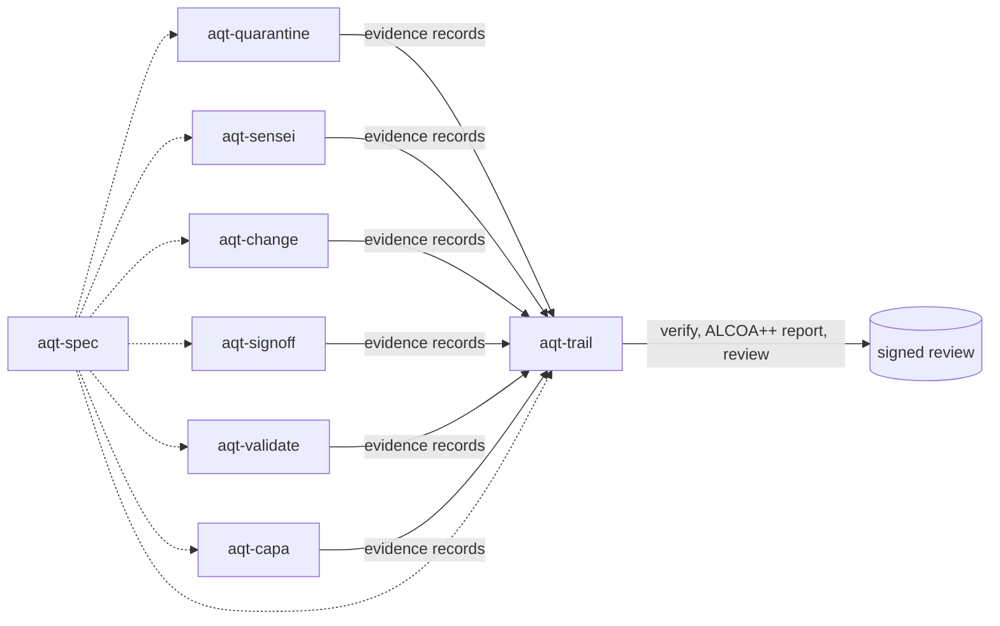

# Agent Quality Toolkit

[](https://github.com/benediktneumayer2-tech/agent-quality-toolkit/actions/workflows/ci.yml)   

**Quality management for AI coding agents — quarantine, independent review, sign-off, change control, validation and CAPA, with evidence you can verify.**

AI coding agents read untrusted web pages, change code faster than anyone can review, and report "done" in their own words. The Agent Quality Toolkit (AQT) applies the controls that regulated industries use to keep records and products trustworthy — GDP-style quarantine and release, the four-eyes principle, signatures with a stated meaning, change control, audit trails and their review, method validation, deviations and CAPA — to the work of coding agents.

Every tool works on its own. Together they write one kind of evidence record into one verifiable audit trail.

| Package | What it does |
|---|---|
| [`aqt-spec`](aqt-spec/) | Evidence record specification (canonical hashing, chaining, signatures, checkpoints), JSON Schemas, test vectors, GxP catalogues and crosswalk, and the `aqt_evidence` reference library |
| [`aqt-trail`](aqt-trail/) | Tamper-evident audit trail: a separate writer that observes who appended, signed checkpoints, RFC 3161 anchors, importers for Claude Code, Codex and pi sessions, an ALCOA++ report and **audit-trail review** |
| [`aqt-signoff`](aqt-signoff/) | Signatures with meaning bound to exact content, automatic invalidation on change, Part 11-style manifestation, and **approved actions** that never retry blindly |
| [`aqt-change`](aqt-change/) | Change control for agent work: hash-reconciled plans, runner-captured verification receipts, review records, approved-versus-actual reconciliation, trace reports and a "no done without evidence" hook |
| [`aqt-sensei`](aqt-sensei/) | An independent advisor agent of any vendor, kept read-only by the operating system, with owner-controlled exchange, budgets and an advice ledger |
| [`aqt-quarantine`](aqt-quarantine/) | Quarantine and release of untrusted agent inputs: scored, held when risky, released only by a responsible person with a recorded reason |
| [`aqt-validate`](aqt-validate/) | Validation of AI controls: detector calibration with exact confidence bounds and AI-reviewer qualification on seeded defects, with validity periods and requalification triggers |
| [`aqt-capa`](aqt-capa/) | Deviations from agent work, root cause, corrective changes to agent instructions under sign-off, effectiveness checks and trend review |



## Try it in one command

Prerequisites: Linux, Python ≥ 3.11, [uv](https://docs.astral.sh/uv/) and git. After the install, everything runs offline, in a temporary folder, with synthetic data.

```bash
uv venv examples/demo/.venv && uv pip install --python examples/demo/.venv/bin/python -e "aqt-spec[schema]" -e aqt-trail -e aqt-signoff -e aqt-change -e aqt-sensei -e aqt-quarantine -e aqt-validate -e aqt-capa pytest
examples/demo/.venv/bin/python examples/demo/run_demo.py
```

In about five seconds the demo tells one story end to end ([details](examples/demo/README.md)):

1. An injected web page reaches a coding agent → **held**; the agent's attempt to release it is **refused**; the quality manager **releases** it with a signed reason.
2. A sandboxed **advisor** answers the worker; every message is on record.
3. The plan baseline is **signed**; a failing and then a passing test run are **captured as receipts**; an independent review passes; the gate says **GO** — and **NO-GO** as soon as code changes after the tests ran.
4. The agent's refused decision becomes a **deviation**; a corrective change to `AGENTS.md` is hash-bound, **approved** and checked for **effectiveness** before closure.
5. The injection detector is **validated** (exact confidence bounds) and **qualified**; its thresholds file drives quarantine.
6. The audit trail **verifies intact**, reaches conformance level 3 with an RFC 3161 anchor (test authority), gets an **ALCOA++ report** and a signed **audit-trail review**, and the change is **released** with a Part 11-style signature manifest.

Run inside an AI agent session, the ALCOA++ report honestly fails *attributable*: the trail writer observes the agent process behind the simulated humans. That is the control working.

All package test suites and the demo run with `scripts/test_all.sh` (518 offline tests plus the demo, isolated from your real configuration).

## How it maps to quality and validation practice

| Practice | Reference (examples) | Tool |
|---|---|---|
| Data integrity, ALCOA++ | MHRA/PIC/S data-integrity guidance | `aqt-trail` ALCOA++ report |
| Audit trail and its regular review | Part 11 §11.10(e); Annex 11 §9 | `aqt-trail` |
| Electronic signatures: meaning, manifestation, link to the record | Part 11 §11.50, §11.70; Annex 11 §14 | `aqt-signoff` |
| Change control, approved versus actual | Annex 11 §10; ICH Q10 §3.2.3 | `aqt-change` |
| Risk-based validation of a control: acceptance criteria, qualification, requalification | Annex 11 §4; GAMP 5 | `aqt-validate` |
| Deviations, CAPA and effectiveness checks | ICH Q10 §3.2.2 | `aqt-capa` |
| Quarantine, then release by a responsible person | EU GDP Guidelines (2013) | `aqt-quarantine` |
| Independent review (four-eyes principle) | Second-person review, common GxP practice | `aqt-sensei`, `aqt-change` review |

The full mapping, clause by clause and including the 2025 drafts of Annex 11, Chapter 4 and Annex 22, is in [`aqt-spec/crosswalk.md`](aqt-spec/crosswalk.md) and the catalogues in [`aqt-spec/catalogues/`](aqt-spec/catalogues/).

## Status

Version 0.1, a preview (October 2026). Each package has a `Design.md`, a README, documentation and an offline test suite. Interfaces may still change before 1.0.

Manual checks that need a real agent session are documented per package: the Claude Code hooks of aqt-quarantine and aqt-change (`docs/claude-code.md`), a live aqt-sensei pairing (`docs/manual-verification.md`) and the reviewer command lines of aqt-validate (`docs/usage.md`). Not done yet: an independent security review of the signing and verification code.

## Honest scope

Agent Quality Toolkit supports quality-management practices; it is not a validated system and does not by itself make any process compliant with GMP, GDP, 21 CFR Part 11 or EU Annex 11. Detectors are a triage layer, not a guarantee against adaptive attacks. Tamper evidence depends on keys and anchors kept outside the agents' reach. Demo decisions use test injection (DEMO ONLY) and a local test timestamp authority (TEST ONLY).

The toolkit was built by Benedikt Neumayer with AI coding agents, under his product ownership, architecture review and quality assurance.

## Licence

Copyright 2026 Benedikt Neumayer. Code: Apache-2.0 ([`LICENSES/Apache-2.0.txt`](LICENSES/Apache-2.0.txt)). Specification, catalogues and crosswalk in `aqt-spec`: CC BY 4.0 ([`LICENSES/CC-BY-4.0.txt`](LICENSES/CC-BY-4.0.txt)). Each package carries its own `LICENSE` and `NOTICE`.

Security issues: see [`SECURITY.md`](SECURITY.md). Contributions: see [`CONTRIBUTING.md`](CONTRIBUTING.md).
