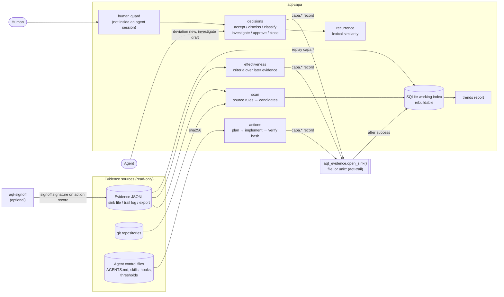
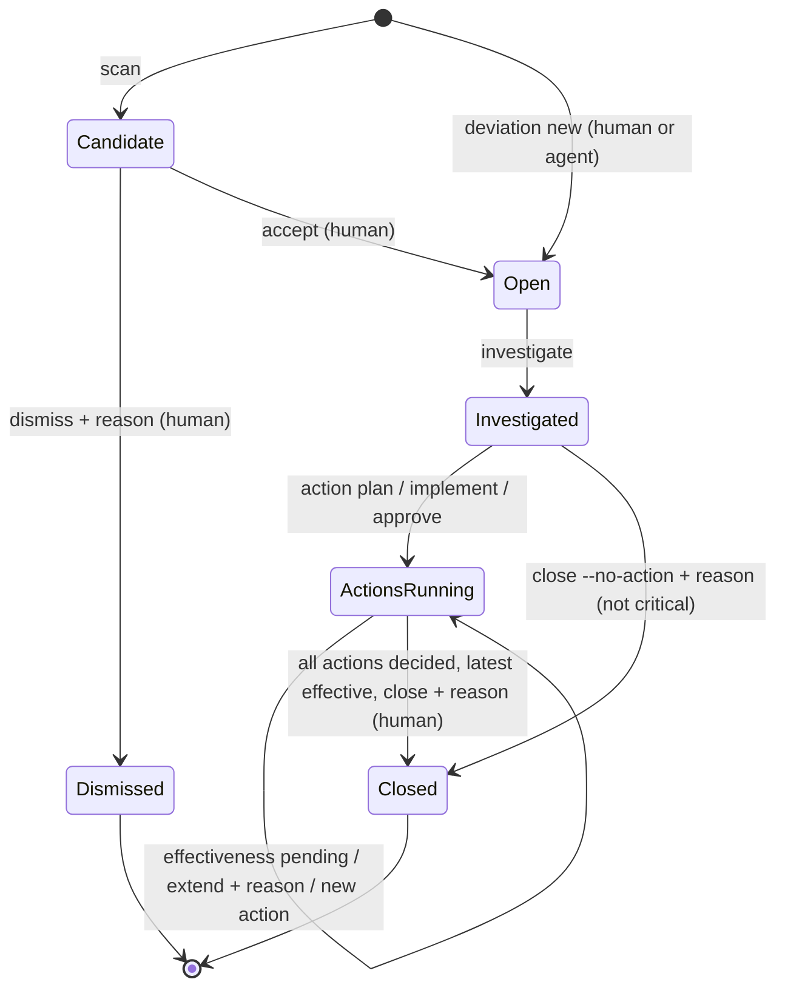

# aqt-capa — Target Design

**Package:** `aqt-capa` of the Agent Quality Toolkit (AQT). **Date:** 2026-10-21. **Brief:** `planning/04_designs/SUITE_ARCHITECTURE.md` §2.8.
**Status:** Phase B (MVP built). Aligned with `planning/04_designs/INTERFACES.md` (binding: I1, I4–I7, I9, I10, I12). Proposals in §2 can be changed. The outcomes in §1 are the target.

---

## 1. Introduction

### Core idea

Coding agents fail in recognisable ways. They follow a poisoned web page, claim "done" while a test fails, write code a reviewer rejects, or get their commit reverted the next day. Today these failures are anecdotes. Someone notices, adds a line to `AGENTS.md` and forgets about it. Nobody records why it happened. Nobody approves the instruction change, and nobody checks whether the change actually stopped the failure. A quality manager would treat each failure as a **deviation**: record it, classify it, find the root cause, take a **corrective and preventive action (CAPA)** under approval, and decide later from data whether the action worked.

`aqt-capa` applies that loop to agent work. It reads the evidence the other AQT tools already write (quarantine cases, verification receipts, reviews, refusals, audit-trail review findings) plus reverted commits from git. It proposes deviation **candidates**, and a human accepts or dismisses each one with a reason. Investigations follow a structured 5-Whys and Ishikawa record. Corrective actions are concrete, hash-bound changes to agent controls (`AGENTS.md`, `CLAUDE.md`, a skill, a hook, a review profile, a detector threshold file). Each action carries an **effectiveness criterion** that the tool evaluates from later evidence. A deviation closes only on an effective result or on an explicit, justified decision. A trend report feeds a management-review style summary.

**Users.** The primary user is a solo developer or small team running coding agents who wants failures to lead to lasting fixes. The secondary user is a QM-minded reviewer or auditor who wants to see that agent failures are handled systematically. Agents are callers too: an agent may *report* a deviation or draft an investigation, but only a human accepts, dismisses, approves, extends or closes.

### End-to-end behaviour

1. `aqt-capa scan` reads the evidence JSONL files (the sink file and/or the aqt-trail log or export) and the configured git repositories. It lists new candidates, for example "change.receipt rec_… failed (exit 1) in session S".
2. The human runs `aqt-capa candidate accept C-… --severity major --category instructions --reason "…"`. This opens deviation `DEV-0007`, linked to its source record. Alternatively `candidate dismiss C-… --reason "expected failure while bisecting"` dismisses it. Both decisions are records.
3. `aqt-capa deviation new` opens a deviation by hand for failures the scan cannot see, such as a human correction in chat.
4. When the deviation opens, the tool shows similar past deviations (recurrence). The human may link them.
5. `aqt-capa investigate DEV-0007 --why … --why … --factor method:"…" --root-cause "…" --root-category instructions` records the investigation.
6. `aqt-capa action plan DEV-0007 --kind corrective --target AGENTS.md --description "…" --criterion no-recurrence --window-sessions 20` records the action and the target file's current hash. The file is then edited by the human or by an agent. `aqt-capa action implement CAPA-0007-1` records the new hash and a diff excerpt.
7. Approval of the implemented change uses one of two paths. With aqt-signoff, the human signs the implementation record (`aqt-signoff sign --record <id> --meaning approved`). Without it, `aqt-capa action approve CAPA-0007-1 --reason …` records a human approval that is not signed.
8. `aqt-capa effectiveness` evaluates every running check from the evidence. "No failure of this kind" is not enough: the window must hold enough later activity and must contain no recurrence, no undecided matching candidate and no trail gap. It also confirms that the target file still has the approved hash. Each check's result is `effective`, `not-effective` or `pending`.
9. `aqt-capa close DEV-0007 --reason …` succeeds only when every action has a decided result and the most recent one is effective. Otherwise the human extends the window with a reason or plans a further action. A minor deviation may close without a CAPA when the investigation and a justification are recorded.
10. `aqt-capa trends --since 90d` produces a Markdown or JSON summary. It covers deviations by category, severity, source and period, open deviations and their age, overdue checks, the effectiveness rate and the top recurrences.

**Inputs:** evidence records (aqt-spec 0.1 JSONL), git history, human decisions on the command line, target files of actions. **Outputs:** `capa.*` evidence records to the configured sink, a rebuildable SQLite working index, terminal, Markdown and JSON views (`list`, `show`, `trends`).

### Performance intent

Personal scale: some thousands of deviations over the lifetime and evidence files of up to a few hundred thousand records. Proposed target: a scan or effectiveness run over such a file finishes in seconds on a laptop by streaming the JSONL once. Every command is interactive and local, with no network, no model and no GPU. Recurrence matching is lexical, so it is fast and explainable.

### Design flexibility

This document defines what `aqt-capa` must achieve and suggests a route. The builder may change module boundaries, SQLite schema, command spelling, similarity method and report layout. The builder may merge commands or add small conveniences, as long as the core functions keep their meaning. Those functions are: evidence-driven candidates decided by a human, classification, a structured investigation, hash-bound corrective actions under approval, effectiveness evaluated from evidence, gated closure and a trend report. Every state change must remain an evidence record first, and the index must remain rebuildable from those records. Ordinary adaptations need no approval round or deviation report. A feature from the brief that turns out infeasible is reported, not dropped silently.

> **Implementation workflow.** All implementation guided by this design uses `lean-vertical-delivery` (small end-to-end slices, proportionate checks, a small completion report; no separate testing or documentation regime). Work is tracked in Project Tracker Next (project "Agent Quality Toolkit", one implementation for this package) through its low-call lifecycle. This package has no interactive UI; if one is added later, it is designed with `ui-studio`. When the same functionality fails repeatedly despite a reassessed approach, consult a Sensei with the intended behaviour, the attempts and the specific help needed.

---

## 2. Proposed architecture

The proposal is one small Python package with a CLI, a pure-function core and SQLite as the working index. **Evidence first:** every command that changes state builds a `capa.*` record and appends it through `aqt_evidence.open_sink()`. The index is updated only after the append succeeds. If the sink refuses the record, the command fails (exit 2) and nothing changes. The index can be dropped and rebuilt by replaying `capa.*` records from the evidence files.



The scan reads evidence and git and stores candidates in the index. Decisions pass the human guard when the operation is human-only, write a record, then update the index. Actions hash the target files. Effectiveness reads the evidence written after the action was approved: new deviations, matching candidates, `trail.gap` markers and agent sessions (counted by `actor.agent.session`). Signatures from aqt-signoff come back through the evidence files like any other record. `aqt-capa rebuild` replays the `capa.*` records into a fresh index.

**Suggested modules (not binding):** `config.py` (TOML and XDG paths), `index.py` (SQLite), `records.py` (record builders), `sources.py` (source rules, git revert finder), `guard.py` (human check), `similarity.py`, `actions.py` (hashing, diff, approval lookup), `effectiveness.py`, `trends.py`, `cli.py`.

**Storage.** The index lives at `$XDG_STATE_HOME/aqt/capa/capa.db` (override with `--db` or `AQT_CAPA_DB`) and holds the tables deviations, candidates, actions, evaluations and records (record id, type, hash, time, JSON). Evidence is read with `aqt_evidence.iter_evidence` (INTERFACES I4) from `--evidence PATH` (repeatable), config `evidence.paths`, or the default (`AQT_EVIDENCE`, else the sink file plus the aqt-trail log). A configured file that does not exist yet is read as empty, with a note on stderr. If the index is missing, the next command rebuilds it before allocating new IDs, so human-readable IDs (`DEV-0007`, `CAPA-0007-1`, candidate `C-<8 hex>`) stay stable. IDs are stored in each record's `data`.

**Reuse from Agent Platform Next (ideas only, no code; nothing there implements CAPA):**
- Threat triage roles from A2. The analyst rates and recommends, the owner decides, and automation never confirms a threat. This becomes the human-gated candidate flow. Sources: `scripts/herdr/web_safety.py` (case labels and state derivation) and `scripts/herdr/threat_dispatcher.py`.
- From Project Tracker Next (A6): terminal records are never reopened, and a correction gets a linked follow-up. A closed deviation is final, and a recurrence opens a new deviation linked `recurrence-of`. The Tracker's Deviations and Failures-and-Learnings sections show the gap this tool fills: they have no root cause, no action and no effectiveness check.

**Reuse from open source:** standard library only (`sqlite3`, `tomllib`, `difflib`, `subprocess` for `git`, `argparse`). These are ideas, not code:
- Foreman's retro flywheel (MIT): a gated patch bench for prompt changes.
- OCA `mgmtsystem_nonconformity` / `_action` (AGPL-3.0, ideas only): nonconformity and action states.
- pharma-investigation-platform (MIT): a human QA gate that automation cannot bypass.

### 2.1 Core concepts

**Candidate versus deviation.** A candidate is an evidence signal that *might* be a deviation. It has a deterministic key (the source record id, or `git:<commit>`), so a repeated scan never duplicates it. A candidate is never opened automatically. Undecided candidates stay visible in `list` and `trends` and block effectiveness decisions they could affect. A dismissal needs a reason and becomes a record, because a dismissed signal is itself evidence of judgement (ALCOA++ *complete*).

**Source rules (defaults, configurable in TOML).** Each rule maps a record pattern to a candidate with a suggested severity and category. The human confirms or changes the suggestion.

| Source | Pattern (record type and `data` fields per INTERFACES I5/I6) | Suggested severity / category |
|---|---|---|
| Quarantine hold | `quarantine.held` (skipped when the same `case_id` was declared a threat) | minor / security |
| Declared threat | `quarantine.threat.declared` | major / security |
| Failed receipt | `change.receipt` with `passed: false` or non-zero `exit_code` | minor / tool (major if a `change.finish` lists it in `receipts`) |
| Finish not GO | `change.finish` with `gate` ≠ `GO` or non-empty `waivers` (I6 has no stale marker; stale receipts surface this way) | minor (major on `NO-GO`) / task-specification |
| Failed review | `change.review` with `data.verdict == "FAIL"` | major / model |
| Refused attempt | any `<tool>.refused` record (I5) | minor / instructions |
| Trail review finding | `trail.review` finding with `disposition: deviation` (one candidate per finding) | from finding severity / unclassified |
| Reverted commit | git: `This reverts commit <sha>` or `Revert "…"`, optionally only when the reverted commit has agent trailers | major / (unclassified) |
| Unknown action outcome | `signoff.action.outcome` with `outcome: unknown` (can be disabled) | minor / environment |

**Severity criteria (proposal).**
- **Critical:** possible data or secret exposure; an unapproved change reached a protected branch or production; integrity of the evidence itself is broken (tamper, gap). A CAPA is mandatory.
- **Major:** a wrong result was delivered or accepted as done (a failed or stale receipt behind a finish, a FAIL review ignored, a merged agent change reverted); or a minor deviation recurs three or more times in 30 days (the tool suggests an upgrade).
- **Minor:** a control caught the problem before impact (a hold, a failed receipt before finish, a refused attempt).

Due dates for the investigation are configurable per severity (default: critical 2 days, major 7, minor 30). Overdue items appear in `list` and `trends`.

**Categories:** `instructions`, `missing-context`, `tool`, `model`, `task-specification`, `environment`, `security`, plus `unclassified` until the investigation is done. Category drives recurrence matching and trends.

**Recurrence.** For a new deviation the tool ranks past deviations by a score in parts per million (`score_ppm`, integers only, INTERFACES I7). The score is token Jaccard over title and description (lower-cased, stop-words removed), with bonus points for the same category, the same source type and the same subject ref or target path. The top three above a threshold are shown. The human can link them (`rel: recurrence-of`). Linked recurrences feed the severity upgrade rule and the trend "top recurrences". This is deliberately simple and explainable; an embedding model is a later option.

**Investigation.** The record holds:
- `whys`: an ordered list of 1–5 entries;
- `factors`: Ishikawa (6M) categories adapted to agent work, as `{category, text}`. The categories are *method* (instructions, process, task specification), *machine* (harness, tool, model), *material* (inputs, context, data), *measurement* (tests, reviews, detectors), *people* (human or agent actor) and *environment*;
- `root_cause` statement and `root_category` (one of the categories above);
- `impact` (free text: what was affected, whether released work needs checking);
- `evidence` links.

An agent may write a draft (`actor.kind = agent`, `action = drafted`). A human records the accepted version (`action = recorded`). A revision stores before and after hashes.

**Corrective and preventive actions bound by hash.** An action names one target file, relative to a configured project root, never as an absolute path in records.
- `plan` records the current hash (`before`), the kind (corrective / preventive), the description and the effectiveness criterion.
- `implement` records the new hash (`after`) and a short unified-diff excerpt with the full diff hash.
- Approval is bound to the implementation record's content hash (`aqt_evidence.record_content_hash`, INTERFACES I1), which survives storage in the trail. Implementing again clears an earlier approval.
- `verify` (also run inside `show`, `effectiveness` and `close`) compares the file's current hash with the approved `after`. A mismatch is reported as *changed since approval*. The check cannot become effective until the change is approved again.

This is approved-versus-actual control applied to agent instructions, which are treated as controlled documents.

**Approval.** Approval is satisfied in two ways:
- **(a)** A `signoff.signature` record in the evidence whose `subject.sha256` (or `data.signature.statement.subject.sha256`) equals that hash, with `meaning: approved`, by a signer who is not the implementing actor. If `aqt_signoff` is importable, `aqt_signoff.is_approved(hash, meaning="approved", sources=…)` decides (INTERFACES I10); otherwise the signature is reported as `signed-unverified`.
- **(b)** A `capa.action` record with `action: approved`, `meaning: approved`, a human actor and a reason, written through the human guard. By default the approver must differ from the implementer (`[approval] allow_self_approval` for solo projects).

`show` states which path applies: "signed and verified", "signed, not verified (aqt-signoff not installed)" or "recorded approval, unsigned".

**Effectiveness criteria and evaluation.** The criterion is set at plan time and stored in the action record, so it cannot be tuned afterwards. MVP criterion `no-recurrence`:

```
match:   {category?, source_type?, tag?, target?}   # what counts as a recurrence
window:  {sessions: N} and/or {days: D}             # minimum observed activity
max:     0                                          # allowed recurrences
start:   time of approval
```

The evaluation counts matching deviations whose failure occurred after `start` (candidate time for accepted candidates, otherwise the opening time). Candidates that match and are still undecided count as "decide first". It also counts distinct agent sessions and elapsed days in the evidence after `start`.
- `not-effective`: recurrences exceed `max`. This can be decided early.
- `effective`: the window is complete, recurrences ≤ `max`, no undecided matching candidate, no `trail.gap` in the window, and the target hash is still the approved one.
- `pending`: anything else, with the reason ("12/20 sessions", "2 undecided candidates", "trail gap 2026-11-03", "target changed since approval").

This guards against the classic false "effective" verdict, where nothing failed only because nothing ran or the detector was off.

**Deviation lifecycle.**



`Closed` is terminal: a recurrence opens a new deviation. A `not-effective` result keeps the deviation open until the human plans a further action, or extends the window with a reason when the result is genuinely inconclusive.

**Human guard.** Accept, dismiss, classify, recording an investigation, approve, cancel, extend and close are human-only. They call the shared `aqt_evidence.require_human()` (INTERFACES I9), which refuses when there is no TTY on stdin, when harness environment markers are present (for example `CLAUDECODE`, Codex and pi variables) or when a harness binary is in the parent process chain (`/proc`). A refusal is recorded as `capa.refused` (`action: refused`, actor = the claimed actor, `data = {attempted_action, reason_code, agent_markers}`, I5), so it is evidence too. Commands agents may run are attributed to `agent:<harness>:<session>` when the check fires. The guard is a heuristic, not a security boundary (§2.4).

### 2.2 Interfaces

**CLI** `aqt-capa` (argparse; global `--config`, `--db`, `--evidence PATH` (repeatable), `--json`). Exit codes: 0 ok; 1 check failed or precondition unmet (for example `close` refused, `action verify` mismatch, `effectiveness --check` not all effective); 2 usage or runtime error (including a sink refusal).

| Command | Purpose |
|---|---|
| `scan` (global `--repo PATH`) | Apply source rules, store new candidates, print them |
| `candidate list` · `candidate accept C --severity S --category K --reason R [--title T]` · `candidate dismiss C --reason R` | Human decision on candidates |
| `deviation new --title T --description D --severity S --category K [--subject REF] [--link REL=REC]` | Manual intake (agents allowed) |
| `deviation classify DEV [--severity S] [--category K] [--recurrence-of DEV2] --reason R` | Reclassify or link (human) |
| `investigate DEV --why … --factor CAT:TEXT --root-cause … --root-category K [--impact …] [--evidence REC] [--draft]` | Investigation record (`--draft` for agents) |
| `action plan DEV --kind corrective\|preventive --target PATH --description D --criterion no-recurrence [--match-category K] [--match-source TYPE] [--window-sessions N] [--window-days D] [--max N]` | Plan an action and record the before-hash |
| `action implement A` · `action approve A --reason R` · `action verify [A]` | Record the after-hash · approve unsigned · check the current hash |
| `effectiveness [DEV\|A] [--check]` · `effectiveness --extend A --window-… --reason R` | Evaluate (and record results that changed) · extend |
| `close DEV --reason R [--no-action]` | Gated closure |
| `list [--open] [--overdue]` · `show DEV [--markdown]` | Views; `show` lists the record timeline and links |
| `trends [--since 90d] [--by month\|week] [--format md\|json]` | Management-review summary |
| `rebuild` | Drop and replay the index from `capa.*` records |

**Python API (small):** `Capa(config, store=, sink=, evidence=, guard=, context=)` with `scan()`, `accept()`, `dismiss()`, `new_deviation()`, `classify()`, `investigate()`, `plan()`, `implement()`, `approve()`, `cancel()`, `verify()`, `evaluate()`, `effectiveness()`, `extend()`, `close()`, `list()`, `show()`, `rebuild()`; `trends(capa, since=, by=)` and `render_markdown()`. Each method that changes state returns the stored record.

**Config** `$XDG_CONFIG_HOME/aqt/capa.toml`: `[identity] id, role, display`; `[evidence] paths`; `[project] root, id`; `[scan] repos, disabled_rules, agent_commit_patterns`; `[due_days]`; `[similarity] threshold_ppm`; `[approval] allow_self_approval`; `[state] db`. Guard markers come from the shared aqt-spec helper. An example config goes in `examples/`.

**Records** (all with `subject = {kind: "deviation", ref: "DEV-0007"}` unless noted; human decisions carry `reason`):

| Type | `action` values | Main `data` payload |
|---|---|---|
| `capa.deviation` | `opened` (manual), `accepted` (from a candidate), `classified`; `dismissed` (candidate, subject = source record) | `dev_id`, `title`, `description` + `description_sha256`, `severity`, `category`, `source {type, ref, rule}`, `candidate {…}`, `due`, `similar [{dev_id, score_ppm}]`; `before`/`after` and `recurrence_of` on reclassification |
| `capa.investigation` | `drafted`, `recorded`, `revised` | `whys[]`, `factors[{category, text}]`, `root_cause`, `root_category`, `impact`; links `rel: evidence` |
| `capa.action` | `planned`, `implemented`, `approved` (`meaning: approved`), `cancelled` | always `action_id`, `dev_id`, `target {path, before_sha256, after_sha256, project?}`, `effectiveness_criterion {type, match, window, max}` (I6); plus `kind`, `description` (planned), `diff_sha256`, `diff_excerpt` (implemented), `approves`, `approves_sha256` (approved) |
| `capa.effectiveness` | `evaluated`, `extended` | `action_id`, `result` (effective / not-effective / pending), `reasons[]`, `counts {recurrences, undecided, sessions, days, gaps}`, `window`, `target_hash_ok` |
| `capa.closure` | `closed` (`meaning: approved`) | `dev_id`, `basis` (effective / no-action), `actions[{action_id, result}]` |
| `capa.refused` | `refused` | `attempted_action`, `reason_code` (`agent-context` / `no-tty`), `agent_markers` (I5) |

Links use `rel: source` (to the evidence record or git commit), `recurrence-of`, `deviation`, `action`, `implements` and `approval`. Large texts are stored as a hash plus a short excerpt, following the spec.

### 2.3 Stack and method table

| Area | Choice | Why | Trade-offs | Alternative |
|---|---|---|---|---|
| Language and deps | Python ≥ 3.11, stdlib + `aqt-spec` (+ `cryptography` via aqt-spec) | Suite rule; easy install | No ORM or rich CLI | `rich` for nicer output, only as an optional extra |
| Working index | SQLite (`sqlite3`), rebuildable | Brief requirement; fast queries for trends; one file | Duplicates data held in the evidence | Pure JSONL replay on every command (fine below about 10k records) |
| Evidence I/O | `open_sink()` to write; `read_jsonl` to stream files | One evidence model; works with file and trail sinks | Reading from a socket sink needs a file path (the trail log or an export) | A trail read or query operation, if aqt-trail adds one |
| Git | `git log` via `subprocess` | No dependency; revert detection is a log grep | Requires git on PATH; heuristic | `dulwich` (Apache-2.0) if git is unavailable |
| Similarity | Token Jaccard plus field bonuses, ppm | Explainable, deterministic, offline | Misses paraphrases | TF-IDF cosine (stdlib), later embeddings as an optional extra |
| Diff | `difflib.unified_diff` excerpt + hash of the full diff | Stdlib; enough to see what changed | Binary targets are hash-only | `git diff` when the target is tracked |
| Approval | aqt-signoff signature if present, else a recorded human approval | Works alone, stronger together | Unsigned approval rests on the guard and trail attribution | Require aqt-signoff (rejected: breaks standalone use) |
| Time windows | Integer days and session counts from `actor.agent.session` | Matches the evidence model; no floats | Session counts depend on importers or hooks being active | Count `change.finish` records instead of sessions |

### 2.4 QM mapping, threat model and limits

| Feature | Concept and clause (paraphrased; supports, does not satisfy) |
|---|---|
| Deviation intake from evidence, manual intake | ISO 9001:2015 10.2.1 a (react to the nonconformity); EU GMP Annex 11 (2011) §13 incident management; Annex 11 draft (2025) §3.1(i); EU GDP Guidelines ch. 1 §1.2 (deviations documented and investigated) |
| Classification by severity and category | ISO 9001 10.2.1 b (evaluate the need for action); ICH Q9(R1) risk-based effort |
| Recurrence links | ISO 9001 10.2.1 b 3 (whether similar nonconformities exist or could occur) |
| Structured investigation (5-Whys, 6M) | ISO 9001 10.2.1 b 2 (determine causes); ICH Q10 §3.2.2 CAPA system |
| Hash-bound action on agent controls | ISO 9001 10.2.1 c, f (implement action; change the QMS) and 8.5.6 control of changes; 7.5.3 control of documented information; Annex 22 draft §10 (configuration and change control of AI) |
| Approval of the action | 21 CFR Part 11 §11.50 / §11.70 via aqt-signoff; Annex 11 (2011) §14 / draft §13 electronic signatures |
| Effectiveness criteria fixed in advance and evaluated from evidence | ISO 9001 10.2.1 d (review effectiveness); ICH Q10 §3.2.2; EU GDP ch. 1 §1.2 (appropriate CAPA) |
| Gated closure, no reopening, follow-up deviation | ISO 9001 10.2.2 (documented information on actions and results) |
| Every step is a record (who, role, when, why, before/after) | ALCOA++: attributable, contemporaneous, original (records first, index derived), complete (dismissals kept), traceable (links to source records); 21 CFR 11.10(e) audit trail when the sink is aqt-trail |
| Human-gated decisions, agents may only report or draft | Annex 22 draft §1 (human in the loop); segregation of duties |
| Trends report | ISO 9001 9.1.3 analysis and evaluation, 9.3.2 c 4 management-review input (nonconformities and corrective actions), 10.3 continual improvement; EU GDP ch. 1 §1.4 management review; Annex 11 draft §14 periodic review follows up CAPA |

**Threat model and limits.**
- **Self-asserted actors.** Without aqt-trail, an agent with shell access can append a `capa.*` record that claims a human actor, or edit the SQLite index. Mitigations:
  - the index is never evidence, and `rebuild` restores it from records;
  - with aqt-trail, each record carries the writer's `observed` process chain, which reveals an agent parent;
  - with aqt-signoff, approvals need a passphrase-protected key.

  The README states that unsigned approvals in a plain JSONL sink are only as trustworthy as the user's environment. Without aqt-signoff installed, a matching `signoff.signature` record counts as approval but is labelled `signed-unverified` everywhere it is shown.
- **The human guard is a heuristic.** It catches accidental agent use, not a determined adversary.
- **Scan coverage.** Absence of candidates does not mean absence of failures. Effectiveness requires minimum activity and reports `pending` when trail gaps exist, but it cannot see failures no control records (for example a bad answer nobody noticed).
- **Heuristic sources.** Reverts can be benign, and failed receipts can be intended (TDD red step). This is why humans decide every candidate.
- **Lexical similarity** misses paraphrased recurrences. The human can always link manually.
- **No integrity checks of its own.** aqt-capa does not verify chain or signatures of the evidence it reads; `aqt-trail verify` does. `effectiveness` and `trends` print which evidence files and time ranges they used.
- **Privacy.** Descriptions may contain personal data. Large texts are stored as a hash plus an excerpt. Fixtures are synthetic.
- **Wording.** The README states that the toolkit *supports* CAPA practice and carries the non-compliance statement from SUITE_ARCHITECTURE §1.3.

### 2.5 Novelty and prior art

| Project | What it does | Difference |
|---|---|---|
| Foreman retro flywheel (MIT, R1 §3.11) | Turns retrospectives into prompt patches and gates them on a bench | Closest in spirit. It has no deviation record, classification, root cause, approval semantics or effectiveness criterion fixed in advance; it uses a private format and appears idle |
| herdr-consensus fix plan (R1) | Human decision per finding plus a locked SHA-256 fix plan | It covers code-review findings only, with no recurrence or effectiveness loop |
| "Self-correcting memory" agent projects (R1 O4) | The agent writes lessons into its own memory or instructions | The agent changes its own controls with no approval and no check whether the lesson worked. aqt-capa separates who reports from who approves and measures the result |
| OCA mgmtsystem nonconformity/action (AGPL-3.0, R3 G) | Generic Odoo QMS with nonconformity and CAPA modules | Mature QMS data model, but no link to agent evidence and a heavy platform. Ideas only, no code. A later export target is possible |
| OpenQMS.net (AGPL + commercial) | eQMS with CAPA and deviations | Immature, generic, not about agents |
| pharma-investigation-platform (MIT, R3 N) | AI-assisted pharma deviation and OOS investigation with a human QA gate | Investigates *pharma* deviations with AI. aqt-capa investigates *agent* deviations with a human. Its replay idea informs the v0.2 triage assistant |

**Honest assessment:** none of the steps (CAPA, 5-Whys, hash-bound changes) is new on its own. What R1 G5 and R3 §5 did not find anywhere is the combination: intake from machine evidence of agent controls, corrective actions as hash-bound changes to agent instructions under signature, and an effectiveness verdict computed from later evidence with honest `pending` states.

---

## 3. Flexible roadmap

### MVP slice (Phase B)

It must work end to end, offline, on synthetic data:
**Status: built (0.1.0).** `tests/test_end_to_end.py` covers steps 1–8, `tests/test_units.py` step 9 and the rules, `tests/test_cli.py` the CLI exit codes; `examples/demo.py` runs the loop offline.

1. A synthetic evidence JSONL (I6 field names) holds a failed and a passing `change.receipt`, a `change.review` FAIL, a held and then declared quarantine case, a `quarantine.refused` record and a `trail.review` finding. A temporary git repository holds a revert commit.
2. `scan` lists six candidates (the held case folds into its threat declaration). A second scan adds none. One candidate is dismissed with a reason, and one is accepted as `DEV-0001` with severity and category. Similar deviations are shown when a second, related deviation is opened.
3. `investigate` records whys, factors and a root cause. `--draft` from a simulated agent environment is accepted, and `approve` from that environment is refused and recorded as `refused`.
4. `action plan` on a fixture `AGENTS.md`, the file is edited, then `action implement` and `action approve` run. `action verify` passes, then fails after a further edit (exit 1).
5. `effectiveness` reports `pending` (too few sessions). After synthetic sessions with no recurrence are appended it reports `effective`; with a matching recurrence it reports `not-effective`; with a `trail.gap` in the window it reports `pending`.
6. `close` is refused while the result is pending and succeeds when it is effective. `--no-action` is refused for critical deviations.
7. `trends --format json|md` shows the expected counts.
8. `rebuild` reproduces an identical index (same IDs and states) from the evidence file alone.
9. The aqt-signoff path is checked with a hand-built `signoff.signature` fixture record: detection and "signed, not verified" status. Real verification is checked only if aqt-signoff is installed (skipped otherwise).

**Checks:** one pytest end-to-end test following steps 1–8, plus focused unit tests for source rules, severity and effectiveness evaluation, similarity scoring, the guard (with an injected environment and process chain) and record validity (`validate_record` on every written record). Also the README quick start, an example config and a demo script in `examples/`.

### Later stages

| Stage | Result | Decision (who, when) | Risk / response |
|---|---|---|---|
| Signed CAPA approvals without aqt-signoff | `action approve --sign` writing an I1 detached statement with the I9 registry key | Lead, if wanted | Duplicates aqt-signoff → only if standalone signing is needed |
| Link actions to aqt-change | Actions implemented through a change plan with receipts | Lead or owner, after both MVPs | Double bookkeeping → link by record id only |
| Human-gated triage assistant (v0.2) | An LLM suggests category and root cause with rationale and confidence; below threshold "undecided"; human decides (R3 O7, Annex 22 §8–10) | Owner, after the demo | Overclaiming → synthetic data only, no auto-accept |
| HTML report and export | CAPA report per deviation; export to a QMS (e.g. CSV for OCA) | Worker, when requested | Low |
| Incremental scan cursor, more criteria (rate-based, receipt pass rate) | Faster scans; richer effectiveness | Worker, when files get large | Criteria creep → keep `no-recurrence` as default |
| Review desk UI (suite-level) | One local UI for candidates and CAPA | Owner; designed with `ui-studio` | Scope → after the CLIs settle |
