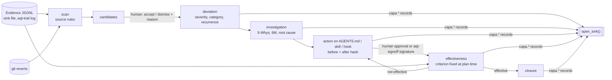

# aqt-capa — deviations and CAPA for AI coding agent work

Part of the **Agent Quality Toolkit (AQT)**. Agent failures stop being anecdotes: they become **deviations** with a root cause, a **corrective or preventive action (CAPA)** on the agent's controls under approval, and an **effectiveness check** that decides from later evidence whether the action worked.

## The problem

Coding agents fail in recognisable ways: they act on a poisoned web page, report "done" with failing tests, ship code a reviewer rejects, or get reverted the next day. Usually someone adds a line to `AGENTS.md` and moves on. Nobody records the root cause, nobody approves the instruction change, and nobody checks whether it worked. A quality manager would run a CAPA loop. `aqt-capa` brings that loop to agent work, fed by the evidence the other AQT tools already write.

## 60-second quick start

```bash
uv venv .venv && uv pip install --python .venv/bin/python -e ../aqt-spec -e ".[test]"
cp examples/capa.toml ~/.config/aqt/capa.toml        # set identity, project root, repos

aqt-capa scan                                        # candidates from evidence + git reverts
aqt-capa candidate accept C-1a2b3c4d --category instructions --reason "agent reported done with red tests"
aqt-capa investigate DEV-0001 --why "tests failed" --why "agent reported done anyway" \
    --factor "method:AGENTS.md has no completion rule" \
    --root-cause "completion criteria missing" --root-category instructions
aqt-capa action plan DEV-0001 --kind corrective --target AGENTS.md \
    --description "never report done with failing tests" --window-sessions 20
$EDITOR AGENTS.md                                    # or let the agent make the change
aqt-capa action implement CAPA-0001-1
aqt-capa action approve CAPA-0001-1 --reason "clear, testable rule"   # or: aqt-signoff sign --record <id> --meaning approved
aqt-capa effectiveness                               # pending -> effective / not-effective
aqt-capa close DEV-0001 --reason "no recurrence in 20 sessions"
aqt-capa trends --since 90d
```

`python examples/demo.py` runs the whole loop offline on synthetic data.

## How it works



- **Evidence first.** Every state change is a `capa.*` record written through `aqt_evidence.open_sink()` (a JSONL file or the aqt-trail socket). The SQLite file is only a working index. `aqt-capa rebuild` recreates it from the records.
- **Candidates, never automatic deviations.** The scan reads these sources:
  - quarantine held or declared-threat cases;
  - failed receipts (major when a finish references them);
  - finishes that are not `GO` or carry waivers;
  - `FAIL` reviews;
  - every `<tool>.refused` record;
  - audit-trail review findings with disposition `deviation`;
  - unknown action outcomes;
  - reverted git commits.

  A human accepts or dismisses each candidate with a reason. The dismissal is evidence too.
- **Actions bound by hash.** An action names one control file. `implement` records the before and after hashes and a diff excerpt. Approval is bound to that implementation record's content hash. It is either a recorded human approval (unsigned) or an aqt-signoff signature. With aqt-signoff installed, only signatures that verify count: the implementer's own signature is left out unless `allow_self_approval` is set, the configured `approved` policy is applied to the remaining signatures, and the approval is attributed to the signatures that meet it. A verification error never counts as approval. Without aqt-signoff, a signature record is reported as `signed-unverified`. If the file later changes, `verify` reports `changed-since-approval`.
- **Honest effectiveness.** The default criterion is `no-recurrence` within N agent sessions and/or D days. The result is `effective` only when all of these hold:
  - the window is complete;
  - no matching deviation occurred after approval;
  - no matching candidate is still undecided;
  - no `trail.gap` falls in the window;
  - the control file still has the approved hash.

  Otherwise the result is `pending` with the reasons, or `not-effective`.
- **Human-only decisions** use the shared check `aqt_evidence.require_human()`: accept, dismiss, classify, record an investigation, approve, cancel, extend and close. Agents may report deviations, draft investigations, and plan and implement actions. Refusals are recorded as `capa.refused`.

See [docs/usage.md](docs/usage.md) for every command, the record payloads and the configuration.

## QM mapping

The features are designed along these concepts and support them. Clause IDs follow the AQT catalogue convention.

| Feature | Concept |
|---|---|
| Intake from evidence and by hand | `iso9001-2015:10.2` (10.2.1 a); `annex11-2011:13` incident management; `annex11-2025d:3.1`; `gdp-2013:1.2` |
| Severity, category, recurrence links | `iso9001-2015:10.2` (10.2.1 b); `ichq9:5.1` risk-based effort |
| Structured investigation | `iso9001-2015:10.2` (10.2.1 b 2); `ichq10:3.2.2` |
| Hash-bound change of agent controls, approval | `iso9001-2015:8.5.6`, `7.5.3`, `10.2` (10.2.1 c, f); `annex22-2025d:10`; `part11:11.50(a)`, `11.70` via aqt-signoff |
| Effectiveness criterion fixed in advance, evaluated from evidence | `iso9001-2015:10.2` (10.2.1 d); `ichq10:3.2.2` |
| Gated closure, no reopening | `iso9001-2015:10.2` (10.2.2) |
| Every step a record with who / role / when / why | `alcoa:attributable`, `contemporaneous`, `original`, `complete`, `traceable` |
| Human in the loop for decisions | `annex22-2025d:1` |
| Trend report | `iso9001-2015:9.1.3`, `9.3`; ISO 9001 10.3; `gdp-2013:1.4`; `annex11-2025d:14.1` |

## Threat model and limits

- **The human check is a heuristic, not a security boundary.** It looks for environment markers and the agent harness in the process chain, and needs a TTY. A same-user process can work around it.
- **Self-asserted actors.** In a plain JSONL sink, an agent with shell access could write a `capa.*` record claiming a human actor, or edit the SQLite index. Three things limit this:
  - the index is never evidence, and `rebuild` restores it;
  - with aqt-trail, every record carries writer-observed process attribution;
  - with aqt-signoff, an approval can be a signature made with a passphrase-protected key, and aqt-capa verifies it.

  Without aqt-signoff, a `signoff.signature` record found in the evidence is reported as `signed-unverified`.
- **Unsigned human steps.** Accept, dismiss, classify, record an investigation, a recorded approval (`action approve`), cancel, extend and close are unsigned records. In a plain JSONL sink, an agent can forge them, for example a closure with basis `effective`. `rebuild` then shows the deviation as closed: the effectiveness gate is enforced when `close` runs, not when records are read back. With aqt-trail, such a record is attributed to the process that wrote it; review closures there. Only the approval of an action can carry a signature today.
- **Coverage.** Absence of candidates is not absence of failures. Effectiveness needs minimum activity and stays `pending` on trail gaps, but it cannot see failures that no control records.
- **Heuristic sources.** A revert can be benign and a red test can be intended. This is why a human decides every candidate.
- **Lexical similarity** misses paraphrased recurrences. Link recurrences manually with `deviation classify --recurrence-of`.
- **No integrity check of the evidence it reads.** aqt-capa does not verify chains or signatures of its inputs; run `aqt-trail verify` for that.
- **Privacy.** Records may contain personal data such as names in actor ids and free-text descriptions. Descriptions are stored with a hash and truncated to 2,000 characters.

## Regulatory status

*Agent Quality Toolkit supports quality-management practices; it is not a validated system and does not by itself make any process compliant with GMP, GDP, 21 CFR Part 11 or EU Annex 11.*

## Licence

Apache-2.0 (see `LICENSE` and `NOTICE`).
