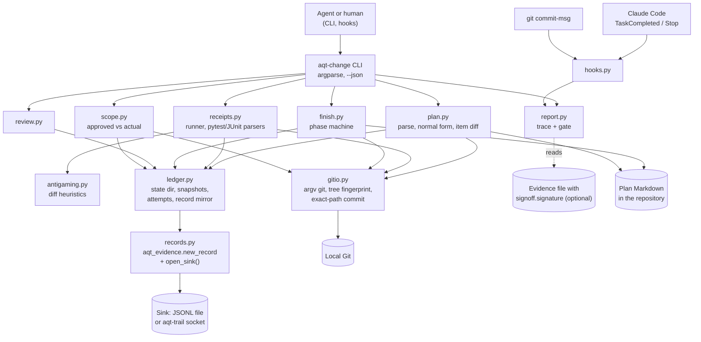
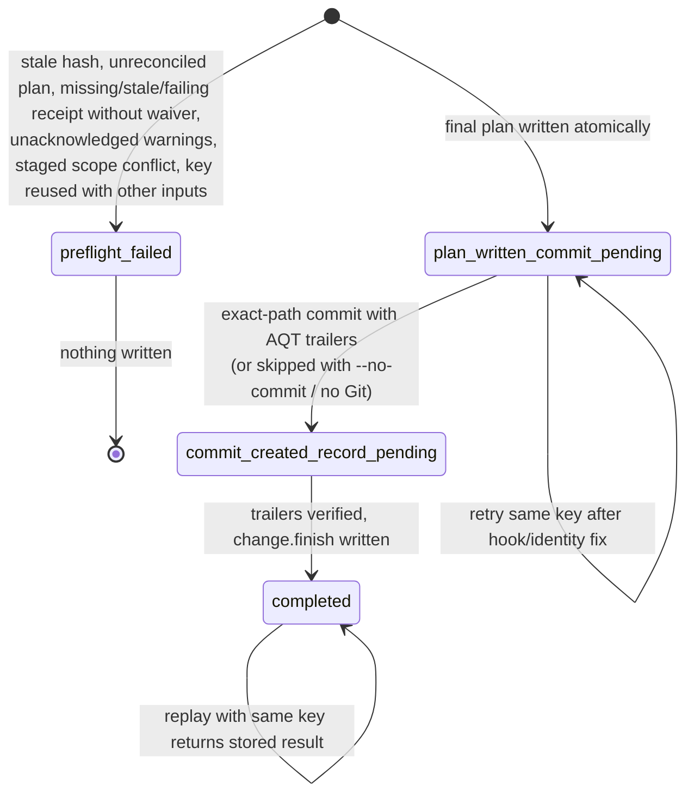

# aqt-change: change control and verification receipts for agent work

**Status:** target design, 2026-10-21; adjusted to `planning/04_designs/INTERFACES.md` (binding) in phase B. **Package:** `aqt-change` (Agent Quality Toolkit). **Brief:** `planning/04_designs/SUITE_ARCHITECTURE.md` §2.4.

---

## 1. Introduction

### 1.1 Core idea

Coding agents say "done, all tests pass" far more often than they can prove it. aqt-change makes "done" mean *evidenced*:

- **Plans cannot change silently.** A Markdown work plan has an accepted version, identified by a SHA-256 hash. Any later edit stays *unreconciled* until someone records what kind of change it was (editorial or semantic) and why. Until then the plan cannot be finished.
- **The runner captures the evidence, not the agent.** `aqt-change run -- pytest -q` runs the command itself and writes a *receipt*: command, exit code, duration, output hashes, parsed test counts, the Git state and the plan version. A receipt goes *stale* as soon as the code or the plan changes afterwards.
- **Finish is one checked operation.** `aqt-change finish` refuses to close a plan with unreconciled edits or missing, failing or stale receipts. If those checks pass, it writes the final plan state, makes one commit containing only the named paths (with trailers) and records the finish. It is idempotent and resumes after a crash.
- **What was approved is compared with what changed.** The plan declares the paths it intends to touch. `reconcile-diff` lists everything in the actual diff that the approved plan did not cover.
- **Everything is an evidence record.** Every step writes an aqt-spec record (`change.*`). A trace report and a machine-readable gate (GO / NO-GO / MANUAL_VERIFY_REQUIRED) are derived from these records.

### 1.2 Users and the problem

**Primary users:** solo developers and small teams who let Claude Code, Codex or pi implement planned work and want objective evidence before they accept it. **Secondary users:** people in regulated environments who need change-control and verification records for AI-assisted software (supplier-side SDLC evidence, CSA-style assurance records).

**The problem** (R4 §4.1, R3 §5): in the plan, spec and tracker tools that exist today, verification is mostly a prompt rule ("run the tests before you claim completion"). Where evidence exists, the agent wrote it as text. Approvals are rarely bound to an artefact hash, and no tool compares the *approved* plan with the *actual* diff. Project Tracker Next (PTN), the author's private tracker, already solves hash-reconciled plan edits and an idempotent scoped-commit finish. It still lacks runner-captured receipts, staleness rules, anti-gaming checks, review records and approved-versus-actual reconciliation (A6 §2.5, R4 §4.3).

### 1.3 End-to-end behaviour in plain language

1. A plan file (PTN sprint format) lists tasks `[T01]…` and verification items `[V01]…`. A verification item can name the command that proves it, for example `` `$ python -m pytest -q` ``. The front matter can declare the approved change scope (`aqt.paths`).
2. `aqt-change begin plan.md` records the plan's baseline: the accepted version hash and the Git base commit. If aqt-signoff is installed, a human can sign this baseline record with the meaning *approved*.
3. The agent works. Ticking checkboxes and appending log entries is normal progress. Any other edit to the plan makes `aqt-change plan status` report *unreconciled*. The agent (or the owner) runs `aqt-change reconcile plan.md --kind semantic --reason "…"`. The tool refuses to call an edit editorial when the structured meaning changed, and it refuses any rewrite of earlier history entries.
4. `aqt-change run --plan plan.md --all` runs every declared command and writes one receipt per item. A receipt passes only if the exit code is 0 and the parsed counts show no failures and at least one test.
5. `aqt-change review add …` records a review: who reviewed (human or agent, which model), how independent the reviewer was, the verdict, the findings and the diff hash the review applies to.
6. `aqt-change finish plan.md --key k1 --path src/x.py …` checks everything, writes the completion section from the receipts, commits the exact paths with `AQT-*` trailers and writes `change.finish`.
7. `aqt-change report plan.md` produces the trace: task → commits → receipts → reviews → sign-offs, with deviations and open waivers. It also writes the gate JSON for CI.
8. Hooks enforce the same rules: a Claude Code `TaskCompleted`/`Stop` hook blocks "done" while a ticked verification item has no fresh passing receipt, and a git `commit-msg` hook checks the `AQT-*` trailers.

### 1.4 Inputs and outputs

| Inputs | Outputs |
|---|---|
| Markdown plans (PTN sprint format, plus an optional `aqt:` front-matter block) | Updated plan files (lifecycle fields, completion section) |
| Commands to run; JUnit XML files (optional) | Evidence records `change.plan.reconciled`, `change.receipt`, `change.review`, `change.reconciliation`, `change.finish` to the configured sink |
| The local Git repository (read; one scoped commit at finish) | A local ledger (state directory): accepted plan snapshots, output logs, finish attempts, a mirror of its own records |
| Optional: an evidence file with `signoff.signature` records | Trace report (Markdown/HTML), gate JSON, hook verdicts |
| User config `$XDG_CONFIG_HOME/aqt/change.toml` | — |

### 1.5 Performance intent

The tool should feel instantaneous in an agent loop. `plan status`, the hook checks and `gate` (without `--rerun`) should take well under a second on repositories of ordinary size, because hooks run on every task completion and every stop. Only changed files are hashed. Receipts add no measurable overhead to the command they wrap; output is streamed to disk, never held in memory. Finish costs a few Git calls. Reports for a plan with hundreds of records render in about a second.

### 1.6 Design flexibility

This design fixes the observable behaviour: the record types and their meaning, the plan format compatibility, the refusal rules (unreconciled, stale, failing, history rewrite), idempotent finish, the gate vocabulary and the hooks' blocking semantics. Module layout, internal state file formats, parser technique, report styling and command spellings are suggestions. Builders may adapt them, add small conveniences or drop a heuristic that proves noisy, as long as the core outcome stays: *no silent plan change, no unevidenced "done", visible deviations*.

> **Implementation workflow.** All implementation guided by this design uses `lean-vertical-delivery` (small end-to-end slices, proportionate checks, a small completion report; no separate testing or documentation regime). Work is tracked in Project Tracker Next (project "Agent Quality Toolkit", one implementation for this package) through its low-call lifecycle. This package has no interactive UI; if one is added later, it is designed with `ui-studio`. When the same functionality fails repeatedly despite a reassessed approach, consult a Sensei with the intended behaviour, the attempts and the specific help needed.

---

## 2. Proposed architecture



**Suggested modules** (`src/aqt_change/`, not binding): `plan.py` (front-matter subset parser, sections, items, events, normal form, structured diff), `ledger.py` (state directory, atomic JSON writes, content-addressed snapshots and logs, record mirror), `records.py` (record builders, sink writes, actor detection), `gitio.py` (argument-list Git runner, tree fingerprint, diff since base, exact-path commit), `receipts.py` (command runner, output capture, pytest summary and JUnit parsing), `antigaming.py`, `finish.py`, `review.py`, `scope.py`, `report.py` (trace, Markdown/HTML, gate), `hooks.py`, `config.py`, `cli.py`.

**Storage.**
- *Plans* stay where they are: canonical Markdown in the repository, as in PTN.
- *Evidence* goes to the aqt-spec sink (`AQT_SINK`; default `$XDG_STATE_HOME/aqt/evidence.jsonl`). It is the authoritative record.
- *Ledger (working state)* lives in `<git-dir>/aqt-change/` when the root is a Git repository, so it is per worktree, never tracked and never shows up in diffs. Without Git it lives in `$XDG_STATE_HOME/aqt/change/<sha256 of the absolute root, 16 hex>/`; `AQT_CHANGE_STATE` overrides both. Contents:
  - `plans/<plan-id>.json`: accepted raw hash and basis hash, status, base commit, IDs of the baseline and latest reconciliation records;
  - `objects/<sha256>`: accepted plan snapshots, used to diff an edited plan against its accepted version;
  - `logs/<sha256>`: full stdout/stderr of receipts, mode 0600;
  - `attempts/<plan-id>/<key>.json`: finish phase state;
  - `records.jsonl`: a mirror of every record this tool wrote, so staleness and gate checks work even when the sink is the write-only trail socket.
  The ledger can be rebuilt from the sink when the sink is a readable file (`aqt-change ledger rebuild`, later stage).

**How records are written.** Each operation builds one record with `aqt_evidence.new_record`. It appends the record to `open_sink()` first and then to the mirror, and updates ledger state last, using temp file + fsync + `os.replace`. If the sink refuses the record, the operation fails and the ledger stays unchanged. Large texts (output, plan content, findings) are stored as `sha256` plus a short excerpt. Actor: `aqt_evidence.detect_agent_context()` decides agent versus human (shared markers, I9). Inside an agent context the actor is always `agent:<harness>:<session>`; `AQT_ACTOR` may set the identity (`agent:…` inside agents, any id outside) but never turns an agent into a human. Human-only steps (a review recorded with independence `human`) call `aqt_evidence.require_human()`; a refusal is recorded as `change.refused` (I5). The actor is self-declared unless aqt-trail adds `observed` attribution (§2.4 threat model).

**Reused from Agent Platform Next / Project Tracker Next** (read-only source; ideas and small adapted fragments; private specifics removed; origin noted in `NOTICE`):

| From (Project Tracker Next) | Reused as |
|---|---|
| `src/project_tracker/content/markdown_parser.py`: `TASK_RE`, section aliases, `### <timestamp> — <title>` events | Plan item and event parsing (regexes adapted) |
| `src/project_tracker/services/plan_maintenance.py`: `_validate_change`, `_appended_events`, `_changed_items`, `_semantic_fingerprint`, `_policy_for_status` | Reconciliation rules: immutable identity/lifecycle fields, append-only events, editorial refused when structure changed, reason rules per status, checked items preserved, no semantic change to terminal plans |
| `src/project_tracker/services/implementation_work.py`: `finish`, `_resume_attempt`, `_reconcile`, `_completion_warnings` | The finish phase machine, idempotency key + request hash, `idempotency_conflict`, visible override reasons |
| `src/project_tracker/services/git_evidence.py`: `build_commit_message`; `git_control` exact-path rules | Trailer building; exact-file paths only, unrelated *staged* paths abort, hooks and identity never bypassed, no remote operations |
| `src/project_tracker/services/implementation_mutations.py`: `create_sprint` template | `plan new` template (same sections) |

**Reused from open source** (ideas and formats only, no code unless stated): Claude Code hook protocol (exit 2 / `decision: block`; host documentation); `git interpret-trailers` conventions; JUnit XML (de-facto format); the dunnit anti-gaming patterns (MIT; ideas only); BMAD TEA's separation of derived gate and waiver register (MIT; ideas only); OpenSpec ADDED/MODIFIED/REMOVED vocabulary for item diffs (MIT; ideas only). Runtime: `aqt-spec`, `cryptography` (via aqt-spec), standard library. No AGPL/GPL code (pygit2 and dulwich are not used; Git is called as a CLI).

### 2.1 Core concepts

- **Plan.** A Markdown file with YAML front matter `tracker: {schema: 1, kind: sprint, id, implementation, status, …}` (PTN-compatible) and sections `## Tasks`, `## Verification`, event sections (`## Progress Log`, `## Blockers`, `## Deviations`, `## Failures And Learnings`, `## Decisions`), `## Linked Git Changes` and `## Completion`. Items look like `- [ ] [T01] text` and need stable IDs. An optional extra front-matter block, which PTN ignores:
  ```yaml
  aqt:
    paths: ["src/aqt_change/**", "tests/**", "README.md"]   # approved change scope (globs)
    review: {min_independence: fresh-context}               # optional per-plan policy tightening
  ```
- **Declared command.** A verification item names its proof as inline code that starts with `$ `, for example ``- [ ] [V01] Unit tests pass `$ python -m pytest -q` ``. The text after `$ ` is split with `shlex`, so argv must match exactly. An item without a declared command is a *manual* item.
- **Raw hash and basis hash.** The raw hash is SHA-256 over the file bytes. The *basis* is the plan's normal form: check marks masked, lifecycle fields (`status`, `started_at`, `completed_at`, `git`) removed, the `## Completion` section removed, and event sections cut back to the *accepted* prefix. **Status-neutral edits** (ticking boxes, appending events) leave the basis unchanged and need no reconciliation. Every other change alters the basis and is *unreconciled* until reconciled.
- **Reconciliation.** This records that the edited version is accepted: `kind` editorial or semantic, plus a reason. *Editorial* is refused when the structured meaning changed (item IDs or texts, `tracker` identity, `aqt` block, declared commands). *Semantic* needs a reason. In an active plan it must keep completed items unchanged. In a terminal plan (completed, failed, cancelled, superseded) it is refused, and a follow-up plan is required (`plan new --follows`). Editing or deleting earlier event entries is always refused.
- **Receipt.** The runner's record of one command execution, bound to the plan basis hash and the *tree fingerprint*. A receipt is **fresh** while both still match the current state and **passing** when the outcome is `passed`. A *manual receipt* (`attest`) records evidence files and a reason, with meaning `verified`. Manual receipts count as *claimed* evidence, kept apart from *observed* runs.
- **Tree fingerprint.** SHA-256 over the sorted `(path, blob id)` map of the working tree content: `git ls-tree -r HEAD`, overlaid with the changed and untracked files from `git status --porcelain -z`. Ignored files, plan files and the ledger are left out. Because it hashes *content*, committing that same content at finish does not make the receipts stale, while any code change after the run does. HEAD is recorded alongside for traceability. This refines the brief's "HEAD changed" rule.
- **Waiver.** A finish-time decision to accept a missing or failing item, given with `--waive V02="reason"`. It is written into the plan's completion section and into `change.finish`. A waiver never turns the derived gate into GO.
- **Independence class** of a review, ordered: `same-session` < `fresh-context` < `different-model` < `human`.
- **Approval state** of the plan: the *approval target* is the latest `baseline`/`begin`/semantic `reconcile` record. A signature subject is `{kind: record, ref: <rec id>, sha256: record_content_hash(record)}` (I1). `signed` = `aqt_signoff.is_approved(...)` confirms it (I10); `unverified` = a matching `signoff.signature` record was found via `iter_evidence` but aqt-signoff is not installed to verify it; `invalid` = aqt-signoff is installed and rejects the signature; `stale` = an earlier target was approved, then the plan changed semantically; `unsigned` otherwise.
- **Lifecycle owner.** `lifecycle_owner = "aqt-change"` (default): `begin`/`finish` write `status`, `started_at`, `git`, `completed_at` and the completion section. `"external"` (for files that Project Tracker Next manages): aqt-change never writes the plan file; `begin` only records the baseline (base commit from `tracker.git.base_commit` or HEAD), `finish` checks and records `change.finish` without writing or committing, and lifecycle field changes are status-neutral.
- **Gate.** A decision derived only from the records: `GO`, `NO-GO` or `MANUAL_VERIFY_REQUIRED`, with machine-readable reasons.



### 2.2 Interfaces

**CLI** (`aqt-change`, every command takes `--json`; exit codes 0 ok / 1 check failed / 2 usage or runtime error; `--root` and `--state` override discovery):

| Command | Does | Exit 1 when |
|---|---|---|
| `plan new PATH --id ID --title T [--implementation I] [--follows ID]` | Writes a plan from the template | — |
| `plan add PATH` | Registers an existing plan; `change.plan.reconciled` (action `baseline`) | plan invalid (no stable IDs, duplicate IDs) |
| `plan status [PATH…]` | Per plan: accepted/edited hashes, `clean`, `status-neutral changes` or `unreconciled`, item diff | any plan unreconciled or invalid |
| `reconcile PATH --kind editorial\|semantic --reason R [--expect SHA]` | Accepts the current version (`--expect` = the raw hash the caller edited) | refused by a rule; hash mismatch |
| `begin PATH` | Sets `in_progress`, `started_at`, `git.base_commit`; baseline record (action `begin`) | not `planned`/`blocked`; unreconciled |
| `run [--plan PATH] [--item ID \| --all] [--junit FILE] [--timeout S] [--quiet] [-- CMD…]` | Runs and records receipts; without `--item` an explicit command is matched to the declared command | the command did not pass |
| `attest PATH --item ID --evidence FILE… --reason R` | Manual receipt (meaning `verified`) | item has a declared command (use `run`) |
| `review add PATH --reviewer ID [--harness H --model M] --independence C --verdict PASS\|CONCERNS\|FAIL\|WAIVED [--findings FILE.json] --reason R` | `change.review` bound to the current diff hash | — |
| `reconcile-diff PATH` | Approved scope vs actual diff since `base_commit`; `change.reconciliation` | unapproved changes or missing evidence |
| `finish PATH --key K --summary S [--path P…] [--message M] [--waive ID=R…] [--ack-warnings R] [--no-commit] [--remaining R]` | Phase machine §2.1 | preflight failed or a phase pending |
| `report PATH [--format md\|html] [--out FILE] [--gate FILE] [--evidence FILE] [--rerun]` | Trace report and gate | — (report always renders) |
| `gate PATH [--evidence FILE] [--rerun]` | Prints gate JSON | decision is not `GO` |
| `hook claude-code` / `hook commit-msg FILE` | Hook entry points (stdin JSON / message file) | Claude Code protocol: exit 2 blocks; commit-msg exit 1 rejects |
| `hooks print` / `hooks install-git` | Prints a settings snippet; installs a `commit-msg` shim (refuses to overwrite an existing hook) | — |

`--rerun` re-executes every declared command in the current tree before the gate is decided (dunnit-style independent re-check). It never trusts stored receipts alone.

**Python API** (thin; the CLI calls it): `Ledger.open(root=None, state=None)`; `ledger.status(path) -> PlanStatus`; `ledger.reconcile(path, kind, reason, expect=None) -> dict`; `ledger.begin(path)`; `run_receipt(ledger, argv, plan=None, item=None, junit=None, timeout=None) -> dict`; `attest(...)`; `add_review(...)`; `reconcile_diff(ledger, path) -> dict`; `finish(ledger, path, key=…, …) -> FinishResult`; `gate(ledger, path, evidence=None, rerun=False) -> dict`; `render_report(ledger, path, fmt) -> str`; `parse_plan(text) -> Plan`.

**Files.** `examples/change.toml`:

```toml
actor = "human:alice"                     # default human actor id
lifecycle_owner = "aqt-change"          # or "external" (Project Tracker Next owns lifecycle writes)
excerpt_lines = 20                        # tail excerpt in receipts; 0 disables
timeout_seconds = 1800
fingerprint_exclude = [".venv/**", "node_modules/**"]
[gate]
require_signed_approval = false           # true: unsigned baseline → MANUAL_VERIFY_REQUIRED
min_review_independence = "none"          # none|same-session|fresh-context|different-model|human
warnings_block = false                    # true: anti-gaming warnings → NO-GO instead of MANUAL
always_allowed_paths = []                 # e.g. ["CHANGELOG.md"]
```

**Commit trailers** (compatible with `git interpret-trailers`; PTN's `PT-*` trailers stay untouched when present): `AQT-Plan: <plan-id> <basis sha256:…12 hex>`, `AQT-Task: <id>` (one per task completed in this finish), `AQT-Receipts: rec_…, rec_…`, `AQT-Finish: <plan-id>/<idempotency key>`. The key appears in `change.finish`, so commit and record find each other without a circular reference.

**Records** (`type` · `action` · `subject` · essentials; hashes are `sha256:<hex>`, integers only; the INTERFACES.md I6 names `argv`, `exit_code`, `passed`, `plan_basis_hash`, `tree_fingerprint`, `counts`, `plan_ref`, `receipts`, `waivers`, `gate`, `verdict`, `independence`, `diff_sha256`, `findings` are fixed). Refusals of human-only steps: `change.refused` with `data {attempted_action, reason_code, agent_markers}`:

| Type | Action | Key fields |
|---|---|---|
| `change.plan.reconciled` | `baseline` \| `begin` \| `reconcile` | `subject {kind: plan, ref: <plan-id>, sha256: raw after}`, `before/after {sha256: raw}`, `reason` (required for semantic and active/terminal editorial), `data {plan_id, path, kind: baseline\|editorial\|semantic, status, basis_before, basis_after, items {added, removed, changed}, scope_changed, events_appended, base_commit?, snapshot}` |
| `change.receipt` | `run` \| `attest` | `subject {kind: plan-item, ref: <plan-id>#V01}`, `data {plan_id, item, kind: run\|manual, argv, cwd, outcome: passed\|failed\|error\|timeout\|interrupted\|attested, exit_code, passed (bool), started, ended, duration_ms, stdout/stderr {sha256, bytes, tail}, counts {total, passed, failed, errors, skipped, xfailed, xpassed, source: pytest\|junit}, junit_sha256, git {head, dirty}, tree_fingerprint, fingerprint_excludes, plan_basis_hash, env {platform, python, executable, env_sha256}, warnings [anti-gaming], evidence [{path, sha256}]}`; `meaning: verified` and `reason` only for `attest` |
| `change.review` | `review` | `meaning: reviewed`, `reason` (summary), `data {plan_id, reviewer {kind, id, harness, model}, independence, verdict, findings [{severity, title, path, line}] or findings_sha256 + count, diff_sha256, diff {base, head, tree_fingerprint}, qualification?}`; actor = whoever recorded it |
| `change.reconciliation` | `reconcile-diff` | `data {plan_id, base_commit, approval {state, record, sha256, signature}, declared_paths, changed [{path, status}], unapproved [paths], untouched_declared [globs], missing_evidence [items], result: clean\|findings}` |
| `change.finish` | `finish` | `subject` final raw hash, `before/after`, `links` to receipts/reviews/reconciliations (`rel: receipt\|review\|plan-version`), `data {plan_ref, plan_id, idempotency_key, request_sha256, commit, paths, tasks {done, open}, verification {ID: receipt ids \| "waived"}, receipts [ids], waivers [{item, reason}], warnings_ack, warnings, gate, lifecycle_owner}` |

**Gate JSON:** `{"aqt_gate": "0.1", "plan_id", "decision", "reasons": [{"code", "item", "detail"}], "approval", "receipts", "reviews", "waivers", "evaluated_at", "policy_sha256"}`. NO-GO codes: `plan_unreconciled`, `receipt_missing`, `receipt_stale`, `receipt_failed`, `unapproved_change`, `review_fail` (the latest review is FAIL; it stays open until a later review replaces it, even after code changes), `not_finished`. MANUAL codes: `waiver_present`, `manual_item_agent_attested`, `anti_gaming_warning`, `approval_unsigned` / `approval_unverified` (when required), `approval_invalid`, `review_waived`, `scope_unverifiable`, `approval_stale`, `review_concerns`, `review_independence_below_policy`, `scope_undeclared`.

**Hook semantics.** `hook claude-code` reads the hook event JSON from stdin. For `TaskCompleted` it blocks (exit 2, reason on stderr) when the task text references a verification ID (`[V01]`) of an in-progress plan and that item has no fresh passing receipt. For `Stop` it blocks when an in-progress plan has a *ticked* verification item without a fresh passing receipt (phantom completion), or has unreconciled edits. When `stop_hook_active` is true it does not block a second time; it reports the problem without blocking, and `finish` still refuses. It never runs tests itself. `hook commit-msg` checks `AQT-*` trailer syntax and resolves the plan ID and receipt IDs in the ledger. With `--require` it also rejects commits without `AQT-Plan` while a plan is in progress.

**Anti-gaming heuristics** (diff from `base_commit` to the working tree; reported as warnings, never as proof): added `pytest.mark.skip`/`skipif`/`xfail`, `pytest.skip(`, `unittest.skip`, `it.skip`/`describe.skip`/`.only(`; net-removed `assert` lines in test files; removed `def test_`/`it(` blocks; changes to `addopts`, `-k`, `--deselect`, `collect_ignore`, `testpaths` in `pyproject.toml`/`pytest.ini`/`setup.cfg`/`tox.ini`/`conftest.py`; JUnit file older than the run start; edits to the plan's declared commands (these already need a semantic reconciliation).

### 2.3 Stack and method

| Area | Choice | Why | Trade-offs | Alternative |
|---|---|---|---|---|
| Language/CLI | Python ≥ 3.11, argparse | Suite rule; zero deps | Verbose subcommand code | Typer/Click (extra deps) |
| Records | `aqt_evidence` (`new_record`, `open_sink`, `content_hash`) | One evidence model | Bound to spec 0.1 | Own format (rejected) |
| Front matter | Strict YAML *subset* parser/writer (mappings, scalars, quoted strings, block and flow lists), line-preserving key edits like PTN's writer | No PyYAML dep; PTN files use only this subset; edits keep the rest of the file byte-identical | Unsupported YAML is refused with a clear error | PyYAML optional extra if real plans need more |
| Markdown | Line-based parser that knows headings, fenced code and task items (PTN regexes) | Structure is headings + items; fast; deterministic | Not a full CommonMark AST | markdown-it-py (MIT, as PTN) |
| Git | `git` CLI via `subprocess` argument lists, no shell, no remote commands | Universal, licence-clean, same as PTN | Parses porcelain output | pygit2 (GPLv2+exception), dulwich (GPL/Apache dual) |
| Staleness | Content tree fingerprint + plan basis hash | Survives the finish commit; catches dirty edits | Hashing changed files per check | HEAD-only (misses dirty edits) |
| Receipts | `subprocess.Popen`, output streamed to files, tail excerpt; pytest summary regex; JUnit via `xml.etree` | Stdlib; works for any command | Count parsing only for pytest/JUnit; ElementTree on untrusted XML has entity-expansion risk (local test output, size-capped) | pytest plugin (Python-only), defusedxml (dep) |
| State | JSON files with atomic replace + content-addressed objects | Inspectable, tiny, crash-safe | No queries; fine at plan scale | SQLite (as aqt-capa) |
| Globs | Small `**`-aware glob → regex | `fnmatch` lacks `**`; `PurePath.full_match` needs 3.13 | Own code to test | pathspec (dep) |
| Reports | f-string templates, `html.escape`, Mermaid optional in Markdown | No deps; static HTML | Plain styling | Jinja2 |
| Hooks | Thin CLI entry points; config snippets printed, never auto-edited into user settings | Respects user config ownership | One manual copy step | Installer that edits settings |

### 2.4 QM mapping, threat model and limits

| Feature | QM concept | Clauses (paraphrased; catalogue IDs from aqt-spec when published) |
|---|---|---|
| Hash-reconciled plan, editorial/semantic + reason, no silent acceptance | Control of changes; revision and change control documentation | ISO 9001:2015 8.5.6, 8.3.6; EU GMP Annex 11 (2011) §10; draft Annex 11 §12.2 (reason for change, R-03); 21 CFR 11.10(k)(2) |
| Append-only event history; terminal plans need a follow-up | Changes must not obscure earlier entries | 21 CFR 11.10(e); ALCOA++ Original, Enduring |
| Runner-captured receipts with output hashes | Objective evidence of verification; executed test evidence; logs as assurance records | ISO 9001 8.6; draft Annex 11 §9.4 (R-15); FDA CSA (2025) record of assurance activities (R-16); ALCOA++ Attributable (computerised system), Contemporaneous, Original, Accurate |
| Staleness after code or plan change | Retest after change; documented "no retest" justification | draft Annex 11 §3.1(ii), Annex 22 draft §10.1 (R-17) |
| Anti-gaming warnings | Data integrity: accurate, complete | ALCOA++ Accurate, Complete |
| Finish preflight; enforced order begin → run → finish | Operational sequence checks enforced by the system | 21 CFR 11.10(f) (R-30) |
| Waivers and override reasons visible in plan and record; derived gate unchanged | Concession / release under deviation, documented | ISO 9001 8.7.1, 8.6; GMP deviation documentation |
| Review records with independence class, bound to diff hash | Independent review, four-eyes; human-review records for AI output | ISO 9001 8.3.4; Annex 22 draft §1 (HITL), §10.5 (R-23, R-24) |
| Approved scope vs actual diff | Detection of undocumented (unapproved) changes | draft Annex 11 §14.2(iii) (R-19); ISO 9001 8.5.6 |
| Scoped commit + trailers; trace report | Traceability requirement → change → test → approval | ALCOA++ Traceable; GAMP 5 trace matrix; draft Annex 11 §6 (R-14) |
| Sign-off linkage (aqt-signoff) | Signature bound to the approved version | 21 CFR 11.50, 11.70 (via aqt-signoff) |

*Agent Quality Toolkit supports quality-management practices; it is not a validated system and does not by itself make any process compliant with GMP, GDP, 21 CFR Part 11 or EU Annex 11.*

**Threat model.** Adversaries: (1) a *careless* agent that claims completion without running anything; (2) a *gaming* agent that tries to make checks pass without doing the work; (3) a person who later tries to rewrite history. Assets: the plan's accepted versions, the receipts, the finish record and the link between commit and evidence.

| Attack | Defence | Residual |
|---|---|---|
| "Done" without running tests | Hooks block; finish refuses; gate NO-GO | None, if the hooks are installed |
| Run a trivial command instead (`true`) | Receipt argv must equal the declared command | Changing the declared command needs a semantic reconciliation; that change is visible but possible |
| Edit the plan to drop a verification item | Unreconciled until reconciled as semantic with a reason; recorded item diff; approval becomes `stale` → MANUAL | Visible, not prevented; human approval (aqt-signoff) is the real control |
| Weaken the tests (skip, xfail, removed asserts, deselect) | Anti-gaming warnings → MANUAL (or NO-GO by policy); reviews | Heuristics; a subtly broken test or a patched conftest can pass |
| Forge a receipt by writing the ledger mirror or the JSONL sink | With aqt-trail: records arrive through the separate writer with `observed` process attribution and chaining. Without it: `gate --rerun` re-executes the commands | Without aqt-trail and `--rerun`, an agent with shell access can forge local files |
| Claim to be human (`AQT_ACTOR`) | Agent markers in env; trail attribution; signoff passphrase for approvals | The actor field is self-declared without aqt-trail/aqt-signoff |
| Rewrite Git history after finish | Receipts and finish records live in the trail; trailers and tree fingerprint let the trace detect a mismatch | Detection only with an external trail |

**Limits.** It does not judge whether the tests are *adequate*; that is the job of reviews and aqt-validate reviewer qualification. Count parsing covers pytest and JUnit only; other commands use exit codes. The heuristics target Python and JavaScript test idioms. The design assumes one local user and a POSIX system (file locking in aqt-spec). It never contacts remotes and does not sandbox the commands it runs: they run with the user's rights. Output logs can contain secrets: they stay local (0600), only hashes and a configurable tail excerpt enter records, and the excerpt can be disabled.

### 2.5 Novelty and prior art

| Project (R4) | What it covers | What aqt-change adds |
|---|---|---|
| Project Tracker Next (author's private tracker) | Hash-reconciled plans, idempotent scoped finish, override reasons | Runner receipts with staleness, anti-gaming, reviews, approved-vs-actual, gate, hooks, aqt-spec records; no database or server |
| Spec Kitty | Append-only JSONL trail, evidence tier, commit links | Plan *content* reconciliation by hash; evidence captured by the runner, not supplied by the caller |
| BMAD TEA | Traceability matrix, PASS/CONCERNS/FAIL gate file, waiver register | Gate derived from runner-captured, hash-bound records; waivers kept separate in the same way |
| dunnit, nomArmy, Rashomon | Re-run proofs, anti-gaming diff checks, independent tool-call records | Same checks combined with plan state, staleness and a persistent evidence record |
| Doorstop, tracey | Fingerprints/suspect links, versioned requirement IDs (for requirements) | The same idea applied to *agent work plans* plus execution evidence |
| MCP Task Orchestrator, MoAI-ADK | Server-enforced phase gates; idempotent operation receipts | Enforcement through host hooks and finish, without a server |
| Entire, Git AI, Agent Trace | Who or what wrote the code | Not duplicated; receipts can link their IDs later |
| Superpowers `verification-before-completion` | The rule "evidence before claims" (prompt-level) | The record half of that rule |

**Honest assessment:** each mechanism exists somewhere. R4 §4.3 and R3 O4 found no tool that combines all of them: hash reconciliation of work plans, receipts captured by the runner and tied to tree and plan hashes, a scoped idempotent finish, and approved-versus-actual reconciliation, all in one GxP-aware evidence model. Mechanisms are easy to copy, so the value lies in coherence, low ceremony and the QM semantics, not in lock-in.

---

## 3. Flexible roadmap

### 3.1 MVP (brief §2.4 items 1–7), built as four slices

**Status:** implemented in 0.1.0 (all four slices; 71 offline tests, `examples/quickstart.sh` covered by a test). Declared commands run without a shell (no `--shell` flag); a FAIL review stays open until superseded; an approval rejected by aqt-signoff is reported as `invalid`.

| Slice | Works end to end | Checked by |
|---|---|---|
| S1 Plan ledger | `plan new/add/status`, `reconcile`, `begin`; normal form; all PTN refusal rules; records to a file sink | Fixture plans: status-neutral edit → clean; text edit → unreconciled; editorial-with-structure refused; history rewrite refused; terminal semantic refused; record payloads validate |
| S2 Receipts + finish | `run` (single, `--item`, `--all`, `--junit`, timeout), `attest`, tree fingerprint, staleness, anti-gaming; `finish` with and without Git, trailers, idempotent replay, crash resume at each phase | Temp Git repos; a fake test command that prints a pytest summary; staleness after a code edit but not after the finish commit; injected crashes between phases; `idempotency_conflict` |
| S3 Review, scope, report | `review add`, `reconcile-diff`, `report` (md/html), `gate`, `--rerun`, signoff lookup from an evidence file | Synthetic signoff record; unapproved path → NO-GO; waiver → MANUAL; independence policy |
| S4 Hooks | `hook claude-code` (TaskCompleted, Stop, `stop_hook_active`), `hook commit-msg`, `hooks print/install-git` | Recorded synthetic hook payloads; exit codes; real `git commit` in a temp repo with the shim |

**Done when** one scripted example (`examples/quickstart.sh`, offline) runs plan → begin → edit + reconcile → run → review → finish → report → gate GO, and the variant with a stale receipt ends in NO-GO. All tests are offline and use synthetic fixtures only.

### 3.2 Later stages

| Stage | Result | Decision needed | Risk |
|---|---|---|---|
| MCP server | `status`/`run`/`finish` tools for agents without hooks | Tool surface and payload budget | Duplicates the CLI; keep it thin |
| Adapters | Spec Kit `tasks.md`, OpenSpec `changes/*/tasks.md`, Backlog.md task files | Which first (distribution vs. effort) | Format drift upstream |
| Suspect links | Flag plans when a linked `Design.md` section hash changes (Doorstop/tracey idea) | Requirement ID syntax | Noise |
| Provenance links | Entire checkpoint / Agent Trace IDs in receipts and trailers | Standard stability | Draft specs change |
| Codex/pi hooks | Same gate in other hosts | Host hook availability | Host absorption |
| Evidence pack | CSA-style per-change pack (intended use, risk, assurance, results, approvals; R3 O5) | Template content | Over-claiming; wording rules apply |
| Ledger rebuild / trail cross-check | `ledger rebuild`, mirror vs. trail comparison | — | Low |
| in-toto/DSSE export of receipts | Interop with supply-chain tooling | Optional extra | Scope creep |
