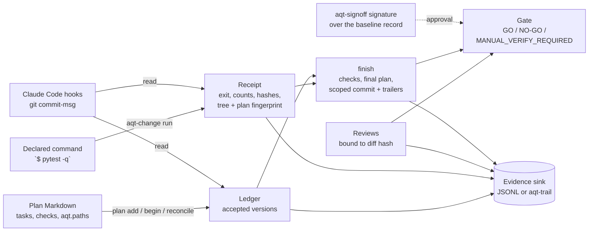

# aqt-change

**Change control and verification receipts for AI coding agent work.** Part of the Agent Quality Toolkit.

> Agent Quality Toolkit supports quality-management practices; it is not a validated system and does not by itself make any process compliant with GMP, GDP, 21 CFR Part 11 or EU Annex 11.

## The problem

Coding agents report "done, all tests pass" far more often than they can prove it. In most planning tools, verification is a prompt rule, and whatever evidence exists is text the agent wrote itself. Plans change silently while the work is under way, approvals are not tied to a version, and nothing compares what was approved with what actually changed.

aqt-change makes "done" mean *evidenced*:

- **No silent plan changes.** A Markdown plan has an accepted version, identified by its SHA-256 hash. Any edit other than ticking boxes or appending log entries stays *unreconciled* until it is classified as editorial or semantic and given a reason. Earlier history entries cannot be rewritten.
- **The runner captures the evidence, not the agent.** `aqt-change run` executes the declared command itself. It records a *receipt*: argv, exit code, duration, output hashes plus a short tail, parsed pytest/unittest/JUnit counts, HEAD, a fingerprint of the working-tree content and the plan version. A receipt goes *stale* when the code or the plan changes afterwards.
- **One checked finish.** `finish` refuses to close a plan with unreconciled edits or missing, stale, failing or (with aqt-trail) unconfirmed receipts. It writes the final plan state and commits only the named files, with `AQT-*` trailers, and refuses when a tested change would stay out of that commit. It is idempotent and resumes after a crash.
- **Approved versus actual.** The plan declares the paths it may change. `reconcile-diff` lists everything outside that scope.
- **A derived gate.** `GO`, `NO-GO` or `MANUAL_VERIFY_REQUIRED`, computed only from the records. Waivers stay visible and never produce GO.
- **Hooks.** A Claude Code `TaskCompleted`/`Stop` hook blocks "done" while a ticked verification item has no fresh passing receipt. A git `commit-msg` hook checks the trailers.

Each step writes an [aqt-spec](../aqt-spec) evidence record (`change.plan.reconciled`, `change.receipt`, `change.review`, `change.reconciliation`, `change.finish`). The records go to a JSONL file or to the aqt-trail writer.

## Quick start (60 seconds)

```sh
uv venv .venv && uv pip install --python .venv/bin/python -e ../aqt-spec -e .
sh examples/quickstart.sh      # offline demo in a temporary Git repository
```

In your own repository:

```sh
aqt-change plan new plans/s01.md --id s01 --title "Subtraction"   # Project Tracker Next-compatible template
# edit: tasks "- [ ] [T01] …", checks "- [ ] [V01] Tests pass `$ python -m pytest -q`", aqt.paths
aqt-change reconcile plans/s01.md --kind semantic --reason "define the work"
aqt-change begin plans/s01.md                          # baseline + Git base commit
# … the agent works …
aqt-change run --plan plans/s01.md --all               # receipts for every declared command
aqt-change review add plans/s01.md --reviewer agent:codex:r1 --independence different-model \
    --verdict PASS --reason "reviewed the diff"
aqt-change finish plans/s01.md --key s01 --summary "sub() added" --path src/calc.py
aqt-change report plans/s01.md --format html --out report.html --gate gate.json
aqt-change gate plans/s01.md                           # exit 0 only for GO
aqt-change hooks print > claude-hooks.json             # merge into your Claude Code settings
aqt-change hooks install-git                           # commit-msg trailer check
```

## How it works



- **Plan format:** Project Tracker Next sprint files (front matter `tracker:`, `## Tasks`, `## Verification`, event sections, `## Completion`), plus an optional `aqt:` block that Project Tracker Next ignores. Details are in [docs/usage.md](docs/usage.md).
- **Freshness:** the receipt stores the plan's *basis hash* and the *tree fingerprint*. The basis hash covers the plan without check marks, lifecycle fields, the completion section or event entries. The tree fingerprint hashes the working-tree content, excluding the plan file and the files the repository's tracked `.gitignore` files ignore. Because both hash content, committing the same code at finish does not make a receipt stale; any later code edit does. The rule is strict: any *untracked, non-ignored* file that appears after a run (a coverage file, a report, a scratch note) also makes the receipt stale. Write tool outputs to paths covered by `.gitignore`, or list them in `fingerprint_exclude` (for example `["build/**", "coverage.xml"]`): in the committed `.aqt/change.toml` it leaves out any matching file; in your user `change.toml`, which an agent can edit, only untracked files outside the plan's paths. A JUnit file passed with `--junit` is left out on the same terms. A run that changes the fingerprinted tree while it runs does not count until a later run leaves the tree unchanged (MANUAL `command_modified_worktree`; `finish` refuses). Commands run with a fresh, empty Python bytecode cache (`PYTHONPYCACHEPREFIX`), so `.pyc` files already in the tree cannot stand in for the source.
- **Ledger:** working state lives in `<git-dir>/aqt-change/` and never shows up in diffs. The evidence sink is authoritative.
- **Approval for QM use:** the library default is `require_signed_approval = false`, so a solo developer can start without aqt-signoff. For QM use, enable it (as in `examples/change.toml`), and commit it in the project's `[gate]` in `.aqt/change.toml` so that the agent's environment cannot drop it. Then a plan done entirely by an agent cannot reach GO until a person has signed the approved plan version.
- **Project settings:** `.aqt/change.toml`, committed with the code, holds `require_trail`, `trail_keys` (the trail writer's pinned service key ids), `fingerprint_exclude` and a `[gate]` table (`require_signed_approval`, `min_review_independence`, `warnings_block`, `always_allowed_paths`). Settings that loosen checks count fully only there: from the user configuration, `fingerprint_exclude` leaves out only untracked files outside the plan's paths, and a path allowed only by its `always_allowed_paths` gives MANUAL (`allowed_by_user_config`). See [docs/usage.md](docs/usage.md#project-settings).
- **Lifecycle owner:** set `lifecycle_owner = "external"` for files that Project Tracker Next manages. aqt-change then never writes the plan file; it only records, checks and reports.

## QM mapping

| Feature | Concept | Clauses (paraphrased) |
|---|---|---|
| Hash-reconciled plans, editorial/semantic + reason | Control of changes; revision and change control documentation | `iso9001-2015:8.5.6`, `iso9001-2015:7.5.3`, `annex11-2011:10`, `annex11-2025d:12.2`, `part11:11.10(k)` |
| Append-only plan history; follow-up plans for terminal plans | Changes must not obscure earlier entries | `part11:11.10(e)`, `alcoa:original`, `alcoa:enduring` |
| Runner-captured receipts | Objective evidence of verification; executed test evidence | `iso9001-2015:8.6`, `annex11-2025d:9.4`, `alcoa:attributable`, `alcoa:contemporaneous`, `alcoa:accurate` |
| Staleness after change | Retest after change | `annex11-2025d:3.1`, `annex22-2025d:10` (§10.1) |
| Finish preflight and order begin → run → finish | Operational sequence checks | `part11:11.10(f)` |
| Waivers and override reasons visible | Concession, documented deviation | `iso9001-2015:8.7` |
| Reviews with independence class | Independent review; human review of AI output | `iso9001-2015:8.5.6`, `annex22-2025d:10` (§10.5) |
| Approved scope versus actual diff | Detection of unapproved changes | `annex11-2025d:14.1` (§14.2) |
| Trailers and trace report | Traceability | `alcoa:traceable`, `annex11-2025d:6.1` |

These are concepts the tool *supports*. Procedures, validation of your own process and human accountability remain with you.

## Threat model and limits

aqt-change protects against a *careless* agent (claims done without running anything) and makes a *gaming* agent visible. It does not stop a determined local attacker.

- A changed declared command, a dropped verification item or scope widening all need a *semantic reconciliation* with a reason. The change is visible and makes a signed approval `stale`; the tool does not prevent it. Real control comes from human approval through aqt-signoff.
- Anti-gaming checks (added skip/xfail/only, removed asserts or tests, deselection config, stale JUnit files) are heuristics for Python and JavaScript idioms. They raise warnings (MANUAL, or NO-GO by policy), never proof.
- The ledger in `.git/aqt-change/`, including its copy of every record (`records.jsonl`), is writable by the agent's user. **Without aqt-trail**, an agent with shell access can forge receipts and reviews there or in a sink file, and `gate`, `finish` and the hooks count them. **With aqt-trail** in use (a trail log exists, or records go to a writer; `AQT_SINK=file:` does not switch this off), a receipt or review counts only if the trail log holds the same record (same id and content hash) and the writer received it over its socket. A record only in the local copy, or edited there, gives NO-GO; one that reached the trail through the spool, or a log that cannot be read, gives MANUAL. Where the trail log is comes from the environment that runs the gate, which the agent sets: commit `require_trail = true` in `.aqt/change.toml` so that no log found means NO-GO (without it, records that came back from a writer keep the check on, but the agent can rewrite the local copy), and pin the writer's service key with `trail_keys` so that a log the agent wrote itself and pointed `AQT_EVIDENCE` at confirms nothing (in user mode the agent can read that key; separate-user mode keeps it out of reach). A deciding gate is only as trustworthy as the environment it runs in: run it in the owner's shell or in CI. This makes forging visible, not impossible: a same-user agent can still send a made-up record through the writer, which keeps it with the sender's process chain, and in user mode it can write the log file itself, which `aqt-trail verify` reports as a broken chain (the gate looks records up; it does not verify the log). The local copy still decides which records belong to this project and in which order, so deleting a later failing run of an unchanged tree from it is not noticed by the gate (the trail keeps that run). `gate --rerun` re-executes the declared commands instead of trusting stored receipts.
- The tree fingerprint hashes every tracked file's content. When a tracked file differs from the index but `git status` does not show it (index flags `skip-worktree` / `assume-unchanged`, a `core.fsmonitor` hook, relaxed `core.checkStat` / `core.trustctime`, edited index data), Git would hide the change from `status`, `diff` and `add`: the gate is NO-GO (`hidden_worktree_change`), `finish` refuses and the hooks block. Files outside a sparse checkout give MANUAL (`sparse_checkout`). Untracked files that only `.git/info/exclude`, `core.excludesFile` or an untracked `.gitignore` ignore (one that ignores itself does not show in `git status`) are fingerprinted too and give MANUAL (`locally_ignored_files`). Only tracked `.gitignore` files take a file out, and the `.gitignore` that pytest, mypy, ruff and venv/uv put into their own folders (`.pytest_cache`, `.mypy_cache`, `.ruff_cache`, `.venv`, `.tox`, `.nox`).
- Ignored files that a run loads: Python bytecode cannot decide a run (fresh cache, see *Freshness*), but other ignored files are not fingerprinted and a run in the working tree may load them: a compiled extension module next to a `.py` file (Python prefers `calc.*.so` to `calc.py`), a `.pyc` without a source, the build caches of other tools (`target/`, `build/`, `node_modules/`), the virtual environment. A command that clears the environment of its child processes (for example tox) does not pass the fresh bytecode cache on. `gate --rerun` runs in the same working tree; only a run on a clean checkout of the commit (CI) is decisive.
- The plan state's base commit (in `.git/aqt-change/plans/`) decides the scope diff and which copies of `.aqt/change.toml` count. It must be one that the plan's `begin` record names: when the trail log confirms another base commit, the gate is NO-GO (`plan_base_mismatch`) and `finish` refuses; when only the local copy of the records disagrees, or a log records several base commits for the plan (a made-up second begin record sent through the writer), MANUAL. The settings also count from every base commit such a record names and from every commit since that changed the file. Without a trail, an agent that rewrites the begin record in the local copy as well is not noticed.
- `finish` commits only the named files, so it checks that the commit holds the tested tree: a tracked file inside the plan's paths or covered by the fingerprint that differs from HEAD, or an untracked file inside the plan's paths, that is not named refuses the finish (`finish_tested_change_not_committed`). After a finish without a commit (`--no-commit`, external lifecycle owner), the gate gives MANUAL (`tested_change_not_committed`) until HEAD holds them. Untracked files outside the plan's paths may stay out; the scope check reports them.
- The actor is detected with the shared aqt-spec agent markers. `AQT_ACTOR` can set an identity but cannot turn an agent into a human. A human-only step (recording a review with independence `human`) uses `require_human()` and records refusals as `change.refused`. This is a guard, not a security boundary.
- Claude Code hook setup and a one-time check in a real session: [docs/claude-code.md](docs/claude-code.md).
- The tool does not judge whether tests are adequate; reviews and aqt-validate address that. Count parsing covers pytest, unittest and JUnit XML only. Commands run with your rights, without a sandbox and without a shell. Output logs stay local (mode 0600); records keep only hashes and a configurable tail excerpt. It assumes POSIX, local single-user use and no network.

## Licence

Apache-2.0 (see `LICENSE`). Parts of the reconciliation and finish logic are adapted from the author's private Project Tracker Next (see `NOTICE`).
