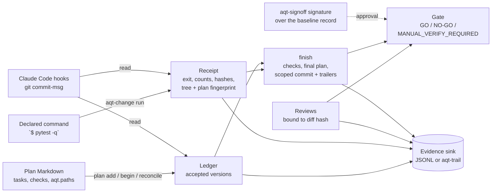

# aqt-change

**Change control and verification receipts for AI coding agent work.** Part of the Agent Quality Toolkit.

> Agent Quality Toolkit supports quality-management practices; it is not a validated system and does not by itself make any process compliant with GMP, GDP, 21 CFR Part 11 or EU Annex 11.

## The problem

Coding agents report "done, all tests pass" far more often than they can prove it. In most planning tools, verification is a prompt rule, and whatever evidence exists is text the agent wrote itself. Plans change silently while the work is under way, approvals are not tied to a version, and nothing compares what was approved with what actually changed.

aqt-change makes "done" mean *evidenced*:

- **No silent plan changes.** A Markdown plan has an accepted version, identified by its SHA-256 hash. Any edit other than ticking boxes or appending log entries stays *unreconciled* until it is classified as editorial or semantic and given a reason. Earlier history entries cannot be rewritten.
- **The runner captures the evidence, not the agent.** `aqt-change run` executes the declared command itself. It records a *receipt*: argv, exit code, duration, output hashes plus a short tail, parsed pytest/unittest/JUnit counts, HEAD, a fingerprint of the working-tree content and the plan version. A receipt goes *stale* when the code or the plan changes afterwards.
- **One checked finish.** `finish` refuses to close a plan with unreconciled edits or missing, stale or failing receipts. It writes the final plan state and commits only the named files, with `AQT-*` trailers. It is idempotent and resumes after a crash.
- **Approved versus actual.** The plan declares the paths it may change. `reconcile-diff` lists everything outside that scope.
- **A derived gate.** `GO`, `NO-GO` or `MANUAL_VERIFY_REQUIRED`, computed only from the records. Waivers stay visible and never produce GO.
- **Hooks.** A Claude Code `TaskCompleted`/`Stop` hook blocks "done" while a ticked verification item has no fresh passing receipt. A git `commit-msg` hook checks the trailers.

Each step writes an [aqt-spec](../aqt-spec) evidence record (`change.plan.reconciled`, `change.receipt`, `change.review`, `change.reconciliation`, `change.finish`). The records go to a JSONL file or to the aqt-trail writer.

## Quick start (60 seconds)

```sh
uv venv .venv && uv pip install --python .venv/bin/python -e ../aqt-spec -e .
sh examples/quickstart.sh      # offline demo in a temporary Git repository
```

In your own repository:

```sh
aqt-change plan new plans/s01.md --id s01 --title "Subtraction"   # PTN-compatible template
# edit: tasks "- [ ] [T01] …", checks "- [ ] [V01] Tests pass `$ python -m pytest -q`", aqt.paths
aqt-change reconcile plans/s01.md --kind semantic --reason "define the work"
aqt-change begin plans/s01.md                          # baseline + Git base commit
# … the agent works …
aqt-change run --plan plans/s01.md --all               # receipts for every declared command
aqt-change review add plans/s01.md --reviewer agent:codex:r1 --independence different-model \
    --verdict PASS --reason "reviewed the diff"
aqt-change finish plans/s01.md --key s01 --summary "sub() added" --path src/calc.py
aqt-change report plans/s01.md --format html --out report.html --gate gate.json
aqt-change gate plans/s01.md                           # exit 0 only for GO
aqt-change hooks print > claude-hooks.json             # merge into your Claude Code settings
aqt-change hooks install-git                           # commit-msg trailer check
```

## How it works



- **Plan format:** Project Tracker Next sprint files (front matter `tracker:`, `## Tasks`, `## Verification`, event sections, `## Completion`), plus an optional `aqt:` block that PTN ignores. Details are in [docs/usage.md](docs/usage.md).
- **Freshness:** the receipt stores the plan's *basis hash* and the *tree fingerprint*. The basis hash covers the plan without check marks, lifecycle fields, the completion section or event entries. The tree fingerprint hashes the working-tree content, excluding the plan file and ignored files. Because both hash content, committing the same code at finish does not make a receipt stale; any later code edit does. The rule is strict: any *untracked, non-ignored* file that appears after a run (a coverage file, a report, a scratch note) also makes the receipt stale. Write tool outputs to paths covered by `.gitignore`, or list them in `fingerprint_exclude` in `change.toml` (for example `["build/**", "coverage.xml"]`). A JUnit file passed with `--junit` is excluded automatically.
- **Ledger:** working state lives in `<git-dir>/aqt-change/` and never shows up in diffs. The evidence sink is authoritative.
- **Approval for QM use:** the library default is `require_signed_approval = false`, so a solo developer can start without aqt-signoff. For QM use, enable it (as in `examples/change.toml`). Then a plan done entirely by an agent cannot reach GO until a person has signed the approved plan version.
- **Lifecycle owner:** set `lifecycle_owner = "external"` for files that Project Tracker Next manages. aqt-change then never writes the plan file; it only records, checks and reports.

## QM mapping

| Feature | Concept | Clauses (paraphrased) |
|---|---|---|
| Hash-reconciled plans, editorial/semantic + reason | Control of changes; revision and change control documentation | `iso9001-2015:8.5.6`, `iso9001-2015:8.3.6`, `annex11-2011:10`, `annex11-2025d:12.2`, `part11:11.10(k)` |
| Append-only plan history; follow-up plans for terminal plans | Changes must not obscure earlier entries | `part11:11.10(e)`, `alcoa:original`, `alcoa:enduring` |
| Runner-captured receipts | Objective evidence of verification; executed test evidence | `iso9001-2015:8.6`, `annex11-2025d:9.4`, `alcoa:attributable`, `alcoa:contemporaneous`, `alcoa:accurate` |
| Staleness after change | Retest after change | `annex11-2025d:3.1`, `annex22-2025d:10.1` |
| Finish preflight and order begin → run → finish | Operational sequence checks | `part11:11.10(f)` |
| Waivers and override reasons visible | Concession, documented deviation | `iso9001-2015:8.7` |
| Reviews with independence class | Independent review; human review of AI output | `iso9001-2015:8.3.4`, `annex22-2025d:10.5` |
| Approved scope versus actual diff | Detection of unapproved changes | `annex11-2025d:14.2` |
| Trailers and trace report | Traceability | `alcoa:traceable`, `annex11-2025d:6` |

These are concepts the tool *supports*. Procedures, validation of your own process and human accountability remain with you.

## Threat model and limits

aqt-change protects against a *careless* agent (claims done without running anything) and makes a *gaming* agent visible. It does not stop a determined local attacker.

- A changed declared command, a dropped verification item or scope widening all need a *semantic reconciliation* with a reason. The change is visible and makes a signed approval `stale`; the tool does not prevent it. Real control comes from human approval through aqt-signoff.
- Anti-gaming checks (added skip/xfail/only, removed asserts or tests, deselection config, stale JUnit files) are heuristics for Python and JavaScript idioms. They raise warnings (MANUAL, or NO-GO by policy), never proof.
- Without aqt-trail, an agent with shell access can forge local ledger or sink files. With aqt-trail, records pass through a separate writer that attributes the process. `gate --rerun` re-executes the declared commands instead of trusting stored receipts.
- The actor is detected with the shared aqt-spec agent markers. `AQT_ACTOR` can set an identity but cannot turn an agent into a human. A human-only step (recording a review with independence `human`) uses `require_human()` and records refusals as `change.refused`. This is a guard, not a security boundary.
- Claude Code hook setup and a one-time check in a real session: [docs/claude-code.md](docs/claude-code.md).
- The tool does not judge whether tests are adequate; reviews and aqt-validate address that. Count parsing covers pytest, unittest and JUnit XML only. Commands run with your rights, without a sandbox and without a shell. Output logs stay local (mode 0600); records keep only hashes and a configurable tail excerpt. It assumes POSIX, local single-user use and no network.

## Licence

Apache-2.0 (see `LICENSE`). Parts of the reconciliation and finish logic are adapted from the author's private Project Tracker Next (see `NOTICE`).
