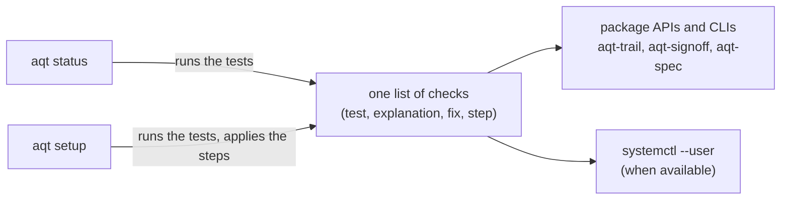

# agent-quality-toolkit — the `aqt` command

Part of the **Agent Quality Toolkit (AQT)**: quality management for AI coding agents. This package installs all eight AQT packages plus `aqt-ui`, and adds one command, `aqt`, on top of them:

- `aqt setup` sets up one machine step by step: the trail, the trail writer as a user service, your signing identity and the basic settings. It is safe to rerun.
- `aqt status` answers in one screen whether everything is in order, and gives the fix for each problem.
- `aqt <tool> …` runs any tool, for example `aqt trail verify` or `aqt ui`.

## The problem

Setting up AQT by hand means following a checklist: create the trail, write a systemd unit, start the writer, enrol a signing key, write two settings files, and then check each of these. A step that is forgotten often fails silently, for example records that go to a side file instead of the trail. `aqt` turns that checklist into code that checks itself.

## 60-second quick start

From a clone of the repository (the packages are not on PyPI yet):

```bash
uv venv .venv
uv pip install --python .venv/bin/python -e "aqt-spec[schema]" -e aqt-trail -e aqt-signoff -e aqt-change \
    -e aqt-sensei -e aqt-quarantine -e aqt-validate -e aqt-capa -e aqt-ui -e aqt-cli
.venv/bin/aqt status          # what is missing
.venv/bin/aqt setup           # do it, step by step
```

`aqt setup` asks before each step. `aqt setup --yes` applies every step that does not need you without asking. Enrolling your signing identity always needs you: you choose the ID (or pass `--id human:alice --name "Alice Example" --role quality-manager`) and type the passphrase at aqt-signoff's own prompt, also under `--yes`.

## How it works



Each check has a result (`ok`, `warn`, `fail` or `skip`), a one-line explanation and the fix as a command. `aqt status` prints them; `aqt status --json` returns `{"verdict": …, "checks": [{"id", "result", "explanation", "fix"}, …]}`. The exit code is 0 when no check failed (warnings allowed), 1 when one failed, and 2 for a usage or runtime error.

| Check | Tests | Step in `aqt setup` |
|---|---|---|
| `packages` | the eight packages and aqt-ui are installed (with versions) | – (prints the install command) |
| `trail.init` | the trail state exists | `aqt-trail init` |
| `service` | the systemd user unit is installed and enabled (skipped without `systemd --user`) | writes `~/.config/systemd/user/aqt-trail.service` with the `aqt-trail` of this environment, then `systemctl --user enable --now aqt-trail` |
| `writer` | the writer answers on its socket | `systemctl --user start aqt-trail`; without systemd it prints the foreground command |
| `spool` | no records wait in the spool | `aqt-trail drain` |
| `sink` | where records go; a fallback to the side file is a warning | – |
| `signer` | a signer with an active key is enrolled | `aqt-signoff init` (needs you) |
| `signoff.config` | `signoff.toml` names an enrolled signer | writes `signoff.toml` (signer, the system's time zone) |
| `trail.config` | `trail.toml` sets the review time zone and hours | writes `trail.toml` with defaults |
| `trail.intact` | the last record is signed by the service key and matches the writer's head and the last checkpoint; `--verify` checks the whole trail | – |
| `vectors` | the record library agrees with the specification's test vectors | – |

`aqt setup` applies the steps in this order and checks each one again just before it, so a step that is already done is skipped. It never overwrites keys, the signer registry or an existing file: a settings file or unit that exists is left as it is.

Pass-through: `aqt trail`, `aqt signoff`, `aqt change`, `aqt sensei`, `aqt quarantine`, `aqt validate`, `aqt capa`, `aqt ui` and `aqt spec` (or `aqt evidence`) run that tool's command line in the same process, with the same arguments and exit code. A tool that is not installed prints its install command.

## Threat model and limits

- **Status is a quick look, not a verification.** Without `--verify`, `trail.intact` checks only the end of the trail (the last record, the writer's head, the last checkpoint). A change in the middle of the log is found by `aqt status --verify` or `aqt-trail verify`.
- **Same-user agents.** An agent running as you can run `aqt setup` too. It cannot enrol a signer without the passphrase prompt, and the enrolment is recorded, as with `aqt-signoff init`. Keep agents out of `~/.config/aqt` (see the manual).
- **Separate-user mode** (manual 3.8) is not set up by `aqt setup`. When a writer answers but this account has no trail state, `aqt status` reports the external writer and does not offer a user service.
- **Linux only**, like the rest of the toolkit. Without `systemd --user` (some containers, WSL) you start the writer yourself.

## Regulatory status

*Agent Quality Toolkit supports quality-management practices; it is not a validated system and does not by itself make any process compliant with GMP, GDP, 21 CFR Part 11 or EU Annex 11.*

## Licence

Apache-2.0 (see `LICENSE` and `NOTICE`).
