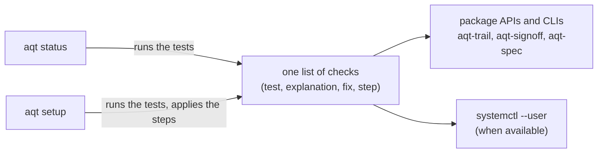

# agent-quality-toolkit — the `aqt` command

Part of the **Agent Quality Toolkit (AQT)**: quality management for AI coding agents. This package installs all eight AQT packages plus `aqt-ui`, and adds one command, `aqt`, on top of them:

- `aqt setup` sets up one machine step by step: the trail, the trail writer as a user service, your signing identity and the basic settings. It is safe to rerun.
- `aqt status` answers in one screen whether everything is in order, and gives the fix for each problem.
- `aqt project init` sets up one repository where agents work: the Claude Code hooks and deny rules, a short block of agent instructions, aqt-change's project settings. `aqt project status` shows what is in place there. Both are safe to rerun; init never commits.
- `aqt <tool> …` runs any tool, for example `aqt trail verify` or `aqt ui`.

## The problem

Setting up AQT by hand means following a checklist: create the trail, write a systemd unit, start the writer, enrol a signing key, write two settings files, and then check each of these. A step that is forgotten often fails silently, for example records that go to a side file instead of the trail. `aqt` turns that checklist into code that checks itself.

## 60-second quick start

From a clone of the repository (the packages are not on PyPI yet):

```bash
uv venv .venv
uv pip install --python .venv/bin/python -e "aqt-spec[schema]" -e aqt-trail -e aqt-signoff -e aqt-change \
    -e aqt-sensei -e aqt-quarantine -e aqt-validate -e aqt-capa -e aqt-ui -e aqt-cli
.venv/bin/aqt status          # what is missing
.venv/bin/aqt setup           # do it, step by step
```

Then, once in each repository where agents work:

```bash
.venv/bin/aqt project init ~/code/my-project    # asks before each step; --yes applies them all
```

It never commits: its last lines print the `git add … && git commit` command for the files it wrote.

`aqt setup` asks before each step. `aqt setup --yes` applies every step that does not need you without asking. Enrolling your signing identity always needs you: you choose the ID (or pass `--id human:alice --name "Alice Example" --role quality-manager`) and type the passphrase at aqt-signoff's own prompt, also under `--yes`.

## How it works



Each check has a result (`ok`, `warn`, `fail` or `skip`), a one-line explanation and the fix as a command. `aqt status` prints them; `aqt status --json` returns `{"verdict": …, "checks": [{"id", "result", "explanation", "fix"}, …]}`. The exit code is 0 when no check failed (warnings allowed), 1 when one failed, and 2 for a usage or runtime error.

| Check | Tests | Step in `aqt setup` |
|---|---|---|
| `packages` | the eight packages and aqt-ui are installed (with versions) | – (prints the install command) |
| `trail.init` | the trail state exists | `aqt-trail init` |
| `service` | the systemd user unit is installed and enabled (skipped without `systemd --user`) | writes `~/.config/systemd/user/aqt-trail.service` with the `aqt-trail` of this environment, then `systemctl --user enable --now aqt-trail` |
| `writer` | the writer answers on its socket | `systemctl --user start aqt-trail`; without systemd it prints the foreground command |
| `spool` | no records wait in the spool | `aqt-trail drain` |
| `sink` | where records go; a fallback to the side file is a warning | – |
| `signer` | a signer with an active key is enrolled, and every key in the signer registry counts by its enrolment records (`aqt_signoff.check_signers()`, the check behind `aqt-signoff signers check`); see below | `aqt-signoff init` (needs you); the other fixes are printed (below) |
| `signoff.config` | `signoff.toml` names an enrolled signer | writes `signoff.toml` (signer, the system's time zone) |
| `trail.config` | `trail.toml` sets the review time zone and hours | writes `trail.toml` with defaults |
| `trail.intact` | the last record is signed by the service key and matches the writer's head and the last checkpoint; `--verify` checks the whole trail | – |
| `vectors` | the record library agrees with the specification's test vectors | – |

**The `signer` check in detail.** The first person enrolled counts at once; every later enrolment, extra key or role change counts only after an enrolled signer approves it (manual 3.4). The check reports, in this order:

| Result | When | Fix it prints |
|---|---|---|
| `fail` | enrolment records written before the trail existed were not carried into it yet | `aqt-signoff signers import` |
| `fail` | a key waits for approval by an enrolled signer | the approve command, for example `aqt-signoff signers approve human:bob --key ed25519:… --signer <you>` |
| `fail` | a key lacks its enrolment record (for example one made by `aqt-quarantine init`), or its registry entry contradicts the record | `aqt-signoff rekey --signer ID` for a missing record (the key then waits for approval unless it is the first signer); otherwise `aqt-signoff signers check` |
| `warn` | **re-bootstrap**: a key counts although every earlier key was revoked, and no signer whose key counted before it has confirmed it (in practice it stays flagged); the line says when the revocations before it were not signed | `aqt-signoff signers check` |
| `warn` | an enrolment request that is not in the registry waits for approval | `aqt-signoff signers check` |
| `ok` | every key counts; the line names the first signer | – |

Every fix needs a passphrase, so `aqt setup` cannot apply it. Check that the first signer named is you.

`aqt setup` applies the steps in this order and checks each one again just before it, so a step that is already done is skipped. It never overwrites keys, the signer registry or an existing file: a settings file or unit that exists is left as it is.

### In each repository: `aqt project init` and `aqt project status`

`aqt project init [DIR] [--yes] [--local]` and `aqt project status [DIR] [--json]` work the same way, with their own list of checks. `DIR` defaults to the current directory and resolves to the top of its git repository. Only the installed tools count.

| Check | Tests | Step in `aqt project init` |
|---|---|---|
| `project` | the folder is a git repository (aqt-change needs git; without it, its checks are skipped) | – |
| `claude.hooks` (fail) | the hooks of aqt-trail, aqt-quarantine and aqt-change (manual 4.8) are in `~/.claude/settings.json`, `.claude/settings.json` or `.claude/settings.local.json`: same event, matcher and command | merges the missing ones, and the missing deny rules, into `.claude/settings.json` (`settings.local.json` with `--local`) |
| `claude.deny` (warn) | deny rules for every decision command, as `aqt-<tool> <sub>` and `aqt <tool> <sub>` (below), for `aqt-ui`, for reading the quarantine folder, the trail's `keys/` folder and aqt-sensei's owner token, and for editing the AQT configuration and state folders | the same step |
| `instructions` (warn) | `CLAUDE.md` and an existing `AGENTS.md` at the root hold the current block between `<!-- aqt:begin -->` and `<!-- aqt:end -->` | replaces an outdated block, appends a missing one, or creates `CLAUDE.md` (Claude Code does not read `AGENTS.md`); the rest of the file stays as it is |
| `change.settings` | `.aqt/change.toml` parses; warns when `require_trail` is off or `trail_keys` lacks this machine's trail service key | writes it when missing (with `require_trail` and `trail_keys` when the service key is known), never while a plan is in progress |
| `ui.project` (warn) | this repository is in `[changes] projects` of aqt-ui's `ui.toml` | creates the file, appends `[changes]`, or extends a one-line `projects = [...]` |
| `git.hook` (warn) | a git `commit-msg` hook runs aqt-change (optional) | `aqt-change hooks install-git`, only when there is no commit-msg hook |
| `committed` (warn) | the files init wrote in the repository are committed; `.claude/settings.local.json` is ignored by a committed `.gitignore` | – (prints the `git add … && git commit` command) |

The denied decision commands: aqt-quarantine `release`, `declare-threat`, `trust-source`, `init`; aqt-signoff `init`, `signers approve`, `signers import`, `rekey`, `revoke`, `sign`, `invalidate`, `approve`, `reject`, `resolve`; aqt-trail `review sign`; aqt-capa `candidate accept`, `candidate dismiss`, `deviation classify`, `action approve`, `action cancel`, `close`; aqt-validate `qualify`; aqt-sensei `init`, `pair`, `approve`, `discard`, `forward`, `mode`, `budget`, `pause`, `resume`, `end`. aqt-change has none: agents run it. The folder rules use the real `XDG_CONFIG_HOME`/`XDG_STATE_HOME` (`~/…` under the home folder, `//…` elsewhere).

A settings file that is not valid JSON, or whose `hooks`, an event, `permissions` or `deny` has another shape, is refused. Otherwise every other key and the key order are kept; the file is written with 2-space indentation, atomically and with its mode. Every changed file is backed up first to `$XDG_STATE_HOME/aqt/backups/project-init/<repository>-<hash>/` (a file outside the repository, such as `ui.toml`, to `project-init/user/`), outside the repository, because an untracked file in it would make aqt-change receipts stale. An existing `.aqt/change.toml` is never rewritten.

Pass-through: `aqt trail`, `aqt signoff`, `aqt change`, `aqt sensei`, `aqt quarantine`, `aqt validate`, `aqt capa`, `aqt ui` and `aqt spec` (or `aqt evidence`) run that tool's command line in the same process, with the same arguments and exit code. A tool that is not installed prints its install command.

## Threat model and limits

- **Status is a quick look, not a verification.** Without `--verify`, `trail.intact` checks only the end of the trail (the last record, the writer's head, the last checkpoint). A change in the middle of the log is found by `aqt status --verify` or `aqt-trail verify`.
- **Same-user agents.** An agent running as you can run `aqt setup` too. It cannot enrol a signer without the passphrase prompt, and the enrolment is recorded, as with `aqt-signoff init`. A key added to `signers.json` by hand, without its enrolment record, does not count, and the `signer` check fails. An agent can write an enrolment request for a key of its own, but the key stays pending until an enrolled signer approves it with their passphrase. Two cases count without an approval: the very first enrolment (so enrol yourself first and check the first signer that `aqt status` names), and a key enrolled after every other key was revoked (a re-bootstrap, which `aqt status` shows as `warn` until another signer confirms it). Keep agents out of `~/.config/aqt` (see the manual).
- **Separate-user mode** (manual 3.8) is not set up by `aqt setup`. When a writer answers but this account has no trail state, `aqt status` reports the external writer and does not offer a user service.
- **Deny rules are not a boundary.** Claude Code matches a Bash rule against the command as written: `aqt-signoff sign …` is stopped, but `/full/path/aqt-signoff sign …`, `sh -c '…'` or an option before the subcommand (`aqt-trail --json review sign …`) is not, and Read rules do not stop a script that opens the file itself. The decision commands still refuse in an agent session and need the passphrase; for more, use a sandbox (manual 3.7).
- **Linux only**, like the rest of the toolkit. Without `systemd --user` (some containers, WSL) you start the writer yourself.

## Regulatory status

*Agent Quality Toolkit supports quality-management practices; it is not a validated system and does not by itself make any process compliant with GMP, GDP, 21 CFR Part 11 or EU Annex 11.*

## Licence

Apache-2.0 (see `LICENSE` and `NOTICE`).
