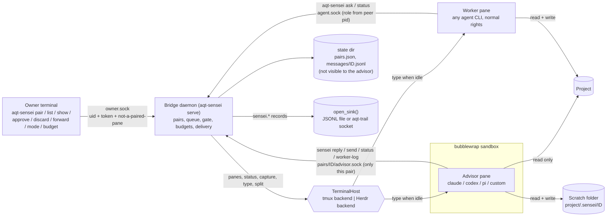

# aqt-sensei — Target Design

**Written:** 2026-10-21 · **Package:** `aqt-sensei` of the Agent Quality Toolkit · **Brief:** `planning/04_designs/SUITE_ARCHITECTURE.md` §2.5 · **Origin:** derived from the author's private Agent Platform Next Sensei bridge (read-only source, copied and adapted; private paths, model presets and the private app removed).

## 1. Introduction

### Core idea and intended result

A coding agent that works alone has no second pair of eyes. `aqt-sensei` gives it one: it pairs a **worker** agent, which does the work with normal rights, with an **advisor** agent ("sensei") of any vendor, which reads the project, diagnoses, plans and reviews, but **cannot change the project because the operating system prevents it**. The two are ordinary, unmodified interactive agent CLIs (Claude Code, Codex, pi, or any configured command) running side by side in terminal panes of **tmux** or **Herdr**. A small local daemon, the **bridge**, relays explicit messages between them, but only when the receiver is idle, and only as far as the human **owner** allows.

The owner decides how much automation is acceptable:
- **manual:** nothing reaches an agent until the owner forwards that message;
- **confirm:** every agent message waits until the owner approves it (optionally edited) or discards it;
- **auto:** messages are delivered when the receiver is idle, until a **budget** runs out; then the pair falls back to confirm and the owner is notified.

Every consultation is evidence. The bridge writes an **advice ledger** of AQT evidence records: who paired which agents under which sandbox profile, what each side sent (content hash plus a short excerpt), what the owner approved, edited, discarded or forwarded, with name, time and reason, when a budget was used up, and every refused attempt to act as the owner. With `aqt-trail` as the sink, the ledger becomes part of a tamper-evident audit trail.

**Users:** a solo developer or small team that already runs coding agents in tmux or Herdr and wants an independent advisor with enforced limits and a record of the advice; a quality-minded reviewer who must later answer "who advised what, and who let it through?".

**End to end, in plain language:**
1. The owner starts the bridge (`aqt-sensei serve`), then pairs an existing worker pane with an advisor command: `aqt-sensei pair --worker %3 --advisor claude --project ~/code/app`.
2. The bridge splits the worker's pane, launches the advisor inside a bubblewrap sandbox (project read-only, its own scratch folder writable, private agent configuration, no access to the bridge state, the owner's configs or credentials), and introduces the advisor to the worker.
3. When stuck, the worker runs `aqt-sensei ask "tests fail after two approaches; notes in notes.md"`, then ends its turn. The bridge attaches a short context digest, applies the mode and budget, and types the message into the advisor pane once it is idle.
4. The advisor reads the project, may search the web, writes a plan into its scratch folder and answers with `sensei reply "root cause …" --file PLAN.md`. The bridge delivers the answer to the worker when it is idle.
5. Throughout, the owner sees pending messages (`aqt-sensei list`, `show`), decides with `approve|discard|forward --reason`, and can change the mode or budget, pause or end the pair. Every step lands in the ledger.
6. `aqt-sensei doctor` proves, inside the same sandbox, that the advisor cannot write the project or reach owner files, sockets or tokens.

**Inputs:** a terminal pane running a worker agent; an advisor platform or command; a project folder; mode and budget; the owner's decisions. **Outputs:** messages typed into the two panes; advisor files in the scratch folder; pair and message state; evidence records (`sensei.pair`, `sensei.message`, `sensei.decision`, `sensei.budget`, `sensei.refused`) in the configured sink.

### Functionality and performance intent

- **Enforced, not requested, read-only access.** The advisor's limits hold when its model ignores its instructions (for example after a prompt injection from a web page). The prompt describes the limits; the kernel enforces them.
- **Never interrupt a busy agent.** Delivery waits for the receiver to be idle; an agent that is working or blocked at an approval dialog is never typed into. A message is delivered within a few seconds after the receiver becomes idle (poll interval about 1.5 s; proposed, not measured).
- **The owner stays in control.** Owner operations are authenticated; an agent cannot approve its own messages, switch a pair to auto, or lift a budget. Manual mode never delivers on its own.
- **Honest states.** Failed deliveries, a turn that ended without a reply, and refused operations are recorded, not hidden. Nothing is retried blindly beyond a small delivery retry count.
- **Cost under control.** The advisor runs only when asked, when the owner writes to it, or when it plans. Budgets count messages, exchanges and an optional declared cost; owner messages never count.
- **Light footprint.** One stdlib-plus-`cryptography` Python daemon; no network listeners; no GPU; the poll costs one host CLI call per tick.
- **Not included:** more than one advisor per worker, advisor chains, multi-user operation, a GUI, cost metering from provider APIs, macOS sandboxing.

### Design flexibility

This document defines the intended functionality and suggests a practical route toward it. The implementing worker may adapt technologies, algorithms, component boundaries, data structures and implementation order to the actual circumstances; small deviations are allowed when the core outcomes stay intact: any-vendor advisor, OS-enforced read-only access, owner-controlled modes and budgets, authenticated owner operations, and the advice ledger. Prefer a simpler working approach over literal conformity to the proposed architecture. Do not silently remove a core feature or hide a material limitation; core-target trade-offs go to the lead architect. Ordinary adaptations need no approval or deviation report.

> **Implementation workflow.** All implementation guided by this design uses `lean-vertical-delivery` (small end-to-end slices, proportionate checks, a small completion report; no separate testing or documentation regime). Work is tracked in Project Tracker Next (project "Agent Quality Toolkit", one implementation for this package) through its low-call lifecycle. This package has no interactive UI; if one is added later, it is designed with `ui-studio`. When the same functionality fails repeatedly despite a reassessed approach, consult a Sensei with the intended behaviour, the attempts and the specific help needed.

## 2. Proposed architecture

The package keeps the proven shape of the original bridge (daemon + agent command + sandboxed launcher) and changes four things: a **terminal-host interface** with tmux and Herdr backends instead of hard-wired Herdr calls; **three sockets with different rights** instead of one socket that served everyone; a **sandbox profile built from configuration** with a private agent home and a cleared environment; and an **advice ledger** of AQT records instead of a private JSONL log.

### Proposed structure and data flow



**The arrows.** Each socket grants a fixed set of operations; the role comes from which socket was used and from the caller's observed process, not from a self-declared pane id. The bridge only types into panes through the terminal host, and only after the host reports the receiver idle. Full message texts stay in the bridge's private state; the sink receives hashes and short excerpts. The advisor sees the project read-only, its scratch folder, its own pair's advisor socket and, for Herdr, a filtering proxy that forwards only its own lifecycle reports.

**Modules (suggested, not binding).**

| Module | Responsibility | Origin |
|---|---|---|
| `bridge.py` | Pairs, messages, gate, budgets, exchange accounting, delivery, turn tracking, intro text, rendering | Adapted from `scripts/herdr/sensei_bridge.py` (about 70 % reusable) |
| `server.py` | `serve`: threaded Unix-socket servers for owner, worker and advisor sockets, `SO_PEERCRED`, owner checks, poll loop | Adapted from `sensei_bridge.py` (`_Server`, `serve`) |
| `hosts/` (`base.py`, `tmux.py`, `herdr.py`, `fake.py`) | `TerminalHost` interface and backends | Herdr backend from the `Herdr` class in `sensei_bridge.py`; tmux new |
| `sandbox.py` | Platform profiles (data), bwrap argument builder, environment allow-list, Herdr report proxy | Adapted from `scripts/herdr/sensei_launch.py` and the private-config idea in `analyst_launch.py` |
| `launch.py` | `aqt-sensei launch --pair ID`: renders the prompt, starts the proxy, `exec`s bwrap | From `sensei_launch.py` `main` |
| `agent.py` | Stdlib-only agent client (`ask`, `reply`, `send`, `status`, `worker-log`); also written as the in-sandbox `sensei` shim | From `scripts/herdr/sensei_cli.py` |
| `ledger.py` | Builds `sensei.*` records with `aqt_evidence`, writes them through `open_sink()`, spools on sink failure | New |
| `doctor.py` | Host, tool and sandbox checks; the in-sandbox probe | New |
| `config.py`, `cli.py` | TOML config, XDG paths, argparse CLI | New |
| `prompts/advisor.md`, `prompts/worker_intro.md` | Role, limits, protocol, method (lean principles, generic wording) | From `scripts/herdr/sensei_prompt.md` and `intro_text()` |

**Storage.**
- **Config:** `$XDG_CONFIG_HOME/aqt/sensei.toml` (backend, poll interval, default mode and budgets, owner id and display name, platform profiles, extra read-only binds, environment allow-list, network). Owner token: `$XDG_CONFIG_HOME/aqt/sensei/owner.token` (0600), created by `aqt-sensei init`.
- **State:** `$XDG_STATE_HOME/aqt/sensei/` (0700): `pairs.json` (atomic replace; includes open turns so a restart keeps them), `messages/<pair>.jsonl` (every message version, last record per id wins, as in the original), `ledger-spool.jsonl` (records not yet accepted by the sink), `homes/<platform>/` (private advisor agent homes with their own sign-in).
- **Runtime:** `$XDG_RUNTIME_DIR/aqt-sensei/` (0700; fallback under the state dir): `owner.sock`, `agent.sock`, `pairs/<pair>/advisor.sock`, `pairs/<pair>/herdr.sock` (proxy), `panes/<pane>.state` (hook-reported agent state for tmux).
- **Scratch folder:** `<project>/.sensei/<pair>/` with a `.gitignore` of `*` (configurable path).

**How records are written.** `ledger.py` builds each record with `aqt_evidence.new_record`, sets the actor (owner `human:<id>`, agents `agent:<harness>:<session or pane ref>`, the bridge `service:aqt-sensei`) and puts the caller's observed process into `data.peer`, with the field names of the trail's `observed` object (INTERFACES I2: `pid`, `uid`, `gid`, `process_chain`, `processes`, `harness`, `client_time`, `via`); the envelope's `observed`, `chain` and `sig` are left to aqt-trail. It appends through `open_sink()` (`AQT_SINK` or the configured spec). Owner decisions are **record-first**: if the sink refuses the record, the decision is not applied and the owner sees the error. When aqt-trail is merely unreachable, `SocketSink` spools the record durably (I3) and the decision proceeds; the trail marks the gap when it drains (lead decision, 2026-10-21). Automatic events (delivery, failure, budget fallback, refusals) are spooled locally and retried on the next tick; `list` shows how many records wait, so nothing is silently lost.

**Reused from Agent Platform Next** (read-only, repository-relative): `scripts/herdr/sensei_bridge.py` (store, gate, budget, exchange accounting, delivery loop, render/header, intro, Herdr CLI wrapper), `scripts/herdr/sensei_cli.py` (socket client, exit codes, shell-sandbox hint), `scripts/herdr/sensei_launch.py` (bwrap layout, Claude/Codex flags, Codex home config, Herdr report proxy), `scripts/herdr/sensei_prompt.md`, `scripts/herdr/analyst_launch.py` (private `CLAUDE_CONFIG_DIR`), `scripts/herdr/test_sensei_bridge.py` and `test_sensei_launch.py` (FakeHerdr and argv-assertion test technique), `docs/implementations/sensei-bridge/Design.md` (behaviour). Not copied: the native history readers (2,700 lines, fast-changing formats), the Project Tracker reconcile, pi-omni specifics, the Flutter app adapter, the shell resume hook.

**Used from open source (external programs, not linked or copied):** tmux (ISC), Herdr (Apache-2.0, its CLI and socket protocol), bubblewrap (LGPL-2.0-or-later, executed as a system binary; no code copied or linked). Ideas only, with attribution in the README: crew (MIT), pi-blanche (MIT), codex-plugin-cc (Apache-2.0), steipete/oracle (MIT), Anthropic's advisor tool (proprietary API).

### One exchange in confirm mode

```mermaid
sequenceDiagram
    participant W as Worker pane
    participant B as Bridge
    participant L as Ledger sink
    participant O as Owner terminal
    participant H as TerminalHost
    participant A as Advisor (bwrap)
    W->>B: ask "…" --file notes.md (agent.sock, peer pid → worker of pair P)
    B->>B: digest from worker pane capture; gate: confirm → awaiting_approval
    B->>L: sensei.message enqueued (sha256, excerpt, files with hashes)
    B-->>W: "Queued for the owner's approval. End your turn now."
    O->>B: show M (rendered text exactly as it will be typed)
    O->>B: approve M --reason "clear question" (owner.sock, token, not a paired pane)
    B->>L: sensei.decision approved (actor human, reason, links M)
    loop every poll
        B->>H: pane status
    end
    B->>H: type "[Worker → Sensei · 1/8] …" into A when idle
    B->>L: sensei.message delivered; sensei.budget consumed 1/8
    A->>A: reads project, searches web, writes PLAN.md in scratch
    A->>B: sensei reply "…" --file PLAN.md (advisor.sock of pair P)
    B->>L: sensei.message enqueued (reply, exchange 1)
    O->>B: approve or edit --reason (before/after hashes recorded)
    B->>H: type "[Sensei → Worker · 1/8] …" into W when idle
    B->>L: sensei.message delivered
```

### 2.1 Core concepts

**Pair.** One worker pane and one advisor pane on one backend, with a project folder, a scratch folder, a sandbox profile (and the hash of the exact bwrap argument list), a mode, budgets, counters and a state (`starting → active ⇄ paused → ended`, as in the original). The pair also records an **independence class** derived from the two sides: `same-model`, `same-vendor` or `different-vendor` (crew's insight that same-model pairs share blind spots; aqt-change uses similar classes for reviews). The class is recorded, not enforced, in the MVP.

**Message and exchange.** Kinds: `intro` (bridge → worker), `prompt` (owner → either side), `ask` (worker → advisor), `reply` and `send` (advisor → worker), `notice` (bridge → worker, e.g. "the advisor ended its turn without a reply"). An **exchange** is one ask and its reply, or one unsolicited send; it is numbered when delivered (`exchanges_used + 1`), and a reply closes the open ask. This accounting is copied unchanged.

**Message states and the gate.**

```mermaid
stateDiagram-v2
    [*] --> queued: owner/bridge message, or agent message in auto with budget left
    [*] --> awaiting_approval: agent message in confirm, or budget used up
    [*] --> held: agent message in manual
    awaiting_approval --> queued: approve (text may be edited) / mode set to auto
    held --> queued: forward (only this; mode changes never release held messages)
    queued --> delivered: receiver idle and the host accepted the input
    queued --> failed: fifth failed delivery
    queued --> discarded: discard or pair ended
    awaiting_approval --> discarded: discard or pair ended
    held --> discarded: discard or pair ended
```



Manual and confirm now differ in substance (A4 gap 6): in **manual**, the owner forwards each message individually and no mode change releases it; in **confirm**, the owner approves, edits or discards, and switching to auto releases waiting messages, with the budget checked again at delivery.

**Budgets.** Three optional limits per pair: `max_messages` (agent messages delivered, both directions), `max_exchanges` (rounds), and `max_cost` (an integer in minor units, from a declared per-exchange estimate in the profile and/or owner entries with `budget --add-cost`; never metered from provider APIs). In auto mode, a message that would exceed any limit switches the pair to confirm, writes `sensei.budget reached`, notifies the owner (Herdr notification or tmux `display-message`; always a pair note) and waits. Owner and bridge messages never count.

**Idle detection.** The bridge delivers only to a receiver in `idle` or `done`.
- **Herdr:** the agent status Herdr already reports from its hook integrations (`idle|working|blocked|done|unknown`).
- **tmux:** first, a hook-reported state file per pane: `aqt-sensei hook-state working|idle|blocked`, called from agent hooks (a ready Claude Code snippet: `UserPromptSubmit` → working, `Stop` → idle, `Notification` for permission prompts → blocked; Codex and pi hooks documented where their hook systems allow it). Without hooks, a heuristic: the pane's visible content has not changed for a quiet period (default 3 s) **and** its last lines match the profile's prompt pattern. Anything else is `unknown`, and unknown never receives input.

**Delivery.** Herdr: `herdr agent prompt <pane> <text>` (rejects a blocked agent before sending input). tmux: `load-buffer` from stdin, `paste-buffer -p` (bracketed paste, so text is not interpreted as keys) into the pane, then `send-keys Enter`. A host error counts as a failed attempt; after five the message is `failed` and recorded.

**Context digest and worker log.** The original built both from the agents' native transcripts. To stay vendor-neutral without copying the transcript readers, the MVP uses the terminal host: the last N lines of the worker pane's scrollback (`tmux capture-pane -p -S -N` / `herdr pane read`), stripped of control sequences and clipped (4,000 characters for the digest, 20,000 for `worker-log`). It is less clean than a transcript, but available for every agent. Transcript-based digests can follow by reusing aqt-trail's importers.

**Turn ends without a reply.** The bridge tracks the turn it started in the advisor pane (persisted in `pairs.json`, fixing the lost-turn gap). If the turn ends with the ask still open, the bridge records `sensei.message no-reply`, sets a pair note and queues a short `notice` to the worker (through the gate, so confirm and manual still apply), instead of guessing an answer from screen text. Transcript-based fallback replies are a later stage.

**The three sockets and owner authentication** (A4 gaps 1 and 8).
- `advisor.sock` exists per pair, inside a runtime folder bound read-only into that pair's sandbox only. A connection means "the advisor of this pair". Allowed: `reply`, `send`, `status`, `worker_log`.
- `agent.sock` is for workers. The caller's pane is derived from the peer pid (`SO_PEERCRED`) by walking `/proc/<pid>` ancestry up to a paired worker pane's root process (`#{pane_pid}` in tmux, `shell_pid` from `herdr pane process-info`). A declared pane id is only a hint and must match. Allowed: `ask`, `status`.
- `owner.sock` is not visible in any sandbox. Every request must pass: the peer uid equals the daemon's uid; the request carries the owner token (compared in constant time); the peer process is **not** a descendant of any live paired pane; it carries no agent-session markers (the shared `aqt_evidence.detect_agent_context`, applied to the peer's `/proc/<pid>/environ` and process names, which includes `AQT_AGENT_SESSION=1`); and its standard input is a terminal that does not belong to a paired pane. A failed check is refused and recorded as `sensei.refused` (INTERFACES I5) with the reason code and the observed process. Owner decisions require `--reason`. Limit (accepted for the MVP): a determined same-user process outside the pairs that reads the token and detaches from its parents is not stopped.

**Sandbox profile** (A4 gaps 2–4).
- **System:** `--unshare-all --share-net --die-with-parent --clearenv` (no `--new-session`: the advisor is an interactive CLI that keeps its own pane's terminal as controlling terminal); read-only `/usr`, `/etc`, `/opt`, `/bin`, `/lib*`; fresh `/proc` and `/dev`; tmpfs over `/tmp`, `/run` (resolver folder re-bound read-only) and `/home`, then an empty `$HOME`.
- **Visible:** the project read-only; the scratch folder read-write; this pair's runtime folder read-only (its `advisor.sock`, the Herdr proxy); the advisor CLI's resolved install folder read-only; the platform's **private** home under `homes/<platform>/` read-write (never the owner's `~/.claude`, `~/.codex` or `~/.pi`); a generated `sensei` shim on `PATH`; configured extra read-only binds (e.g. a skills folder).
- **Not visible:** the bridge state folder, other pairs' runtime folders, the owner token and config, other platforms' homes, the tmux socket, the real Herdr socket, the owner's home.
- **Environment:** cleared, then `HOME`, `PATH`, `LANG`, `LC_ALL`, `TERM`, `COLORTERM`, `TZ`, the profile's own variables (`CLAUDE_CONFIG_DIR`, `CODEX_HOME`, …), `AQT_SENSEI_SOCKET`, `AQT_SENSEI_ROLE`, `AQT_SENSEI_PAIR`, `AQT_AGENT_SESSION=1` (also set in the split pane, so shared AQT human checks refuse anything started there), Herdr's pane variables pointing to the proxy, and an explicit allow-list (for example an API key a pi advisor needs).
- **Network:** `share` by default (model API and web search need it); `none` is available for local models over a socket or for checks. An outbound-only namespace is later work.
- **Platform profiles** are data (built-in TOML, overridable): command template with `{prompt_file}`, `{scratch}`, `{project}`, `{session}`; how the prompt is supplied (Claude `--append-system-prompt-file`; Codex and pi `AGENTS.md` in the scratch folder); flags that switch off the CLI's own approval prompts and nested sandbox inside bwrap (Claude `--permission-mode bypassPermissions --strict-mcp-config --settings {"sandbox":{"enabled":false}}`; Codex `-s danger-full-access -a never --search`); environment; prompt pattern for tmux idle detection; declared cost per exchange. A `custom` profile runs any command.
- **Sign-in:** `aqt-sensei login <platform>` runs the CLI inside the sandbox with only the private home writable (Claude Code interactively for `/login`, Codex `login --device-auth`), so advisor credentials are separate from the owner's.

**Herdr report proxy.** Copied: a child process listens on `pairs/<pair>/herdr.sock`, bound at `HERDR_SOCKET_PATH` inside the sandbox, and forwards only `pane.report_agent`, `pane.report_agent_session` and `pane.release_agent` for the advisor's own pane; everything else gets `forbidden`. Without it, Herdr's own hooks inside the sandbox could not report the advisor's lifecycle; with the real socket the advisor could type into any pane.

**Doctor.** `aqt-sensei doctor` checks the host (bwrap present and able to create user namespaces, which Ubuntu's AppArmor restriction can block; tmux or Herdr reachable; the CLI found), then runs a stdlib probe **inside the exact sandbox of a pair or profile**: writing into the project fails; the owner's home, token, config, state folder, `owner.sock`, `agent.sock` and other pairs' folders are invisible; the environment holds only allowed names; `advisor.sock` answers `status`; the CLI starts (`--version`). Each check prints PASS/FAIL with the evidence; exit 1 on any FAIL. The result is recorded as `sensei.pair` action `doctor` with the profile hash.

### 2.2 Interfaces

**CLI `aqt-sensei`** (argparse; `--json` for machine output; exit 0 ok, 1 refused or check failed, 2 usage, runtime error or bridge offline).

| Command | Caller | Effect |
|---|---|---|
| `init [--owner-id ID --display NAME]` | owner | Writes an example config if missing and creates the owner token |
| `serve` | owner (foreground; systemd user unit example in `examples/`) | Runs the daemon, its sockets and the poll loop |
| `pair --worker PANE --advisor PLATFORM\|CMD --project DIR [--backend tmux\|herdr] [--mode M] [--max-exchanges N] [--max-messages N] [--max-cost N] [--model ID] [--name N] [--network share\|none] [--first-prompt TEXT --start-with worker\|advisor] --reason R` | owner | Splits the pane, launches the advisor, queues the intro; prints the pair id |
| `list [--pair ID]` · `show MSG` | owner | Pairs, pending and recent messages; `show` prints the rendered text exactly as it will be typed (oracle-style payload preview) plus original and edited versions |
| `approve MSG --reason R [--text T \| --edit-file F]` · `discard MSG --reason R` · `forward MSG --reason R` | owner | Gate decisions (forward is the manual-mode release) |
| `mode PAIR manual\|confirm\|auto --reason R` · `budget PAIR [--max-* N] [--clear] [--add-cost N] --reason R` · `pause PAIR` · `resume PAIR` · `end PAIR --reason R` | owner | Pair control |
| `doctor [--pair ID \| --profile P --project DIR]` | owner | Host and sandbox proof |
| `login PLATFORM` | owner | One-time sign-in of the private advisor home |
| `launch --pair ID [--resume] [-- CMD…]` | bridge (inside the advisor pane) | Builds the sandbox and `exec`s the advisor (or `CMD` for checks) |
| `ask TEXT [--file P]…` · `status` | worker agent | Agent operations on `agent.sock` |
| `hook-state working\|idle\|blocked [--pane P]` | agent hooks (tmux backend) | Writes the pane state file |

Inside the sandbox the advisor uses the generated stdlib-only shim: `sensei reply|send TEXT [--file P]…`, `sensei status`, `sensei worker-log [--last N]` (same exit codes; exit 2 with a hint when the caller's own shell sandbox blocks the socket, kept from the original).

**Python API (suggested).** `Bridge(store, host, ledger, clock)` with `handle(role, request, peer)` and `tick()`; `TerminalHost` protocol: `panes() -> dict[pane_id, PaneInfo(status, root_pid, tty, session, title)]`, `capture(pane, lines)`, `deliver(pane, text)`, `split(pane, cwd, env) -> pane_id`, `run(pane, argv)`, `close(pane)`, `notify(title, body)`; `build_sandbox(pair, profile, paths) -> list[str]` (pure, testable); `Ledger(sink, spool)` with `pair()`, `message()`, `decision()`, `budget()`.

**Socket protocol.** One JSON line per connection, `{"op": …, …}` → `{"status": "available", …}` or `{"status": "error", "message": …}` (kept from the original so the agent shim stays tiny). Owner requests add `"token"`. Message text at most 64 KiB; long content goes in files.

**Record types and `data` payloads** (all with `subject`, and `links` to the pair record; texts as `sha256` + excerpt of at most 280 characters, never inline).

| Type | Actions | Actor | Key `data` fields |
|---|---|---|---|
| `sensei.pair` | `attached`, `updated`, `paused`, `resumed`, `ended`, `doctor` | owner, or `service:aqt-sensei` for automatic pauses | `pair_id`, `backend`, `state`, `worker {pane_id, platform, model}`, `advisor {pane_id, platform, model, profile}`, `profile_sha256`, `sandbox_argv_sha256`, `network`, `mode`, `budget`, `used`, `independence`, `project_sha256` (path hash), `doctor {checks, passed}`, `peer`; envelope `before`/`after` for mode changes (budget changes are `sensei.budget set`) |
| `sensei.message` | `enqueued`, `delivered`, `failed`, `no-reply` | the sending agent, owner or bridge | `pair_id`, `message_id`, `seq`, `from`, `to`, `kind`, `exchange`, `state`, `excerpt`, `files [{path, sha256 \| null}]`, `digest_sha256`, `rendered_sha256` (exactly what was typed), `attempts`, `edited`, `peer` (I2 field names) |
| `sensei.decision` | `approved`, `edited`, `discarded`, `forwarded` | owner (`human:<id>`) | binding (I6): `decision` (`approve`\|`edit`\|`discard`\|`forward`), `message_id`, `pair_id`; plus `kind`, `from`, `to`, `peer`; envelope `meaning` approved / rejected / released, `reason`, `before`/`after` hashes and excerpts for edits |
| `sensei.budget` | `consumed`, `reached`, `set`, `cost-added` | `service:aqt-sensei` or owner | `pair_id`, `messages_used`, `exchanges_used`, `cost_used`, the limits, `mode`; `limits_hit`, `fallback_mode` when reached; `before`, `added_cost` for owner changes |
| `sensei.refused` | `refused` | the claimed actor (owner for owner-socket attempts, the agent otherwise) | I5: `attempted_action`, `reason_code` (`uid`, `token`, `paired-pane`, `agent-session`, `no-terminal`, `paired-terminal`, `op-not-allowed`, `not-paired`, `pane-mismatch`), `agent_markers`, `peer`, `pair_id` |

### 2.3 Stack and method table

| Area | Choice | Why | Trade-offs | Alternative |
|---|---|---|---|---|
| Language and deps | Python ≥ 3.11, stdlib + `aqt-spec` (+ `cryptography` through it) | Suite rule; the original is stdlib only | Threads and subprocess calls, no async | None needed |
| Terminal hosts | `TerminalHost` interface; tmux CLI (default) and Herdr CLI backends | tmux is everywhere; Herdr has real agent lifecycle detection | Two code paths; host CLIs change | zellij later via the same interface |
| Idle detection (tmux) | Hook-reported state file, then quiet period + prompt pattern | Hooks are exact where they exist; the heuristic covers the rest | Heuristic can misjudge long silent thinking; unknown blocks delivery | Herdr backend whenever exact lifecycle matters |
| IPC and roles | Three Unix sockets (0600, folders 0700), `SO_PEERCRED`, `/proc` ancestry | Rights follow the socket and the observed process, not a declared id | Linux-specific; `/proc` reads per request | One socket with per-pane tokens (more secrets to hand out) |
| Owner authentication | Uid + token file + not-a-paired-pane + terminal check | Closes the self-approval and sandbox paths found in A4 with little code | A determined same-user process outside the pairs can read the token | Passphrase per decision, or the daemon under a separate Unix user (later) |
| Sandbox | bubblewrap as an external binary, profile as data | Proven in the original on three CLIs; kernel-enforced | Linux only; AppArmor user-namespace limits on Ubuntu; CLIs' own sandboxes must be switched off inside | anthropic sandbox-runtime (Apache-2.0) if macOS support becomes a goal; the CLIs' native read-only modes as weaker fallback |
| Advisor homes | Private per-platform home under the state dir | Advisor never sees the owner's transcripts or credentials (A4 gap 3) | One sign-in per platform; advisors of the same platform share a home | Per-pair homes with copied credentials |
| Digest | Pane scrollback capture | Works for every agent, no transcript parsers | Includes TUI noise; limited by scrollback | Transcript readers from aqt-trail importers |
| State | JSON file + per-pair JSONL message log | Small, inspectable, copied | Whole log loaded at start | SQLite if pairs become many |
| Evidence | `aqt_evidence.new_record` + `open_sink()`; record-first for owner decisions, local spool for automatic events (until `SocketSink` spools itself, I3) | One suite-wide model; works with or without aqt-trail | Excerpts can still reveal content | Hash-only mode (config flag) |
| Config | TOML via `tomllib`, XDG paths, every path overridable by flag/env | Suite convention | — | — |
| Tests | pytest; fake tmux/Herdr hosts; bwrap argv asserted; real sockets in temp dirs; real tmux and bwrap only in opt-in tests on their own session | Offline and deterministic; never touches the owner's panes | Fakes can drift from real CLIs | Opt-in integration tests close that gap |

### 2.4 QM mapping, threat model and limits

**QM mapping** (the package *supports* these practices; it does not make a process compliant).

| Feature | QM concept | Reference (paraphrased) |
|---|---|---|
| Worker performs, advisor cannot write, owner releases | Segregation of duties, four-eyes principle | GMP "performed / checked / approved"; ISO 9001:2015 8.5.1 (controlled conditions) |
| Read-only enforced by the OS, not the prompt | Technical control instead of procedural control | EU GMP Annex 11 (2011) §12.1 (access controls); 21 CFR 11.10(d) (limit access to authorised individuals) |
| Owner authentication; agents refused and recorded | Authority checks | 21 CFR 11.10(g); Annex 11 (2011) §12.1–12.3 |
| Ledger of every message version, decision, refusal | Audit trail of who, what, when, why | Annex 11 (2011) §9, audit-trail section of the 2025 draft; 21 CFR 11.10(e); ALCOA++ attributable, contemporaneous, original, complete |
| Edit keeps original and released hash | Changes do not obscure the original entry | 21 CFR 11.10(e); ALCOA++ original, accurate |
| Decisions carry meaning and reason | Meaning of a signature-like act | 21 CFR 11.50 (concept; not an electronic signature); aqt-signoff can co-sign later |
| Modes, budgets with fallback to confirm, pause and end | Human oversight with ability to intervene | EU AI Act Art. 14; draft EU GMP Annex 22 (human in the loop) |
| `doctor` proof of the sandbox | Verification that a control works as intended | ISO 9001:2015 7.1.5 (fitness of monitoring resources); qualification idea (aqt-validate) |
| Independence class per pair | Independence of the reviewer | ISO 9001:2015 9.2.2 (objectivity of auditors), by analogy |

**Threat model.**
- **Assets:** project integrity; the owner's credentials, transcripts and configs; the owner's decisions; the ledger.
- **In scope:** an advisor whose model ignores its instructions (e.g. after injected web content) — it cannot write the project, reach owner sockets, the token, the bridge state, other pairs or the owner's agent homes; a worker agent that tries to approve its own messages, switch to auto or lift a budget through the CLI — refused by the pane-descendant and terminal checks and recorded.
- **Limits, stated honestly:**
  - **Read-only is not confidentiality.** With the network shared, an advisor can send anything it reads in the project to the internet, and the advisor's model vendor sees what it reads. Loopback services and abstract Unix sockets of the host network namespace remain reachable.
  - A same-user process **outside** the paired panes that deliberately reads the token and detaches from its parent can act as the owner. The checks stop accidents and naive self-approval, not a determined local adversary; root and kernel escapes are out of scope.
  - The owner typing directly into a pane bypasses the bridge and is not recorded.
  - Idle detection on tmux without hooks is heuristic; a wrong "idle" can type into a silently thinking agent (bracketed paste limits the damage to an extra queued prompt).
  - The bridge's own state files are writable by the owner's user; tamper evidence comes from aqt-trail, not from this package.
  - During an aqt-trail outage, owner decisions are spooled rather than blocked; the spooled records carry no trail attribution or chain until aqt-trail drains them behind a `trail.gap` marker. Blocking the owner would be worse than a marked gap.
  - Linux only; Ubuntu's AppArmor can block bwrap user namespaces in some contexts (doctor detects and explains, config can point to a permitted bwrap binary).
  - Advisors of the same platform share one private home and can read each other's sessions.

### 2.5 Novelty and prior art

| Project | What it does well | What aqt-sensei adds or does differently |
|---|---|---|
| **crew** (MIT, Herdr skill) | Lead/partner in sibling panes; refuses same-model pairs; round cap 3; lead records outside the workspace so the worker cannot forge them | OS-enforced read-only advisor (crew relies on the skill), owner modes and budgets, a structured ledger, tmux as well as Herdr. We adopt the independence idea as a recorded class |
| **pi-blanche, pi-meta-harness** (MIT) | Escalate to an expensive advisor only when stuck; advisor/maker/checker roles; durable files | Any vendor in either role (they are pi-only), sandbox, ledger. Same "expensive intelligence decides, cheap agents execute" economics |
| **codex-plugin-cc** (Apache-2.0) | Read-only Codex reviews from Claude Code; optional Stop-hook review gate | Persistent advisor session that can read the whole project; human gate and budgets instead of a gate that can loop and drain limits; vendor-neutral; record of every exchange |
| **Anthropic advisor tool** (proprietary API) | Executor-chosen timing, short advice, full transcript context; `max_uses` per request only | CLI-to-CLI across vendors, advisor with read tools and web, client-side conversation budgets with fallback, an auditable record; no API-level integration |
| **steipete/oracle** (MIT) | Shows the exact payload before sending | Adopted as `show`: the owner sees exactly what will be typed before approving |
| **Agent Platform Next Sensei bridge** (origin, private) | Working Herdr pairing with modes, budgets, bwrap, report proxy | Fixes the gaps found in A4: authenticated owner operations, isolated state and homes, cleared environment, approval metadata, real manual mode, persisted turns; adds tmux and the ledger |

Honest position: advisor pairing is a crowded micro-niche (R1 §3.9, §4.1). The distinctive combination is an **OS-enforced read-only advisor of any vendor**, **owner modes with budgets that degrade to human confirmation**, and an **advice ledger in an open evidence format**. Contributing the enforcement and ledger layer to crew remains a valid alternative and is noted in the README.

## 3. Flexible roadmap

### MVP slice (what must work end to end)

**Status 2026-10-21: built.** 55 offline tests pass; the opt-in real tests (`AQT_SENSEI_REAL=1`: bubblewrap doctor probe, tmux backend on a private socket, and one full exchange with real tmux, real sockets and a scripted worker and advisor in real bwrap) pass on Ubuntu with tmux 3.4 and bubblewrap 0.9.0. Learned in passing: `capture-pane` trims trailing spaces, so prompt patterns accept end-of-line; bwrap sets `PWD` on `--chdir`, which the probe allows.


On a fake tmux host first, then one opt-in real run: `init` → `serve` → `pair` (tmux backend, built-in `claude`/`codex`/`pi`/`custom` profiles) → worker `ask` → confirm-mode `show`/`approve --reason` → delivery when idle → advisor `sensei reply --file` → delivery → budget fallback in auto → `end`; plus manual `forward`, `discard`, `mode`, `budget`, `pause`/`resume`; owner checks with refusals recorded; the Herdr backend behind the same interface (fake-tested, with the report proxy); `doctor` with the in-sandbox probe; all four record types in the sink.

**How it is checked** (proportionate, per `lean-vertical-delivery`):
- Bridge tests ported from `test_sensei_bridge.py` against `FakeHost`: gate per mode (manual never auto-delivers; mode change does not release held messages), exchange and budget accounting with fallback, no delivery to working/blocked/unknown panes, retry to `failed`, persisted open turn and `no-reply` notice after a restart.
- Socket tests with real Unix sockets in temp dirs: advisor socket refuses `ask` and owner ops; worker role from peer ancestry (fake `/proc` tree); owner socket refuses missing token, a descendant of a paired pane, and a non-terminal stdin; each refusal produces a `sensei.refused` record.
- Sandbox argv tests: project `--ro-bind`, scratch `--bind`, `--clearenv` with the allow-list only, no state dir, no other pair, private home only, proxy bind for Herdr; proxy filter test.
- Ledger tests: every record passes `validate_record`; no full text in records; owner decision not applied when the sink refuses; automatic events spooled and drained.
- Opt-in (`AQT_SENSEI_REAL=1`): a real bwrap `doctor` probe in a temp project, and a real tmux run on a private socket (`tmux -L aqt-test-…`) with a scripted fake agent, never the owner's server.

### Later stages

| Stage | Result | Decision (who, when) | Risk / response |
|---|---|---|---|
| Transcript digest and fallback reply | Cleaner digest; the advisor's last answer forwarded when it forgets `reply` | Builder, after aqt-trail importers exist | Formats change; reuse importer fixtures per CLI version |
| Writable plan file | One project file bound writable for advisor plans, reconciled through `aqt-change plan reconcile` | Lead, when aqt-change is stable | Advisor gains one write path; keep it explicit per pair |
| Stronger owner authentication | Passphrase per decision or daemon under a separate user; optional aqt-signoff signature on decisions | Lead/owner, if the same-user limit matters | Setup friction; keep optional |
| Network control | Outbound-only namespace (e.g. pasta/slirp4netns) or domain allow-list | Owner, per threat model | Breaks some CLIs' auth flows; profile flag |
| Review gate hook | Claude Code `Stop`/`TaskCompleted` hook asking the advisor before "done" (codex-plugin-cc idea), bounded by the budget | Builder | Loops and cost; budget fallback already exists |
| zellij backend, per-pair homes, log rotation | Wider host support; stricter isolation; bounded state | Builder, on demand | Low |
