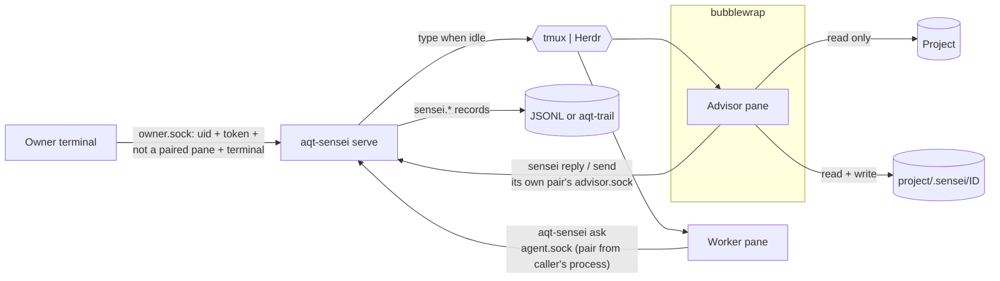

# aqt-sensei

**An independent advisor for your coding agent: any vendor, read-only enforced by the operating system, owner-controlled, every consultation on record.**

Part of the [Agent Quality Toolkit](../) (AQT). Python ≥ 3.11, Linux, Apache-2.0.

## The problem

A coding agent working alone has no second pair of eyes. You can ask another model for a second opinion, but then three things go missing:
- the advisor's *independence* holds only as long as it follows its prompt;
- *you* have no control over how much the two agents talk;
- nobody can show later *what was advised, and who let it through*.

`aqt-sensei` pairs a **worker** agent (normal rights) with an **advisor** agent ("sensei") of any vendor. The advisor reads the project, diagnoses, plans and reviews, but it **cannot change the project**, because bubblewrap mounts the project read-only. A small bridge relays explicit messages between the two terminal panes (tmux or Herdr), but only when the receiver is idle and only as far as you allow. Every step is written as an AQT evidence record: the **advice ledger**.

## 60-second quick start

```bash
pip install -e ../aqt-spec -e .          # or: uv pip install ...
aqt-sensei init --owner-id alice         # config + owner token (0600)
aqt-sensei doctor --profile claude --project ~/code/app   # proves the sandbox
aqt-sensei serve &                       # the bridge (or: examples/aqt-sensei.service)

# in tmux: your worker agent runs in pane %3
aqt-sensei pair --worker %3 --advisor claude --project ~/code/app \
                --mode confirm --max-exchanges 8 --reason "stuck on the parser"
aqt-sensei list                          # pairs and pending messages
aqt-sensei show m-1a2b3c4d5e6f           # exactly what will be typed into the advisor pane
aqt-sensei approve m-1a2b3c4d5e6f --reason "clear question"
```

The worker asks with `aqt-sensei ask "…" [--file notes.md]` and ends its turn. Inside its sandbox the advisor answers with `sensei reply "…" [--file PLAN.md]`. The intro message the bridge sends to the worker explains both commands.

Offline, without tmux, bwrap or a model: `python examples/demo_offline.py` runs one confirm-mode exchange on a fake host and prints the ledger.

## How it works



- **Modes.** `manual`: nothing reaches an agent until you `forward` that message, and no mode change releases it. `confirm`: every agent message waits for `approve` (optionally `--text` edited) or `discard`. `auto`: delivered when the receiver is idle, within the budget.
- **Budgets.** `--max-exchanges`, `--max-messages` and `--max-cost` (integer minor units, declared, not metered). When auto mode reaches a limit, the pair falls back to confirm, you get a notification, and a `sensei.budget reached` record is written.
- **Never interrupts.** The bridge types only into an idle pane. With Herdr it uses Herdr's agent status. With tmux it prefers hook-reported states (`examples/claude-code-hooks.json`, `aqt-sensei hook-state`) and otherwise a quiet screen with a visible prompt; an unknown state never receives input.
- **The sandbox.** Project read-only; scratch folder writable; a private agent home per platform (never your `~/.claude`, `~/.codex` or `~/.pi`; sign in once with `aqt-sensei login <platform>`). The environment is cleared down to an allow-list. The bridge state, other pairs, your token, config and sockets are invisible. `aqt-sensei doctor` proves all of this inside the exact sandbox. Details: [docs/sandbox.md](docs/sandbox.md).
- **The ledger.** `sensei.pair`, `sensei.message` (content sha256 plus an excerpt of at most 280 characters; full texts stay in the bridge's private state), `sensei.decision` (who, when, why, meaning; before/after hashes for edits), `sensei.budget`, and `sensei.refused` for every refused attempt. Records go to `AQT_SINK` (a JSONL file or the aqt-trail socket). Owner decisions are record-first: if the sink refuses the record (a write error, or aqt-trail rejecting it), the decision is not applied. If aqt-trail is only unreachable, the record goes to the durable AQT spool and the decision proceeds (see the threat model).

More usage: [docs/usage.md](docs/usage.md). A live check with real advisor CLIs: [docs/manual-verification.md](docs/manual-verification.md).

## QM mapping

| Feature | QM concept | Reference (paraphrased) |
|---|---|---|
| Worker performs, advisor cannot write, owner releases | Segregation of duties, four-eyes principle | GMP "performed / checked / approved"; `iso9001-2015:8.5.1` |
| Read-only enforced by the OS | Technical rather than procedural access control | `annex11-2011:12.1`; `part11:11.10(d)` |
| Owner authentication; refusals recorded | Authority checks | `part11:11.10(g)` |
| Ledger of every message, decision and refusal | Audit trail: who, what, when, why | `annex11-2011:9`; `part11:11.10(e)`; `alcoa:attributable`, `alcoa:contemporaneous`, `alcoa:complete` |
| Edits keep the original and the released hash | Changes do not obscure the original | `part11:11.10(e)`; `alcoa:original` |
| Decisions carry meaning and reason | Meaning of a signature-like act (not an e-signature) | `part11:11.50` (concept) |
| Modes, budgets with fallback, pause, end | Human oversight and the ability to intervene | `euaiact:14`; `annex22-2025d` (human in the loop) |
| `doctor` proves the sandbox | Verifying that a control works | `iso9001-2015:7.1.5` |
| Independence class per pair | Reviewer independence | `iso9001-2015:9.2.2` (by analogy) |

## Threat model and limits

- **In scope:** an advisor whose model ignores its instructions (for example after injected web content). It cannot write the project or reach the bridge state, your token, sockets, other pairs or your agent homes. Also in scope: a worker agent that tries to approve its own messages, switch to auto or lift a budget. It is refused, because it runs inside a paired pane or carries agent-session markers, and the refusal is recorded.
- **Read-only is not confidentiality.** With the network shared (the default, needed for the model API and web search), the advisor can send whatever it reads to the internet, and its model vendor sees what it reads. Loopback services stay reachable. `--network none` cuts the network (for local models over a socket, or for checks).
- **Same-user limit.** The owner checks stop accidents and naive self-approval. They do not stop a determined process of your own user that runs *outside* the paired panes, reads the token and detaches from its parents. Root and kernel escapes are out of scope.
- Your own direct typing into a pane bypasses the bridge and is not recorded.
- Idle detection on tmux without hooks is heuristic.
- The bridge's own state files are writable by your user. Tamper evidence comes from aqt-trail.
- When aqt-trail is down, owner decisions are not blocked: their records go to the durable spool (`$XDG_STATE_HOME/aqt/spool/`), and aqt-trail writes a `trail.gap` marker and appends them with `observed.via = "spool"` when it drains. Until then, the records lack the trail's process attribution and chain. This is deliberate: blocking the owner during an outage would do more harm than a marked gap.
- Linux only. On Ubuntu, AppArmor can block bwrap's user namespaces in some contexts; `doctor` detects it.
- Advisors of the same platform share one private home.

## Prior art

Advisor pairing is a crowded niche, and `aqt-sensei` learns from it openly:
- **crew** (MIT): refuses same-model pairs, caps rounds, keeps the lead's records outside the workspace. We record an independence class per pair.
- **pi-blanche** and **pi-meta-harness** (MIT): escalate to an expensive advisor only when stuck.
- **codex-plugin-cc** (Apache-2.0): read-only Codex reviews and a Stop-hook gate.
- **Anthropic's advisor tool**: executor-chosen timing, client-side budgets.
- **steipete/oracle** (MIT): payload preview, which became our `show`.

What we add is the combination: an OS-enforced read-only advisor of any vendor, owner modes with budgets that fall back to human confirmation, and an advice ledger in an open evidence format. Contributing the enforcement and ledger layer to crew would be a valid alternative.

## Statement

*"Agent Quality Toolkit supports quality-management practices; it is not a validated system and does not by itself make any process compliant with GMP, GDP, 21 CFR Part 11 or EU Annex 11."*

## Licence

Apache-2.0 (see `LICENSE`). bubblewrap (LGPL-2.0-or-later), tmux (ISC) and Herdr (Apache-2.0) are used as external programs; no code from them is included. See `NOTICE` for the origin of this package.
