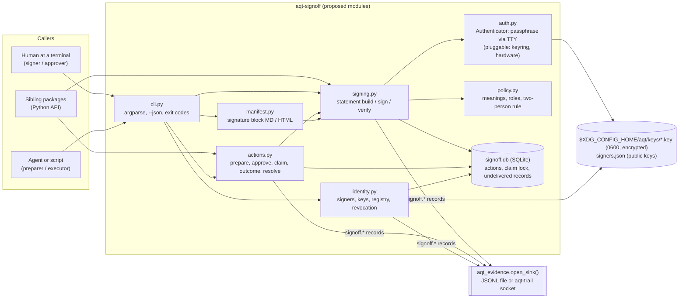

# aqt-signoff — Target Design

**Date:** 2026-10-21. **Package:** `aqt-signoff` of the Agent Quality Toolkit (AQT). **Brief:** `planning/04_designs/SUITE_ARCHITECTURE.md` §2.3.
**Status:** MVP implemented (phase B). Shared formats and cross-tool rules follow `planning/04_designs/INTERFACES.md` (I1, I3, I5, I9, I10), which this design was updated to match.

## 1. Introduction

### Core idea and intended result

AI coding agents produce artefacts (plans, diffs, reports, release notes) and want to trigger external effects (deploys, sends, uploads). Two things are missing in agent tooling today: a **human signature that means something** and stays bound to exactly what was signed, and a way for an agent to **ask for an external action that runs only after a human approved that exact action** and is never repeated blindly when its outcome is uncertain.

`aqt-signoff` supplies both as a small local library and CLI:

1. **Signatures with meaning.** A configured human signer signs a file, an evidence record or an action with a stated meaning (`authored`, `reviewed`, `approved`, `released`, `rejected`, `verified`, `waived`, `acknowledged`) and a reason. Each signing needs re-authentication (passphrase entry). The signature covers a signed statement that contains the signer's printed name, role, meaning, time with zone, reason and the SHA-256 of the exact content. If the content later changes, `verify` reports the signature as **invalidated**, never as valid. A readable **manifestation** (signature block) can be rendered in Markdown or HTML.
2. **Approved actions.** An agent or script **prepares** an action (a command or an HTTP call description plus the hash of its payload). A human **approves** that exact action hash with a reason (an approval is a signature). An executor **claims** the action atomically before running it, so it can never run twice, and reports the **outcome**: `succeeded`, `failed` or `unknown`. An unknown outcome is never retried; only a human **resolution** (after checking the external state) closes it.

Every step writes an AQT evidence record (`signoff.*`) to the configured sink, so signatures and actions land in the same verifiable trail as the rest of the suite (aqt-trail, aqt-change, aqt-capa).

**Users and callers.** A solo developer or small team lead who supervises coding agents (signer, approver); agents and scripts that need an approval (callers of `prepare`/`claim`); sibling packages that need a sign-off (aqt-change finish, aqt-capa CAPA approval, aqt-trail review signature, aqt-quarantine release decisions) through the Python API.

**End-to-end example.** An agent finishes a release note and runs `aqt-signoff prepare --kind command --request-key release-1.2 -- ./publish.sh dist/notes.md`. The owner runs `aqt-signoff show act_…`, reads the exact argv and payload hash, and runs `aqt-signoff approve act_… --hash sha256:… --reason "Notes reviewed against change CR-12"`, typing the passphrase. The agent (or a CI script) runs `aqt-signoff run act_…`; the tool claims the action, re-checks the approval signature and the payload hash, runs the exact argv once and records `succeeded` or `failed`. If the machine crashes mid-run, the action shows `unknown`; `run` refuses to start it again, and the owner later records `resolve act_… --as succeeded --reason "publish log shows upload"`.

Separately, a reviewer signs `docs/validation-report.md` with `--meaning reviewed`, a QA person signs it with `--meaning approved`; `aqt-signoff verify docs/validation-report.md` shows both as valid and the two-person policy as met. A one-character edit turns both into `invalidated`.

**Inputs:** files, record IDs (resolved from a JSONL sink or trail export), action specifications, passphrases typed at a terminal, a TOML config with signers, policy and paths.
**Outputs:** `signoff.*` evidence records in the sink; a local working index (SQLite); signature status reports (text/JSON); signature blocks (Markdown/HTML); exit codes for scripts and hooks.

### Functionality and performance intent

- Signing, verifying and claiming are interactive-speed operations: well under a second for typical artefacts, dominated by the passphrase KDF and file hashing (streamed, so large files are fine).
- Claim exclusivity is strict: two concurrent claims of the same approved action on one machine must never both succeed.
- Verification needs no network and no running service: the signature statement, the public key registry and the artefact are enough. A third party can verify with an exported registry.
- No retries, no hidden state transitions: every status a user sees is either computed from signed statements or recorded as evidence.

### Design flexibility

This document defines the intended functionality and suggests a practical route. The implementing worker may change module boundaries, storage layout, command spellings, payload field names and the order of work, and may simplify where the real code shows a simpler way, as long as the core outcomes hold: re-authenticated signatures with meaning bound to an exact hash, visible invalidation on change, a manifestation, a two-person policy option, and approved actions with atomic claim and honest unknown outcomes that only a human resolves. Ordinary adaptations need no approval or deviation report; record types beyond those fixed in SUITE_ARCHITECTURE §1.2 are agreed with the lead (see §2.2).

> **Implementation workflow.** All implementation guided by this design uses `lean-vertical-delivery` (small end-to-end slices, proportionate checks, a small completion report; no separate testing or documentation regime). Work is tracked in Project Tracker Next (project "Agent Quality Toolkit", one implementation for this package) through its low-call lifecycle. This package has no interactive UI; if one is added later, it is designed with `ui-studio`. When the same functionality fails repeatedly despite a reassessed approach, consult a Sensei with the intended behaviour, the attempts and the specific help needed.

## 2. Proposed architecture

A single Python package with a CLI on top of a small library. No daemon: every command is a short process. Authority comes from **signed statements verified against a pinned key registry**, not from status flags in a database. Signatures are read back from the evidence files (`aqt_evidence.iter_evidence`: the JSONL sink, the aqt-trail log, or `--evidence` files); the SQLite file only holds approved actions (with the claim lock) and records waiting for delivery.



**Flow.** A signing command builds a *signature statement*, asks the authenticator to unlock the signer's key (passphrase typed at the TTY), signs the canonical statement bytes, wraps statement and signature into a `signoff.signature` record (also envelope-signed with the same key), appends it to the sink and stores it in the index. Verification recomputes the subject hash (file bytes, record hash or action hash), checks the statement signature against the registry, applies revocation and policy, and reports a status. Actions move through a state machine in `actions.py`; transitions that need a human (approve, resolve) go through the signing path; the claim is a conditional update inside one SQLite `BEGIN IMMEDIATE` transaction.

**Storage (all paths overridable by flag, env or config).**
- Config: `$XDG_CONFIG_HOME/aqt/signoff.toml` — default signer, time zone, policies, grace period, paths.
- Identities (shared with aqt-trail, aqt-quarantine, aqt-capa; INTERFACES I9): `$XDG_CONFIG_HOME/aqt/signers.json` (version 1: signers with id, printed name, role, keys with `key_id`, `public_pem`, `enrolled_at`, `revoked_at`) and `$XDG_CONFIG_HOME/aqt/keys/<slug>.key` (PKCS#8, passphrase-encrypted, 0600) plus `.pub`. The exact format is in the README.
- State: `$XDG_STATE_HOME/aqt/signoff/signoff.db` — actions, claims, outcomes, records not yet delivered to the sink.
- Evidence: whatever `aqt_evidence.open_sink()` selects (`AQT_SINK`), default `$XDG_STATE_HOME/aqt/evidence.jsonl`; read back with `iter_evidence`.

**How records are written.** Order matters for honesty:
- *Signatures, approvals, resolutions:* build and sign the record → append to the sink → (for actions) update the index. If the sink append fails, the command exits 2 and nothing counts as signed.
- *Claim:* conditional update in SQLite (the exclusivity lock) → append `signoff.action.claimed`. If that append fails, the claim is released in the same process (nothing has run yet) and the command exits 2.
- *Outcome after execution:* commit the outcome locally first (the effect already happened, the fact must not be lost) → append to the sink. If the append fails, the record stays in the index marked *undelivered*; `aqt-signoff sync` delivers it later with the same record ID, and `status` shows the gap. Nothing is silently dropped.
- The envelope `sig` belongs to the writer of the stored record (I1): aqt-trail refuses client records with `sig`, `chain` or `observed`. So the **signer's signature is a detached statement in `data.signature`**, which survives chaining and re-stamping unchanged. aqt-signoff signs the envelope only for a JSONL sink and never sets `observed` (I2).
- A socket sink that is down spools in `aqt_evidence` (I3) once available; until then `SinkError` is handled as above. Re-sent records are idempotent by id at aqt-trail.

**Reuse from Agent Platform Next (read-only, ideas and small fragments; private paths, names and stores removed).**
- `scripts/herdr/personal_calendar.py` — proposal → `executing` claim committed **before** the external call; network error or unreadable answer → `unknown`; a later approve returns the claimed record and never writes again; `calendar_resolve` closes an unknown outcome as `applied` / `not_applied` with `decided_by` and is refused within a grace period of a running claim; same request key with another payload → conflict (`_request_hash`).
- `scripts/herdr/personal_mail.py` — approval binds `approved_version` + `approved_content_hash`; send re-checks both and sets `sending` before SMTP; `unknown` is never resent; `failed` needs a new approval.
- `scripts/herdr/personal_files.py` — content-addressed snapshot and fingerprint freshness (`_snapshot`, `_freshness`), detecting an interrupted apply without repeating it (`_completed`): the idea behind payload-hash checks at claim time.
- A5 §4 "what is not novel": desk approval was a protocol flag (`approved: true`) any owner-run process could set. aqt-signoff closes exactly this gap with a key-bound, re-authenticated signature that the claim verifies cryptographically.

**Reuse from open source.**
- `cryptography` (Apache-2.0/BSD) — Ed25519 and encrypted PKCS#8, via `aqt_evidence.generate_key`, `load_signer`, `sign_record`, `verify_record_signatures`.
- `aqt-spec` / `aqt_evidence` (Apache-2.0, this suite) — envelope, canonical JSON, hashes, sink.
- Ideas only, no code: **eLabFTW** (AGPL; signatures with a chosen meaning in a signed trusted comment, scrypt-protected key, invalidation on change), **minisign** (ISC; Ed25519 with signed trusted comments — candidate export format later), the Core idempotency ledger pattern from A5 §3.5 (request key + payload digest).

### 2.1 Core concepts

**Signature statement.** The unit that is signed. A canonical JSON object:

```json
{"aqt_signature": "0.1", "record_type": "signoff.signature",
 "signer": {"id": "human:alice", "name": "Alice Example", "role": "qa-lead"},
 "key": "ed25519:<16 hex>", "meaning": "approved", "reason": "Reviewed against CR-12",
 "signed_at": "2026-10-21T14:03:12.123456Z", "tz": "America/New_York",
 "subject": {"kind": "file", "ref": "docs/report.md", "sha256": "sha256:…"}, "nonce": "<16 hex>"}
```

It is stored as `data.signature = {"statement": {…}, "alg": "ed25519", "key": "ed25519:<16 hex>", "value": "<base64>"}`, the value being Ed25519 over `canonical_json(statement)` (`aqt_evidence.sign_statement` / `verify_statement`; schema `aqt-spec/schemas/signature.schema.json`, shared with aqt-trail and aqt-quarantine). The `aqt_signature` key separates these bytes from record envelopes and checkpoints; `record_type` binds the statement to the record type that carries it (a statement copied into another record type is invalid); `key` inside the statement must equal the block's key. Optional fields: `expires_at` (approvals), `outcome` (resolutions). Because name, meaning, time and reason are *inside* the signed bytes, the manifestation cannot be altered without breaking the signature (Part 11 §11.50(b)); because the subject hash is inside, the signature cannot be moved to another artefact (§11.70). For an action, `subject` is `{"kind": "action", "ref": "act_…", "sha256": <action hash>}`.

**Subjects and their hashes.** `file` → `bytes_hash` of the file content (path recorded as given, relative where possible; the hash, not the path, is binding). `record` → `aqt_evidence.record_content_hash` (excludes `sig`, `chain`, `observed`, `time`), so a signature over a record survives its storage in aqt-trail. `action` → `content_hash` of the action specification (below). `hash` → any externally computed `sha256:` with a caller-chosen kind and ref (used by sibling packages, e.g. a diff hash from aqt-change). `git-commit` subjects are a later addition.

**Signature status.** Computed at verify time, in this precedence:

| Status | Meaning |
|---|---|
| `invalid` | The statement or its signature does not verify (tampered, wrong key) |
| `unknown-signer` | The key is not in the pinned registry |
| `revoked` | The key was revoked before `signed_at`, or the signature falls after a declared `compromised_since` |
| `invalidated` | The subject's current hash differs from the signed hash, or the signer withdrew the signature |
| `valid` | None of the above |

The first time `verify` sees content change for a signature, it writes one `signoff.invalidation` record (cause `content-changed`, signed and observed hashes) so that the trail shows *when* the signature stopped applying; repeated verifies do not duplicate it. A signer can also **withdraw** a signature (`invalidate SIG --reason`, re-authenticated). A signature is never deleted.

**Re-authentication.** Every signing operation (sign, approve, resolve, withdraw, revoke) unlocks the private key with the passphrase, entered at `/dev/tty` by `getpass`. There is no `--passphrase` flag and no environment variable, so a passphrase cannot end up in an agent's command line or transcript by normal use. Combined with the signer ID this gives two components per signing (Part 11 §11.200(a)(1)). The `Authenticator` protocol (`passphrase(signer, purpose)`, `new_passphrase(signer_id, min_length)`) lets an OS-keyring authenticator follow without changing the signing code; tests use `StaticPassphrase`. A hardware-token authenticator would need a signing-key interface instead of a passphrase (later stage).

**Identities and registry.** `init` creates a signer (id `human:<id>`, printed name, role), a passphrase-encrypted Ed25519 key and a registry entry, and writes a `signoff.key.enrolled` record carrying the public key. IDs are unique and never reused, even after revocation (§11.100(a)). `revoke` marks a key revoked with a reason and an optional `compromised_since`; the signer re-authenticates, or — when the key is lost — the revocation is recorded unsigned by the human actor and flagged as such. `signers export` / `--registry FILE` let someone else verify with pinned keys. After a revocation, `init --add-key` enrols a new key for the same id; the old key files are renamed `*.revoked.key`. Registry trust is the main residual risk (see threat model).

**Policy.** Per meaning, in TOML: allowed roles, `min_signatures`, and `distinct_from_author`. The author of a subject is the actor of a record subject, the preparer of an action, or the signer of an `authored` signature on the same hash. `sign` refuses a self-approval that the policy forbids (exit 1, nothing signed); `verify` reports per meaning whether the policy is met ("approved: 1 of 2, needs a signer other than human:bob"). Default policy: everything allowed, `min_signatures = 1`; the example config shows a two-person rule.

**Approved actions.** Proposed state machine:

```mermaid
stateDiagram-v2
    [*] --> prepared: prepare (request key, action hash)
    prepared --> approved: approve exact hash (signed, reason); policy met
    prepared --> rejected: reject (signed, reason)
    approved --> expired: approval past expires_at
    approved --> claimed: claim (atomic, approvals re-verified, payload hash checked)
    claimed --> succeeded: outcome reported
    claimed --> failed: definite failure reported
    claimed --> unknown: crash, timeout, signal, lost report
    unknown --> succeeded: human resolution (signed, reason)
    unknown --> not_applied: human resolution (signed, reason)
    failed --> [*]: re-prepare as a new version for another attempt
    succeeded --> [*]
    not_applied --> [*]
    rejected --> [*]
    expired --> [*]
```



- *Action specification and hash.* `{action_id, version, kind: command|http|other, description, spec, payload_sha256}`; `spec` is an argv list for commands (no shell), method + URL + header names for HTTP, free text for `other`. The action hash is `content_hash` of this object. Large or private payloads are never stored; only their hash.
- *Prepare is idempotent.* `action_id = "act_" + first 24 hex of H(request_key)`. The same key with the same specification returns the existing action; with a different specification it is refused (`conflict`, exit 1). `prepare --revise ACT` creates version n+1, which invalidates every earlier approval because the hash changes.
- *Approve* requires the caller to state the expected hash (`--hash`), so the human approves what they saw, not what is current. The approval is a signature statement over the action subject with meaning `approved`, an optional `expires_at`, and the action's policy (default: approver ≠ preparer).
- *Claim* is one SQLite transaction: re-verify all approval signatures against the registry (not the DB flag), check expiry and policy, check the presented payload bytes against `payload_sha256` when given, then `UPDATE … SET status='claimed', claim_id=? WHERE id=? AND status='approved' AND action_sha256=?` and require one changed row. A second claim gets `already-claimed` (exit 1) with the existing claim.
- *Run* (command kind only) executes the approved argv once with `subprocess.run` (no shell, configurable timeout): exit 0 → `succeeded`; non-zero exit → `failed` (the command itself reported failure); timeout, signal or executor exception → `unknown`. stdout/stderr are kept as hashes plus a short tail excerpt. HTTP and other kinds are executed by the caller after `claim`, which then reports via `outcome` or the Python context manager.
- *A claim without an outcome is unknown.* If the executor dies, the action stays `claimed`; `status` shows it as `unknown (no outcome reported)` after the configured grace period (default 5 minutes, from the calendar helper). `resolve` is refused inside that grace period, then accepted only from a human with a reason and re-authentication.

**Agent-session guard.** Human-only commands (`init`, `sign`, `approve`, `reject`, `resolve`, `invalidate`, `revoke`) refuse to run unless `aqt_evidence.require_human()` passes (no agent-harness markers in the environment or process chain, interactive terminal), with exit 1, a clear message and a `signoff.refused` record (I5). This is a guard against accidents and confused agents, not a security boundary; the passphrase is the actual control.

### 2.2 Interfaces

**CLI** `aqt-signoff` (argparse; global `--json`, `--config`, `--registry`, `--keys-dir`, `--state-dir`, `--sink`, `--evidence PATH` repeatable). Exit codes: **0** ok; **1** check failed or refused (invalid/invalidated signature, policy not met, conflict, already claimed, guard refusal, wrong passphrase); **2** usage or runtime error (bad arguments, sink unreachable, corrupt state).

| Command | Purpose |
|---|---|
| `init --id ID --name NAME --role ROLE [--add-key]` | Create signer, encrypted key, registry entry; prompts passphrase twice (minimum length configurable, default 12) |
| `signers list` · `signers export [FILE]` · `revoke ID --reason R [--compromised-since T] [--lost]` | Registry management |
| `sign FILE \| --record ID \| --hash H [--kind K --ref R] --meaning M --reason R [--signer ID] [--author ID]` | Create a `signoff.signature` (records are found via `--evidence` / `iter_evidence`) |
| `verify FILE \| --record ID \| --hash H [--require MEANING] [--no-record]` | Status per signature, policy summary; exit 0 only with a valid signature on the current content, no `invalid` signature, and every `--require`d policy met (signatures of older content are reported as `invalidated` history) |
| `invalidate SIG --reason R` | Signer withdraws a signature |
| `manifest FILE \| --record ID  [--format md\|html] [--out PATH]` | Render the signature block |
| `prepare --kind command\|http\|other --request-key K [--description D] [--payload FILE] [-- ARGV…]` · `prepare --revise ACT …` | Propose an action (agent-callable) |
| `show ACT` · `list [--status S]` · `status ACT` | Inspect actions (hash, spec, approvals, claim, outcome) |
| `approve ACT --hash H --reason R [--valid-for 24h]` · `reject ACT --hash H --reason R` | Human decision on the exact hash |
| `claim ACT --hash H [--payload FILE]` · `outcome ACT --claim C --status succeeded\|failed\|unknown [--evidence TEXT]` | Executor steps for HTTP/other actions |
| `run ACT [--timeout S]` | Claim + execute approved argv + record outcome (command kind) |
| `resolve ACT --as succeeded\|not-applied --reason R` | Human resolution of an unknown outcome |
| `sync` | Deliver undelivered records |

**Python API** (sketch; names may change):

```python
from aqt_signoff import Signoff, is_approved, verify_subject
so = Signoff.open()                                   # config + registry + state + sink
so.sign(so.file_subject("docs/report.md"), "approved", "…")   # -> stored record
report = so.verify_file("docs/report.md")             # -> VerifyReport(signatures, policies, ok)
act = so.actions.prepare("http", "upload-7", {"method": "PUT", "url": "…"}, payload=b"...")
with so.actions.claim(act["id"], act["action_sha256"], payload=b"...") as claim:
    response = do_upload()                            # caller's effect
    claim.succeeded(evidence={"http_status": 201})    # or claim.failed(...)
# an exception inside the block, or no call, records outcome "unknown"
```

For other tools (I10): `verify_subject(sha256, *, meaning=None, sources=None) -> list[SignatureStatus]` and `is_approved(sha256, *, meaning="approved", policy=None, sources=None) -> bool`; `so.sign(subject, meaning, reason)` signs any `{kind, ref, sha256}`. Other tools read `signers.json` directly (I9).

**Record types and `data` payloads.** All records carry `actor`, `action`, `subject`, `reason` where a human decided, and `meaning` for signature-like decisions; `links` connect them (`rel`: `signs`, `action`, `approval`, `claim`, `invalidates`, `resolves`).

| Type | Actor | `data` (main fields) |
|---|---|---|
| `signoff.signature` | human | `signature` (I1 block), `meaning` (mirrors the envelope and the statement) |
| `signoff.key.enrolled` · `signoff.key.revoked` | human | `signer` (id), `name`, `role`, `key_id`, `public_pem` (enrolled; proof-of-possession statement); `key_id`, `revoked_at`, `compromised_since`, `signed` (revoked) |
| `signoff.refused` · `signoff.auth.failed` | claimed actor | `attempted_action`, `reason_code`, `agent_markers` (I5) · `signer`, `operation`, `code` |
| `signoff.invalidation` | human (withdraw) or `service:aqt-signoff` (detected change) | `signature_record` (record id), `cause` (`content-changed` / `withdrawn`), `signed_sha256`, `observed_sha256`; a withdrawal also carries a signed `signature` block (meaning `rejected`) |
| `signoff.action.prepared` | agent / service / human | `action` (the specification), `action_sha256`, `request_key_sha256`, `supersedes` (for revisions) |
| `signoff.action.rejected` | human | `action_id`, `version`, `action_sha256`, `signature` |
| `signoff.action.approved` | human | `action_id`, `version`, `action_sha256`, `signature`, `expires_at`; `meaning: approved` |
| `signoff.action.claimed` | executor | `action_id`, `action_sha256`, `claim_id`, `approvals` (record ids), `payload_checked` |
| `signoff.action.outcome` | executor or human | `action_id`, `claim_id`, `outcome` (`succeeded` / `failed` / `unknown`, I6), `basis` (`exit-code` / `signal` / `timeout` / `exec-error` / `executor-report` / `executor-exception` / `no-report` / `human-resolution`), `exit_code`, `stdout_sha256`, `stderr_sha256`, `excerpt`, `duration_ms`; a human resolution adds `resolution` (`applied` / `not-applied`, the latter with `outcome: failed`), a `signature` block, `meaning: verified` and `links rel=resolves` |

The added types (`signoff.key.*`, `signoff.action.rejected`, `signoff.auth.failed`, `signoff.refused`) are agreed in INTERFACES I5.

### 2.3 Stack and method table

| Area | Choice | Why | Trade-offs | Alternative |
|---|---|---|---|---|
| Signature algorithm | Ed25519 via `cryptography` and `aqt_evidence` | Fast, small, deterministic; already the suite's algorithm | No post-quantum; no qualified-signature status | ML-DSA or eIDAS QES adapter later when a user needs it |
| Signed object | Canonical JSON *statement* inside `data` | Survives trail chaining and re-signing; meaning, name, time inside the signed bytes | One more layer than signing the envelope | Envelope `sig` only — breaks when records pass through aqt-trail |
| Key protection | Encrypted PKCS#8 (PBES2) via `generate_key(passphrase=…)` | Standard, no extra dependency, works with `load_signer` | KDF strength set by `cryptography`, not tunable here; same-user processes can copy the file | OS keyring / hardware token behind the `Authenticator` interface |
| Re-authentication | Passphrase at `/dev/tty` per signing | Simple, matches §11.200 two components; no secret on command lines | No lockout across processes; keyloggers out of scope | Short signing session (one full auth, then passphrase only) as §11.200(a)(1)(i) allows — later if signing many items |
| Action index and claim lock | SQLite (stdlib), `BEGIN IMMEDIATE` conditional update | Atomic claim without a daemon; queryable; approvals inside are re-verified | Single host only | `flock` on per-action files — fewer features; a service if multi-host is ever needed |
| Execution | `subprocess.run(argv, shell=False)`, timeout | Exactly the approved argv; no shell expansion | HTTP not executed by the tool (no network by default) | Built-in HTTP executor behind an opt-in extra later |
| Manifestation | String templates for Markdown and HTML (stdlib `html.escape`) | No template engine dependency | Plain styling | PDF via an optional extra later |
| Time | Host UTC plus IANA zone via `zoneinfo` | Stdlib; zone shown in manifestation | Host clock is self-asserted | Trusted time from aqt-trail service time / RFC 3161 anchors |
| Config | TOML via `tomllib` | Suite convention | Read-only parser (writes by `init` use a tiny emitter or JSON registry) | — |
| Agent tool access | MCP stdio server (`request_approval`, `check_approval`), stdlib JSON-RPC | Lets agents ask without shell access; should-have | Extra surface to test | CLI only (MVP) |

### 2.4 QM mapping, threat model and limits

**QM mapping** (features are designed along these concepts and support them; see the README statement on regulatory status):

| Feature | Concept and clause |
|---|---|
| Statement carries printed name, signer id, role, time with zone, meaning | Part 11 §11.50(a)–(b) manifestation; Annex 11 (2011) §14(c) time and date; Annex 11 draft §13.4–13.6; R-10 |
| Signature bound to the exact content hash; copy to other content fails; changed content shows `invalidated` | Part 11 §11.70 signature/record linking; Annex 11 (2011) §14(b) permanently linked; Annex 11 draft §13.8 "appears unsigned"; R-11 |
| Passphrase re-authentication at each signing; ID + secret | Part 11 §11.200(a); Annex 11 draft §13.3 full re-authentication |
| Unique signer IDs, never reused; key revocation record | Part 11 §11.100(a), §11.300(b)–(d) (periodic revision, loss management); R-08 |
| Meaning required, reason required for every human decision | Part 11 §11.50(a)(3); Annex 11 draft §12.2 and §13.5; ALCOA++ Attributable; R-03 |
| Two-person rule, roles per meaning, approver ≠ preparer | Part 11 §11.10(g) authority checks; segregation of duties (Annex 11 draft §11.1); four-eyes principle |
| Action state machine (prepare → approve → claim → outcome) | Part 11 §11.10(f) operational sequence checks; R-30; draft Annex 22 §1 human in the loop for AI-initiated actions; EU AI Act Art. 14 human oversight |
| Unknown outcome never retried; human resolution with reason | GDP/GMP deviation practice ("do not repeat a step whose outcome is unknown"); ALCOA++ Accurate and Complete |
| Every step a `signoff.*` record in the sink; undelivered records kept and synced | Part 11 §11.10(e) audit trail; Annex 11 draft §12.1 (signature execution logged); ALCOA++ Contemporaneous, Complete, Enduring |
| Invalidation recorded, signatures never deleted | GDP "correct, don't erase"; ALCOA++ Original, Traceable |
| Manifestation prints the content hash | Annex 11 draft §13.9 hybrid signing (hash on the printed page); R-13 |
| AI-produced content signed by an accountable human | EU GMP Chapter 4 draft 4.24–4.25; R-22 |

Organisational duties stay with the user: identity verification before enrolment (§11.100(b)), certification to the agency (§11.100(c)), written policies holding signers accountable (§11.10(j)), training, and validation of the whole system.

**Threat model.** Assets: signers' private keys and passphrases, the registry, the approval binding, the evidence records.

| Threat | Response | Residual |
|---|---|---|
| Agent sets an action to "approved" in the DB or fakes `approved: true` (the A5 gap) | Claim re-verifies approval signatures against the registry; DB status is never authority | — |
| Agent signs as a human | Needs the passphrase; TTY-only prompt; agent-session guard; no passphrase flag/env | A human typing the passphrase into an agent chat; keyloggers |
| Agent adds its own key to the registry as a "human" | Enrolment is a recorded event with observed process chain (trail attributes it); `verify` flags signers enrolled after the signed time; config can pin trusted key IDs; docs recommend running agents sandboxed with the key dir hidden and the state dir read-only (A5 "sandboxed proposer" recipe) | On a single-user machine without OS separation an unsandboxed agent can do what the user can; aqt-signoff makes this **detectable**, not impossible |
| Approval reused for another action or a changed payload | Statement binds action id, version and hash; payload hash checked at claim; revision changes the hash | Executor code that ignores the claimed payload |
| Double execution after crash or race | Atomic claim; `run` refuses claimed/unknown actions | Effects outside the tool's control (e.g. a script that retries internally) |
| Back-dated signatures / clock changes | Records reach aqt-trail, which stamps service time and anchors heads | Pure JSONL mode trusts the host clock |
| Key compromise | Revocation with `compromised_since`; affected signatures shown `revoked` | Signatures before the declared time stay valid by design |

**Limits.** Not a qualified (eIDAS) or advanced electronic signature; no trusted time on its own; single host; no PDF signing; HTTP actions are described and guarded, not executed; the agent-session guard is heuristic.

### 2.5 Novelty and prior art

| Project | What it does | Difference |
|---|---|---|
| eLabFTW (AGPL-3.0) | ELN with Ed25519/minisign signatures with a chosen meaning, scrypt key, RFC 3161, immutable archives | Best precedent for meaning + invalidation, but ELN-internal and AGPL; aqt-signoff is a permissive library for *any* file, record or action, plus approved actions |
| minisign (ISC) | Ed25519 file signatures with signed trusted comments | Format idea; no meaning taxonomy, registry, policy, manifestation or actions |
| Documenso, DocuSeal, OpenSign (AGPL-3.0) | PDF e-signature platforms | Document-centric web apps; Part 11 meaning/re-auth semantics not established; no agent actions |
| Sigstore / cosign (Apache-2.0) | Keyless artefact signing with transparency logs | Identity and supply chain, not meaning, role, reason or two-person policy |
| asqav (Elastic-2.0) | Signed receipts, RFC 3161, m-of-n approvals | Functionally closest; source-available licence, AI Act/DORA framing, no GxP manifestation; positioning reference only |
| Agent Governance Toolkit (MIT), Pipelock, Helio, agent-approval-gate | `require_approval` policy gates, receipts | Approval as a policy decision or flag; not a re-authenticated signature bound to the exact action hash; no honest unknown-outcome handling |
| HumanLayer (Apache-2.0, OSS deprecated), LangGraph interrupts (MIT) | Approval SDK / pause-resume primitives | Approval flow without signatures, claim or evidence |
| Spec Workflow MCP (GPL-3.0) | `request-approval` MCP tools | Approvals can be deleted; no retained, hash-bound record |

What is new here is the combination, applied to agent work: Part 11-style signature semantics as a small permissive library, and the Personal Desk's claim-before-effect and "unknown is final until a human resolves it" discipline, with every step in the suite's evidence trail. The individual techniques (Ed25519, idempotency keys, conditional updates) are standard.

## 3. Flexible roadmap

### MVP slice (Phase B)

One end-to-end path that works from a fresh state directory with a JSONL sink:

1. `init` a signer → `sign FILE --meaning reviewed` and a second signer `--meaning approved` → `verify` reports both valid and the two-person policy met → edit the file → `verify` reports `invalidated`, exits 1 and writes one `signoff.invalidation` → `manifest` renders the Markdown/HTML block with names, zone-aware times, meanings, hash and status.
2. `prepare --kind command -- <argv>` (as an agent actor) → `approve --hash` (wrong hash refused) → `run` executes once; a second `run` and a concurrent claim are refused → a simulated crash after claim yields `unknown`, `run` refuses, `resolve` inside the grace period is refused and afterwards accepted with a reason.
3. Revocation, unknown signer, tampered statement, self-approval refusal and the agent-session guard each produce the documented status and exit code.
4. All records validate against the aqt-spec envelope, payload and signature schemas, and the sink passes `aqt-evidence conform --level 1`; signature statements verify after the record has passed through a simulated trail write.

**Checked by** offline pytest with an in-memory authenticator, temp XDG dirs and fake agent markers; one CLI test with a monkeypatched `getpass`; a two-process (or two-thread with separate connections) claim race test. README with quick start, Mermaid, QM table, threat model and the non-compliance statement; example config with a two-person rule.

### Later stages

| Stage | Result | Decision | Risk |
|---|---|---|---|
| MCP server | `request_approval` / `check_approval` over stdio for agents | Deferred by the lead (I12); next candidate | Agents polling; answer with status only, never secrets |
| Integration hooks | Python helpers used by aqt-change finish, aqt-capa approval, aqt-trail review | Lead, with sibling builders | API drift; keep `sign(subject=…)` stable |
| Trusted time | Statement hash anchored via aqt-trail checkpoint or RFC 3161 TSA adapter (eIDAS-qualified TSA possible) | User configures a TSA | Network only when configured |
| Better authenticators | OS keyring, FIDO2/hardware tokens, short signing sessions | Owner, when needed | Platform-specific code behind extras |
| Export and interop | minisign-compatible export, verification bundle (artefact + statements + registry), git-commit subjects | Worker | Format mismatches; keep native format canonical |
| PDF / print | PDF manifestation with hash and QR | Owner | Heavier dependency behind an extra |
