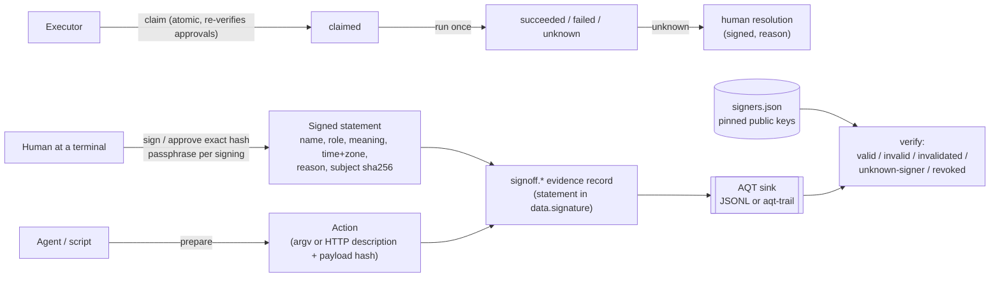

# aqt-signoff

**Signatures with meaning, bound to the exact content, and approved actions that never run twice or retry blindly.** Part of the Agent Quality Toolkit (AQT).

> Agent Quality Toolkit supports quality-management practices; it is not a validated system and does not by itself make any process compliant with GMP, GDP, 21 CFR Part 11 or EU Annex 11.

## The problem

Coding agents write plans, reports and release notes, and they want to deploy, upload or send things. "Approval" in agent tooling is usually a flag any process can set, a chat message, or a button whose record disappears. A quality manager expects more: a named person signs with a stated **meaning** (reviewed, approved, released …), re-authenticates for each signature, the signature is **bound to the exact content** and visibly stops applying when the content changes, and an approved action runs **once**, with an honest record when nobody knows whether it ran.

## 60-second quick start

```bash
uv venv .venv && uv pip install --python .venv/bin/python -e ../aqt-spec -e .
export AQT_SINK=file:$PWD/evidence.jsonl

aqt-signoff init --id human:alice --name "Alice Example" --role quality-manager   # asks for a passphrase twice
aqt-signoff sign docs/report.md --meaning approved --reason "Checked against CR-12" --signer human:alice
aqt-signoff verify docs/report.md            # SIGNED … exit 0
echo change >> docs/report.md
aqt-signoff verify docs/report.md            # UNSIGNED, [invalidated] … exit 1
aqt-signoff manifest docs/report.md --format html --out signatures.html

# an agent proposes, a human approves the exact hash, the executor runs it once
aqt-signoff prepare --request-key publish-1.2 --description "Publish notes" -- ./publish.sh dist/notes.md
aqt-signoff show act_…                       # read argv and hash
aqt-signoff approve act_… --hash sha256:… --reason "Notes reviewed" --signer human:alice
aqt-signoff run act_…                        # succeeded / failed / unknown; a second run is refused
aqt-signoff resolve act_… --as not-applied --reason "Checked the server: nothing was uploaded"   # only for unknown
```

Human-only commands (`init`, `sign`, `approve`, `reject`, `resolve`, `invalidate`, `revoke`) read the passphrase from the terminal and refuse to run inside a detected agent session.

## How it works



- **Authority is cryptographic.** A claim succeeds only when the approvals it holds verify against the pinned signer registry for the exact action hash. Setting a status in the database does nothing.
- **Signature status** is computed at verify time, worst first: `invalid` (statement altered, wrong key) › `unknown-signer` (key not in the registry, or signed before enrolment) › `revoked` › `invalidated` (content changed, or withdrawn by the signer) › `valid`. The first time a change is seen, one `signoff.invalidation` record is written. Signatures are never deleted.
- **Two-person rule:** per meaning, `min_signatures`, allowed `roles`, and `distinct_from_author` (authors are the actor of a signed record, `authored` signatures on the same hash, or `--author`). Actions default to "approver ≠ preparer".
- **Unknown is final.** A claim with no reported outcome becomes `unknown` after a grace period (default 5 min). Nothing retries it; `resolve` (signed, with a reason) closes it as `succeeded` or `not-applied`.
- **Nothing is silently lost.** Signatures are only reported as made when the record reached the sink. An outcome is stored locally first; if the sink is down it waits for `aqt-signoff sync`.

## Shared formats (owned by aqt-signoff)

Other AQT tools rely on these two formats. They are stable for spec 0.1.

### Detached signed statement — `data.signature`

Published as `aqt-spec/schemas/signature.schema.json` (also used by aqt-trail and aqt-quarantine). Sign and verify with `aqt_evidence.sign_statement` / `verify_statement`.

```json
"signature": {
  "statement": {
    "aqt_signature": "0.1",
    "record_type": "signoff.signature",
    "signer": {"id": "human:alice", "name": "Alice Example", "role": "quality-manager"},
    "key": "ed25519:<16 hex>",
    "meaning": "approved",
    "reason": "Checked against CR-12",
    "signed_at": "2026-10-21T14:03:12.123456Z",
    "tz": "America/New_York",
    "subject": {"kind": "file", "ref": "docs/report.md", "sha256": "sha256:…"},
    "nonce": "<16 hex>"
  },
  "alg": "ed25519",
  "key": "ed25519:<16 hex>",
  "value": "<base64 Ed25519 signature over canonical_json(statement)>"
}
```

- Required: `aqt_signature` (`"0.1"`), `signer` (`id`, `name`; `role`), `key` (equal to the block's `key`), `meaning`, `signed_at`, `subject`. aqt-signoff always also writes `record_type`, `reason`, `tz` and a random `nonce`.
- `record_type` is the type of the record that carries the statement; aqt-signoff rejects a statement found in a record of another type. `meaning` is one of the AQT meanings and equals the envelope `meaning` when the record has one (`signoff.signature` also repeats it as `data.meaning`).
- `signed_at` is RFC 3339 UTC with `Z`; `tz` is the signer's IANA zone for display.
- `subject.sha256` binds the content: files `bytes_hash(content)` with `ref` relative to the project; records `aqt_evidence.record_content_hash(record)` with `ref` = record id (survives storage in aqt-trail); actions the action hash; `hash` for any externally computed digest.
- Optional fields: `expires_at` (approvals), `outcome` (human resolutions). Tools may add fields; verifiers sign and check the whole statement.
- Verification: look up `key` in the registry, require that the key's signer equals `statement.signer.id` and `statement.key` equals the block `key`, verify `value` over `canonical_json(statement)`, require `enrolled_at ≤ signed_at`, and treat `signed_at ≥ revoked_at` as revoked.
- Every record aqt-signoff writes validates against the aqt-spec envelope, payload and signature schemas; a sink file from an end-to-end run passes `aqt-evidence conform --level 1` (tested).
- The envelope `sig` is separate (the writer's signature). aqt-signoff signs the envelope only for a JSONL sink and never sends `sig` to aqt-trail.

### Signer registry — `$XDG_CONFIG_HOME/aqt/signers.json`

Published as `aqt-spec/schemas/signers.schema.json`.

```json
{"version": 1,
 "signers": [{"id": "human:alice", "name": "Alice Example", "role": "quality-manager",
              "keys": [{"key_id": "ed25519:…", "public_pem": "-----BEGIN PUBLIC KEY-----\n…",
                        "enrolled_at": "2026-10-21T13:00:00.000000Z", "revoked_at": null}]}]}
```

- Keys: `$XDG_CONFIG_HOME/aqt/keys/<slug>.key` (passphrase-encrypted PKCS#8 PEM, mode 0600) and `<slug>.key.pub`; slug = signer id with `:` → `-` (`human:alice` → `human-alice.key`). A revoked key's files are renamed `<slug>.<key hex>.revoked.key`.
- Signer ids look like `human:<name>` and are never reused. `revoked_at` is the revocation time, or the declared start of a compromise.
- Overrides: `--registry` / `AQT_SIGNERS`, `--keys-dir` / `AQT_KEYS_DIR`. Passphrases are only read interactively — no flag, no environment variable.

## CLI

All commands accept `--json`, `--config`, `--registry`, `--keys-dir`, `--state-dir`, `--sink`, `--evidence PATH` (repeatable). Exit codes: **0** ok, **1** check failed or refused, **2** usage or runtime error.

| Command | What it does |
|---|---|
| `init --id ID --name NAME --role ROLE [--add-key]` | Create a signer and an encrypted key; records `signoff.key.enrolled` |
| `signers list` · `signers export [FILE]` | Show or export the registry (for verification elsewhere) |
| `revoke ID --reason R [--compromised-since T] [--lost]` | Revoke the active key; records `signoff.key.revoked` |
| `sign FILE \| --record ID \| --hash H [--kind K --ref R] --meaning M --reason R [--signer ID] [--author ID]` | Sign; records `signoff.signature` |
| `verify FILE \| --record ID \| --hash H [--require MEANING] [--no-record]` | Status of every signature, policies; exit 0 only with a valid signature on the current content, no invalid signature, and required policies met |
| `invalidate SIG --reason R` | The signer withdraws a signature |
| `manifest FILE \| --record ID [--format md\|html] [--out PATH]` | Signature block: printed name, id, role, meaning, local time with zone and UTC, reason, status, content hash |
| `prepare [--kind command\|http\|other] --request-key K [--description D] [--payload FILE] [-- ARGV…]` | Propose an action (idempotent per key) |
| `prepare --revise ACT …` | New version; earlier approvals no longer apply |
| `show ACT` · `status ACT` · `list [--status S]` | Inspect actions |
| `approve ACT --hash H --reason R [--valid-for 24h]` · `reject ACT --hash H --reason R` | Human decision on the exact hash |
| `claim ACT --hash H [--payload FILE]` · `outcome ACT --claim C --status succeeded\|failed\|unknown` | For effects the caller executes itself (HTTP, other) |
| `run ACT [--timeout 10m] [--payload FILE]` | Claim and run an approved command once (no shell): exit 0 → succeeded, non-zero → failed, timeout or signal → unknown |
| `resolve ACT --as succeeded\|not-applied --reason R` | Close an unknown outcome after checking |
| `sync` | Deliver records that could not reach the sink |

## Python API

```python
from aqt_signoff import Signoff, is_approved, verify_subject

so = Signoff.open()                                    # config, registry, state, sink
so.sign(so.file_subject("docs/report.md"), "approved", "Checked", signer_id="human:alice")
report = so.verify_file("docs/report.md")              # VerifyReport: .ok, .signatures, .policies

act = so.actions.prepare("http", "upload-7", {"method": "PUT", "url": "https://example.invalid/x"},
                         payload=b"...")
with so.actions.claim(act["id"], act["action_sha256"], payload=b"...") as claim:
    ...                                                # perform the effect once
    claim.succeeded({"http_status": 201})              # no report or an exception -> "unknown"

verify_subject("sha256:…")                             # list[SignatureStatus] (for other AQT tools)
is_approved("sha256:…", meaning="approved", policy={"min_signatures": 2, "distinct_from_author": True})
```

## Configuration

`$XDG_CONFIG_HOME/aqt/signoff.toml` (see `examples/signoff.toml`): `[signoff]` signer, tz, `passphrase_min_length`, `claim_grace_ms`, `run_timeout_ms`; `[paths]` registry, keys, state, sink, evidence; `[policy.<meaning>]` and `[actions]` with `min_signatures`, `roles`, `distinct_from_author`. State (the action index, `signoff.db`) lives in `$XDG_STATE_HOME/aqt/signoff/`.

## QM mapping

Features are designed along these concepts and support them; they do not replace the user's procedures or validation.

| Feature | Concept |
|---|---|
| Statement with printed name, role, meaning, time with zone, inside the signed bytes | `part11:11.50`; `annex11-2011:14`; `annex11-2025d:13.4`–`13.6` |
| Signature bound to the content hash; changed content shows `invalidated` | `part11:11.70`; `annex11-2011:14`; `annex11-2025d:13.8` |
| Passphrase re-authentication at every signing (id + secret) | `part11:11.200`; `annex11-2025d:13.3` |
| Unique, never reused signer ids; revocation records | `part11:11.100`, `part11:11.300` |
| Reason required for every human decision | `annex11-2025d:12.2`; `alcoa:attributable` |
| Two-person rule, roles per meaning, approver ≠ preparer | `part11:11.10` (g) authority checks; segregation of duties |
| prepare → approve → claim → outcome sequence | `part11:11.10` (f) operational checks; `annex22-2025d:1` human in the loop; `euaiact:14` |
| Unknown outcomes never retried; signed human resolution | deviation practice; `alcoa:accurate`, `alcoa:complete` |
| Every step recorded; undelivered records kept and synced | `part11:11.10` (e); `annex11-2025d:12.1`; `alcoa:contemporaneous`, `alcoa:enduring` |
| Manifestation prints the content hash | `annex11-2025d:13.9` (hybrid signing) |
| AI-produced content signed by an accountable human | `ch4-2025d:4.24`–`4.25` |

Still the user's job: verifying identities before enrolment, written accountability policies, training, and validating the system in its context of use.

## Threat model and limits

- **Agents running as the same user** can read the encrypted key file and the state; they cannot sign without the passphrase. Flags in the database are not authority: claims verify the signed approvals.
- **The registry is the trust anchor.** An unsandboxed same-user agent could add its own key. Enrolment is recorded (and attributed by aqt-trail), signatures dated before a key's enrolment are rejected, and agents should run sandboxed with the key directory hidden. aqt-signoff makes this detectable, not impossible.
- **The agent-session guard is heuristic** (environment markers and process ancestry via `aqt_evidence.require_human`); the passphrase is the real control. Never type a passphrase into an agent chat.
- **Time** is the host clock unless records go to aqt-trail (service time, anchors). Not an eIDAS qualified or advanced signature; no trusted timestamp of its own; single host; HTTP actions are described and guarded, not executed; no PDF signing.

## Licence

Apache-2.0. See `LICENSE` and `NOTICE`.
