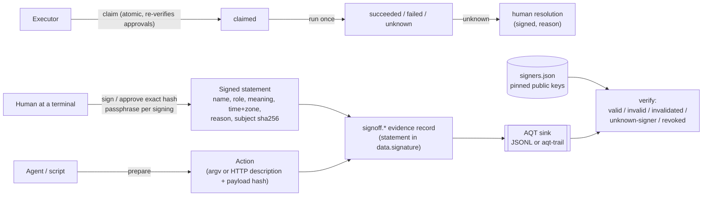

# aqt-signoff

**Signatures with meaning, bound to the exact content, and approved actions that never run twice or retry blindly.** Part of the Agent Quality Toolkit (AQT).

> Agent Quality Toolkit supports quality-management practices; it is not a validated system and does not by itself make any process compliant with GMP, GDP, 21 CFR Part 11 or EU Annex 11.

## The problem

Coding agents write plans, reports and release notes, and they want to deploy, upload or send things. "Approval" in agent tooling is usually a flag any process can set, a chat message, or a button whose record disappears. A quality manager expects more: a named person signs with a stated **meaning** (reviewed, approved, released …), re-authenticates for each signature, the signature is **bound to the exact content** and visibly stops applying when the content changes, and an approved action runs **once**, with an honest record when nobody knows whether it ran.

## 60-second quick start

```bash
uv venv .venv && uv pip install --python .venv/bin/python -e ../aqt-spec -e .
export AQT_SINK=file:$PWD/evidence.jsonl

aqt-signoff init --id human:alice --name "Alice Example" --role quality-manager   # asks for a passphrase twice
# a second person: their enrolment counts once an enrolled signer approves it
aqt-signoff init --id human:bob --name "Bob Example" --role developer          # "waits for approval"
aqt-signoff signers check                    # Bob's key: PENDING, with the approve command
aqt-signoff signers approve human:bob --key ed25519:… --signer human:alice     # Alice's passphrase
aqt-signoff sign docs/report.md --meaning approved --reason "Checked against CR-12" --signer human:alice
aqt-signoff verify docs/report.md            # SIGNED … exit 0
echo change >> docs/report.md
aqt-signoff verify docs/report.md            # UNSIGNED, [invalidated] … exit 1
aqt-signoff manifest docs/report.md --format html --out signatures.html

# an agent proposes, a human approves the exact hash, the executor runs it once
aqt-signoff prepare --request-key publish-1.2 --description "Publish notes" -- ./publish.sh dist/notes.md
aqt-signoff show act_…                       # read argv and hash
aqt-signoff approve act_… --hash sha256:… --reason "Notes reviewed" --signer human:alice
aqt-signoff run act_…                        # succeeded / failed / unknown; a second run is refused
aqt-signoff resolve act_… --as not-applied --reason "Checked the server: nothing was uploaded"   # only for unknown
```

Human-only commands (`init`, `sign`, `approve`, `reject`, `resolve`, `invalidate`, `revoke`, `rekey`,
`signers approve`, `signers import`) read the passphrase from the terminal and refuse to run inside a detected agent session.

## How it works



- **Authority is cryptographic.** A claim succeeds only when `signoff.action.approved` records verify against the pinned signer registry for the exact action hash. The stored action is hashed again before every claim, and the command that runs is that verified body; setting a status, editing the stored action or offering another kind of signature (e.g. a file approval) does nothing. A version is claimed once: a `signoff.action.claimed` record in the evidence refuses a second claim even after the database was rolled back.
- **Enrolment is counter-signed.** `signers.json` is only configuration. A key counts when the enrolment evidence (the trail when there is one, else the evidence files) holds its own signed enrolment request (`signoff.key.enrolled`, signed by the new key) and either it is the very first enrolment of all (the bootstrap signer, shown by `signers check`) or an already enrolled signer whose key counts and is active approved it with their passphrase (`aqt-signoff signers approve`, a `signoff.key.enrolled` record signed by the approver). Until then the enrolment is *pending*: listed by `signers check`, ignored by every check. An approved key counts from the time its request was recorded (the trail writer's time, never a time the client claims). Nobody approves their own enrolment or role; a key rotation (`init --add-key` while the old key counts) is approved by the old key, which is revoked in the same step. A role changes only through an approval by another signer (`signers approve ID --key KEY --role ROLE`); signatures are judged by the role in effect when they were signed, so earlier signatures keep their role. Two enrolment records for one key are a conflict (the key does not count). A new key enrolled when no other key counts any more (all revoked) is a *re-bootstrap*: it counts, and `signers check` flags it until another signer approves it. A revocation record applies even if the file says the key is active, and a role in the file that differs from the enrolled role stops the key. A key made by another tool (for example `aqt-quarantine init`) gets its enrolment request, marked `adopted`, the first time its owner unlocks it in aqt-signoff (or with `rekey`); it then waits for approval unless it is the first signer.
- **Adding aqt-trail later.** Once a trail exists, enrolments count only from the trail. The enrolment records written before it (in the fallback evidence file) are carried into the trail once with `aqt-signoff signers import`, signed by a signer whose key counts in them (or in the trail); their order and times are kept, so earlier signatures stay valid. Records added to the old file after that do not count. Until the import, `signers check` and `aqt status` say so, and signing, `init` and adoption refuse with `import_needed`.
- **Signature status** is computed at verify time, worst first: `invalid` (statement altered, wrong key, or a replayed copy of a statement already in another record) › `unknown-signer` (key not in the registry, not backed by its enrolment record, or signed before enrolment) › `revoked` › `invalidated` (content changed, or withdrawn by the signer) › `valid`. A signed statement counts once, whichever record carries it, and a withdrawal applies to every copy. The first time a change is seen, one `signoff.invalidation` record is written. Signatures are never deleted.
- **Two-person rule:** per meaning, `min_signatures`, allowed `roles` (the registry role, which must also be the role in the signed statement), and `distinct_from_author` (authors are the actor of any evidence record whose content hash is the signed hash, `authored` signatures on the same hash, or `--author`; the same in `sign`, `verify` and `is_approved`). Actions default to "approver ≠ preparer"; the preparer is part of the hashed action.
- **Unknown is final.** A claim with no reported outcome becomes `unknown` after a grace period (default 11 min: the run timeout plus one minute; never shorter than the run timeout, so a command `run` still executes is never offered for resolution). Nothing retries it; `resolve` (signed, with a reason) closes it as `succeeded` or `not-applied`.
- **Nothing is silently lost.** Signatures are only reported as made when the record reached the sink. An outcome is stored locally first; if the sink is down it waits for `aqt-signoff sync`.

## Shared formats (owned by aqt-signoff)

Other AQT tools rely on these two formats. They are stable for spec 0.1.

### Detached signed statement — `data.signature`

Published as `aqt-spec/schemas/signature.schema.json` (also used by aqt-trail and aqt-quarantine). Sign and verify with `aqt_evidence.sign_statement` / `verify_statement`.

```json
"signature": {
  "statement": {
    "aqt_signature": "0.1",
    "record_type": "signoff.signature",
    "signer": {"id": "human:alice", "name": "Alice Example", "role": "quality-manager"},
    "key": "ed25519:<16 hex>",
    "meaning": "approved",
    "reason": "Checked against CR-12",
    "signed_at": "2026-10-21T14:03:12.123456Z",
    "tz": "America/New_York",
    "subject": {"kind": "file", "ref": "docs/report.md", "sha256": "sha256:…"},
    "nonce": "<16 hex>"
  },
  "alg": "ed25519",
  "key": "ed25519:<16 hex>",
  "value": "<base64 Ed25519 signature over canonical_json(statement)>"
}
```

- Required: `aqt_signature` (`"0.1"`), `signer` (`id`, `name`; `role`), `key` (equal to the block's `key`), `meaning`, `signed_at`, `subject`. aqt-signoff always also writes `record_type`, `reason`, `tz` and a random `nonce`.
- `record_type` is the type of the record that carries the statement; aqt-signoff rejects a statement found in a record of another type. `meaning` is one of the AQT meanings and equals the envelope `meaning` when the record has one (`signoff.signature` also repeats it as `data.meaning`).
- `signed_at` is RFC 3339 UTC with `Z`; `tz` is the signer's IANA zone for display.
- `subject.sha256` binds the content: files `bytes_hash(content)` with `ref` relative to the project; records `aqt_evidence.record_content_hash(record)` with `ref` = record id (survives storage in aqt-trail); actions the action hash; `hash` for any externally computed digest.
- Optional fields: `expires_at` (approvals), `outcome` (human resolutions), `withdraws` (withdrawals: the statement digest, `content_hash(statement)`, of the withdrawn statement), `enrolled_at` (enrolment requests; informational, the record time applies), `enrolment` (enrolment approvals: `{signer, name, role, request, request_sha256}`, the request's record id and `record_content_hash`; the subject is the approved key). Tools may add fields; verifiers sign and check the whole statement.
- Verification: look up `key` in the registry and require that the enrolment evidence counts it (bootstrap or approved, see above); require that the key's signer equals `statement.signer.id` and `statement.key` equals the block `key`, verify `value` over `canonical_json(statement)`, require `enrolled_at ≤ signed_at`, and treat `signed_at ≥ revoked_at` as revoked; the role that counts for policies is the signer's enrolled role in effect at `signed_at`, if it equals the signed role. A key's own enrolment request and revocation are proofs of possession and are not judged against its validity period. Identify a statement by its digest: count it once, and apply a withdrawal by the same signer to it wherever it appears. A withdrawal without `withdraws` (earlier versions) applies to the record its signed subject names, when that record's `record_content_hash` still matches; the unsigned `data.signature_record` is never used.
- Every record aqt-signoff writes validates against the aqt-spec envelope, payload and signature schemas; a sink file from an end-to-end run passes `aqt-evidence conform --level 1` (tested).
- The envelope `sig` is separate (the writer's signature). aqt-signoff signs the envelope only for a JSONL sink and never sends `sig` to aqt-trail.

### Signer registry — `$XDG_CONFIG_HOME/aqt/signers.json`

Published as `aqt-spec/schemas/signers.schema.json`.

```json
{"version": 1,
 "signers": [{"id": "human:alice", "name": "Alice Example", "role": "quality-manager",
              "keys": [{"key_id": "ed25519:…", "public_pem": "-----BEGIN PUBLIC KEY-----\n…",
                        "enrolled_at": "2026-10-21T13:00:00.000000Z", "revoked_at": null}]}]}
```

- Keys: `$XDG_CONFIG_HOME/aqt/keys/<slug>.key` (mode 0600, directory 0700) and `<slug>.key.pub`; slug = signer id with `:` → `-` (`human:alice` → `human-alice.key`). The key file uses the AQT key format of `aqt_evidence.crypto` (scrypt N=2^17, r=8, p=1, then AES-256-GCM); a passphrase-encrypted PKCS#8 key from an earlier version is re-encrypted at its next unlock (or with `rekey`). A revoked key's files are renamed `<slug>.<key hex>.revoked.key`.
- Signer ids look like `human:<name>` and are never reused. `revoked_at` is the revocation time, or the declared start of a compromise.
- Overrides: `--registry` / `AQT_SIGNERS`, `--keys-dir` / `AQT_KEYS_DIR`. Passphrases are only read interactively — no flag, no environment variable.

## CLI

All commands accept `--json`, `--config`, `--registry`, `--keys-dir`, `--state-dir`, `--sink`, `--evidence PATH` (repeatable). Exit codes: **0** ok, **1** check failed or refused, **2** usage or runtime error.

| Command | What it does |
|---|---|
| `init --id ID --name NAME --role ROLE [--add-key]` | Create a signer and an encrypted key; records the enrolment request `signoff.key.enrolled`. It counts at once for the first signer, otherwise after an approval. `--add-key`: a rotation while the active key counts (old passphrase, then a new one; the old key approves the new one and is revoked; same role), else a new request with `--role` (default: the current role) that waits for approval |
| `signers list` · `signers export [FILE]` | Show or export the registry (for verification elsewhere) |
| `signers check` | Every registry key against the enrolment evidence (the trail when there is one), the first signer, re-bootstraps, pending enrolments (with the approve command) and records that do not count; exit 1 unless every key counts and nothing is pending, conflicting or unconfirmed |
| `signers approve ID --key KEY [--role ROLE] [--signer YOU] [--reason R]` | Approve another signer's pending enrolment with your passphrase (role: the requested one), or change their role; records `signoff.key.enrolled` signed by you; the registry follows |
| `signers import [--signer YOU] [--dry-run]` | Once, after adding aqt-trail: show the enrolment and revocation records written before the trail, then sign them into it |
| `rekey [--signer ID]` | Unlock the key once: re-encrypt a key file from an earlier version with scrypt, record a missing enrolment |
| `revoke ID --reason R [--compromised-since T] [--lost]` | Revoke the active key; records `signoff.key.revoked` |
| `sign FILE \| --record ID \| --hash H [--kind K --ref R] --meaning M --reason R [--signer ID] [--author ID]` | Sign; records `signoff.signature` |
| `verify FILE \| --record ID \| --hash H [--require MEANING] [--no-record]` | Status of every signature, policies; exit 0 only with a valid signature on the current content, no invalid signature, and required policies met |
| `invalidate SIG --reason R` | The signer withdraws a signature |
| `manifest FILE \| --record ID [--format md\|html] [--out PATH]` | Signature block: printed name, id, role, meaning, local time with zone and UTC, reason, status, content hash |
| `prepare [--kind command\|http\|other] --request-key K [--description D] [--payload FILE] [-- ARGV…]` | Propose an action (idempotent per key) |
| `prepare --revise ACT …` | New version; earlier approvals no longer apply |
| `show ACT` · `status ACT` · `list [--status S]` | Inspect actions |
| `approve ACT --hash H --reason R [--valid-for 24h]` · `reject ACT --hash H --reason R` | Human decision on the exact hash |
| `claim ACT --hash H [--payload FILE]` · `outcome ACT --claim C --status succeeded\|failed\|unknown` | For effects the caller executes itself (HTTP, other); an action that binds a payload needs `--payload` with exactly those bytes |
| `run ACT [--timeout 10m] [--payload FILE]` | Claim and run an approved command once (no shell): exit 0 → succeeded, non-zero → failed, timeout or signal → unknown. A bound payload must be given and is passed on stdin; the timeout may not exceed the claim grace |
| `resolve ACT --as succeeded\|not-applied --reason R` | Close an unknown outcome after checking |
| `sync` | Deliver records that could not reach the sink |

## Python API

```python
from aqt_signoff import Signoff, is_approved, verify_subject

so = Signoff.open()                                    # config, registry, state, sink
so.sign(so.file_subject("docs/report.md"), "approved", "Checked", signer_id="human:alice")
report = so.verify_file("docs/report.md")              # VerifyReport: .ok, .signatures, .policies

act = so.actions.prepare("http", "upload-7", {"method": "PUT", "url": "https://example.invalid/x"},
                         payload=b"...")
with so.actions.claim(act["id"], act["action_sha256"], payload=b"...") as claim:
    ...                                                # perform the effect once
    claim.succeeded({"http_status": 201})              # no report or an exception -> "unknown"

verify_subject("sha256:…")                             # list[SignatureStatus] (for other AQT tools)
is_approved("sha256:…", meaning="approved", policy={"min_signatures": 2, "distinct_from_author": True},
            authors=["agent:…"])                       # authors: optional, record actors are added
check_signers()                                        # {"ok", "keys": [{signer, key_id, counts, pending, …}], "bootstrap",
                                                       #  "rebootstrap", "pending", "imports", "problems", "ignored"}
so.approve_enrolment("human:bob", "ed25519:…", approver_id="human:alice")   # role= for a role change
so.import_enrolments(signer_id="human:alice")         # once, after adding aqt-trail
```

## Configuration

`$XDG_CONFIG_HOME/aqt/signoff.toml` (see `examples/signoff.toml`): `[signoff]` signer, tz, `passphrase_min_length`, `claim_grace_ms`, `run_timeout_ms`; `[paths]` registry, keys, state, sink, evidence; `[policy.<meaning>]` and `[actions]` with `min_signatures`, `roles`, `distinct_from_author`. State (the action index, `signoff.db`) lives in `$XDG_STATE_HOME/aqt/signoff/`.

## QM mapping

Features are designed along these concepts and support them; they do not replace the user's procedures or validation.

| Feature | Concept |
|---|---|
| Statement with printed name, role, meaning, time with zone, inside the signed bytes | `part11:11.50(a)`; `annex11-2011:14`; `annex11-2025d:13.3` (§13.3–13.6) |
| Signature bound to the content hash; changed content shows `invalidated` | `part11:11.70`; `annex11-2011:14`; `annex11-2025d:13.8` |
| Passphrase re-authentication at every signing (id + secret) | `part11:11.200(a)(1)`; `annex11-2025d:13.3` |
| Unique, never reused signer ids; revocation records | `part11:11.100(a)`, `part11:11.300(a)` |
| Reason required for every human decision | `annex11-2025d:12.2`; `alcoa:attributable` |
| Two-person rule, roles per meaning, approver ≠ preparer | `part11:11.10(g)` authority checks; segregation of duties |
| prepare → approve → claim → outcome sequence | `part11:11.10(f)` operational checks; `annex22-2025d:1` human in the loop; `euaiact:14(1)` |
| Unknown outcomes never retried; signed human resolution | deviation practice; `alcoa:accurate`, `alcoa:complete` |
| Every step recorded; undelivered records kept and synced | `part11:11.10(e)`; `annex11-2025d:12.1`; `alcoa:contemporaneous`, `alcoa:enduring` |
| Manifestation prints the content hash | `annex11-2025d:13.9` (hybrid signing) |
| AI-produced content signed by an accountable human | `ch4-2025d:4.24`–`4.25` |

Still the user's job: verifying identities before enrolment, written accountability policies, training, and validating the system in its context of use.

## Threat model and limits

- **Agents running as the same user** can read the encrypted key file and the state; they cannot sign without the passphrase, and scrypt makes offline guessing of a stolen key file expensive (choose a long passphrase all the same). Flags and stored actions in the database are not authority: claims verify the signed approvals against the re-hashed action.
- **The registry is checked, not trusted.** An unsandboxed same-user agent can edit `signers.json` and append enrolment records of its own: a key it makes signs its own request, so any process can create a *pending* enrolment, but only a person whose key already counts can approve it, with their passphrase. Edits of a role, an enrolment time or a revocation in the file do not take effect. What remains: **(1) first use.** The first enrolment of an empty evidence store (or the first import into an empty trail) counts without approval; an agent that enrols before you becomes the first signer (shown at the top of `signers check`, and your own enrolment then waits). Enrol yourself first and check the first signer. **(2) Re-bootstrap.** After every counting key is revoked (a revocation without signature, `--lost`, is accepted from anyone because it can only take rights away), the next new key counts without approval, so a recovery after a lost key is possible. That is also how a takeover would look: `signers check` warns (`RE-BOOTSTRAP`, exit 1) until another signer approves that key, and `aqt status` shows it. **(3) Without a trail** the evidence file is agent-writable: an agent can reorder or delete enrolment and approval records (for example put its own enrolment first). Use aqt-trail, and import the earlier records once. **(4) Approvals are human decisions.** Approve only people and keys you have checked (`signers check` shows who requested what, and the writer's process attribution in `enrolment.observed`). Run agents sandboxed with the key directory hidden.
- **Times.** An enrolment counts from the time the trail writer stored its request; a request that waited in the spool (writer down) counts from when it was drained, so signatures made before that show `unknown-signer` until signed again. Revocation and signature times are the signed times (a holder of a revoked key can backdate a signature; aqt-trail verify warns when it was stored after the revocation; the same holds after a role change).
- **At most once relies on the evidence.** A claim refuses when the evidence holds a claim record for the same version. In the trail that record cannot be removed unnoticed; with a plain JSONL sink a same-user agent could delete it together with the database state.
- **The agent-session guard is heuristic** (environment markers and process ancestry via `aqt_evidence.require_human`); the passphrase is the real control. Never type a passphrase into an agent chat.
- **Time** is the host clock unless records go to aqt-trail (service time, anchors). Not an eIDAS qualified or advanced signature; no trusted timestamp of its own; single host; HTTP actions are described and guarded, not executed; no PDF signing.

## Licence

Apache-2.0. See `LICENSE` and `NOTICE`.
