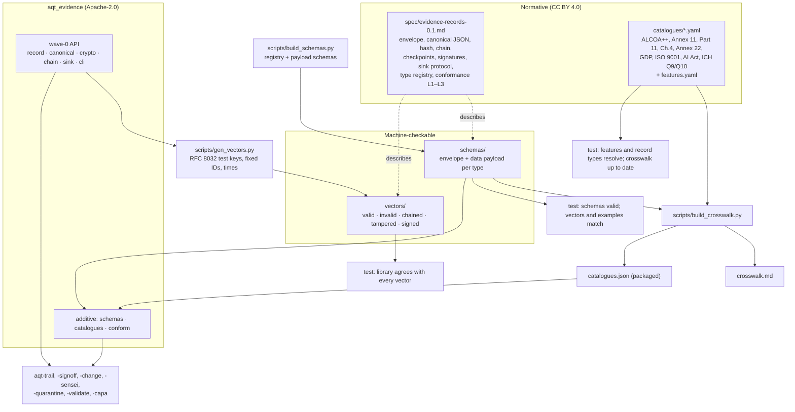

# aqt-spec — Design

**Status:** target design, Phase A 2026-10-21; adjusted in Phase B to the binding `planning/04_designs/INTERFACES.md` (I1–I12), MVP built. **Package:** `aqt-spec` (Python distribution `aqt-spec`, import name `aqt_evidence`). **Brief:** `planning/04_designs/SUITE_ARCHITECTURE.md` §2.1, shared foundation §1.

---

## 1. Introduction

### 1.1 Core idea

aqt-spec is the common ground of the Agent Quality Toolkit. It contains three things that belong together:

1. **The Evidence Records specification 0.1**: an open, language-neutral description of one JSON record that says *who* (person, agent or service, with role) did *what* (action, subject, before and after) *when* (UTC time and zone) and *why* (reason, meaning of a signature). It also fixes how records are canonicalised, hashed, chained, signed, checkpointed and delivered to a sink.
2. **Machine-checkable material**: JSON Schemas for the envelope and for the `data` payloads of every registered record type, and conformance test vectors (valid, invalid, chained, tampered, signed) that any implementation in any language can run.
3. **GxP catalogues and a crosswalk**: paraphrased, clause-numbered requirements from ALCOA++, EU GMP Annex 11 (2011 and July 2025 draft), 21 CFR Part 11, the draft Chapter 4 and Annex 22, the EU GDP Guidelines, ISO 9001:2015, the EU AI Act and ICH Q9(R1)/Q10. Each item names the AQT features that support it. A small script turns the catalogues into `crosswalk.md`: requirement → feature → evidence record type → what the user must still do.

The reference Python library `aqt_evidence` (built in wave 0 by the lead) implements the specification. It stays in this package; its API is stable and only grows additively.

### 1.2 Users and problem

| User | Need | What aqt-spec gives |
|---|---|---|
| Builders of the other seven AQT packages | One record format, one library, one list of record types | `aqt_evidence`, the type registry, payload schemas |
| Implementers in another language | A precise spec they can implement in an afternoon and check | Normative spec, JSON Schemas, test vectors with expected hashes and bytes |
| A quality manager or auditor | "Which regulatory concept does this feature support, and what remains my job?" | Catalogues and the crosswalk, with honest "supports" wording |
| A reviewer of the owner's portfolio | Evidence of regulatory and engineering competence | A short, readable spec and a crosswalk that does not overclaim |

The problem: agent audit logs exist in many shapes, but none carries GxP semantics (reason, meaning, role, before/after, time zone, independent recording) or maps to Annex 11, Part 11 and ALCOA++ (R3 §1 items 3–4, §5). Without a written spec, the seven tools would drift into seven dialects, and nobody outside the Python code could verify a trail.

### 1.3 End-to-end behaviour in plain language

- A **builder** reads the spec overview (about 15 minutes), creates records with `aqt_evidence.new_record(...)`, writes them with `open_sink().append(...)`, and in tests checks the `data` payload against the type's schema.
- An **implementer in Go or TypeScript** reads `spec/evidence-records-0.1.md`, runs the vectors in `vectors/`: for each vector the implementation must reproduce the canonical bytes and record hash, accept or reject the record, find the same first broken sequence number in a tampered chain, and verify signatures made with the published RFC 8032 test keys.
- A **verifier** runs `aqt-evidence conform trail.jsonl --level 3 --key service.pub --checkpoint head.json` and learns whether a file meets L1 (valid records), L2 (intact chain) or L3 (signed by pinned keys and matched by an external checkpoint).
- A **QM reader** opens `crosswalk.md`, picks a framework (for example 21 CFR Part 11), and reads per clause which AQT feature supports it, which record type is the evidence, and which procedural duties remain with the user (SOPs, training, validation, access administration, retention).

### 1.4 Inputs and outputs

| Input | Output |
|---|---|
| Records created by any AQT tool | Validation results, record hashes, chain and signature verification, conformance level |
| Catalogue YAML files (hand-written, reviewed) | `crosswalk.md` and a packaged `catalogues.json` that tools can read with the standard library |
| Generator script with the RFC 8032 test keys, fixed IDs and times | Deterministic vector files (regeneration is byte-identical) |

### 1.5 Performance intent

The library must not be the bottleneck of any tool: creating and validating a record should cost well under a millisecond, and verifying a trail of 100,000 records with signatures should take seconds, not minutes, on an ordinary laptop (proposed target; Ed25519 verification dominates). Catalogue and crosswalk generation run in under a second. The spec itself should be readable in about 15 minutes (overview plus one worked example); the normative detail may be longer.

### 1.6 Design flexibility

Everything below the core outcomes is a proposal. The builder may restructure the spec document, rename files, choose another vector layout, split or merge catalogue files, or replace PyYAML or `jsonschema` with equivalent tools, as long as: the spec stays normative and implementable without reading Python; the vectors stay language-neutral and the library provably agrees with all of them; the catalogues keep id, source, clause, paraphrase and `supported_by`; the crosswalk stays generated, not hand-edited; and the wave-0 library API stays backwards-compatible.

**Implementation workflow.** All implementation guided by this design uses `lean-vertical-delivery` (small end-to-end slices, proportionate checks, a small completion report; no separate testing or documentation regime). Work is tracked in Project Tracker Next (project "Agent Quality Toolkit", one implementation for this package) through its low-call lifecycle. This package has no interactive UI; if one is added later, it is designed with `ui-studio`. When the same functionality fails repeatedly despite a reassessed approach, consult a Sensei with the intended behaviour, the attempts and the specific help needed.

---

## 2. Proposed architecture

### 2.0 Structure and flow



The arrows show the only real flows: the vector generator uses the reference library to compute hashes and signatures, then the agreement test checks the library against the stored vectors (so a later library change that alters bytes fails loudly). The crosswalk generator reads catalogues, the feature registry and the type registry and writes Markdown plus one JSON file that is packaged with the library. Other tools depend only on the library (and, optionally, on packaged schemas and catalogue IDs).

### 2.0.1 Proposed layout (not binding)

```
aqt-spec/
  README.md  Design.md  LICENSE  NOTICE  CHANGELOG.md  pyproject.toml
  spec/evidence-records-0.1.md         normative spec (CC BY 4.0)
  schemas/envelope.schema.json         + one schema per data payload, e.g. signoff.signature.schema.json
  schemas/registry.json                record types: tool, summary, schema file, known actions, meanings, human_reason
  scripts/build_schemas.py             source of the registry and schemas (JSON committed, checked up to date)
  vectors/README.md  vectors/index.json  vectors/keys.json (RFC 8032 test seeds, TEST ONLY)  vectors/<category>/*.json
  catalogues/*.yaml  catalogues/features.yaml
  crosswalk.md                         generated
  scripts/gen_vectors.py  scripts/build_crosswalk.py
  src/aqt_evidence/                    wave-0 library + additive modules
  docs/api.md  docs/implementers.md    examples/  tests/  .github/workflows/ci.yml
```

`schemas/`, `vectors/` and the generated `catalogues/catalogues.json` are included in the wheel under `aqt_evidence/_data/` (hatch `force-include`), so installed tools can load them without the source tree.

### 2.0.2 How records are written

aqt-spec itself writes no evidence at runtime. It defines how the others write: build with `new_record`, optionally `sign_record`, deliver with `open_sink().append`. Only aqt-trail chains (`link`) and checkpoints. The spec documents the sink protocol exactly as `sink.py` implements it and fixes the socket error codes (`invalid_record`, `unauthorized`, `duplicate_id`, `unavailable`, `internal`), idempotent appends by `id`, and client spooling (`SocketSink` spools to `$XDG_STATE_HOME/aqt/spool/spool.jsonl` when the socket is down and sets `last_spooled`; INTERFACES I3). Signing follows I1: the envelope `sig` belongs to the writer of the stored record; human and actor signatures are detached statements in `data.signature`, bound to `record_content_hash` (which excludes `sig`, `chain`, `observed`, `time`) or to a file's bytes hash.

### 2.0.3 Reuse

| Source | What | Licence / treatment |
|---|---|---|
| Agent Platform Next, `docs/implementations/platform-consolidation/sprints/74_TAMPER_EVIDENT_AGENT_AUDIT_TRAIL.md` | ALCOA+ attribute interpretation for a trail (attributable = actor + process chain, contemporaneous = service time, …) | Ideas only, rewritten; no private paths |
| `planning/02_landscape/R3_qm_gxp_compliance.md` §2.2 (R-01…R-30) | Requirement list, clause numbers, interpretation for coding agents | Source for catalogue items; R-IDs kept as cross-reference |
| RFC 8785 (JCS) | Canonicalisation; AQT canonical JSON is a strict subset | Cited, not copied |
| JSON Schema draft 2020-12 | Schema dialect | Standard |
| C2SP tlog-checkpoint | Idea of a signed head statement | Our checkpoint is JSON, not signed-note; difference stated in the spec |
| Agent Trace 0.1.0 (CC BY 4.0) | Spec style and licence choice; attribution vocabulary | Cited; no text copied |
| draft-sharif-agent-audit-trail, draft-noa-scitt-ai-agent-receipt | Field ideas (pre/post phase, "parameters hashed, prompts not stored") | Cited in prior art |
| `cryptography` (Apache-2.0/BSD) | Ed25519 | Runtime dependency (already) |
| `jsonschema` (MIT), PyYAML (MIT) | Schema validation; YAML loading | Test/dev extra and optional `[schema]` extra; not runtime |

### 2.1 Core concepts

**Envelope.** Fixed top-level fields (`aqt, id, type, time, tz, actor, observed, action, subject, before, after, reason, meaning, links, data, chain, sig`); unknown top-level fields are invalid, so extensions go into `data`. Required: `aqt, id, type, time, actor, action`. The spec states the GxP intent of each field (e.g. `before`/`after` = old and new value per Annex 11 draft §12.2, stored as a hash plus optional short value).

**Canonical JSON and the record hash.** UTF-8, keys sorted, compact separators, ASCII keys, integers only within ±2^53, no floats anywhere. For every valid record the bytes equal RFC 8785 output, so a JCS library in another language produces the same hash. The record hash is `sha256:` over the canonical record without `sig`. Producers SHOULD store records in canonical form; verifiers MUST recompute and never trust the stored bytes. Duplicate object keys and lone surrogates MUST be rejected (parsers disagree on them, which would let two readers see two different records under one hash).

**Signatures.** Ed25519 over the same canonical bytes the hash covers; `sig` is a list, so co-signatures (writer service, signer, reviewer) are independent. Key ID = `ed25519:` + first 16 hex digits of SHA-256 of the raw public key. Verification is only meaningful against **pinned** keys (a rewritten log under a fresh key verifies otherwise; R3 §5 Sasana lesson).

**Chain.** `chain = {seq, prev}`; seq from 0, `prev` = previous record hash, `GENESIS` = 64 zeros. Editing, inserting, deleting or reordering breaks verification from the first affected seq. Only aqt-trail chains; tool-local JSONL files are unchained (L1).

**Checkpoint.** A signed statement `{aqt_checkpoint, log, seq, head, time}` with a single `sig` object (unlike records, which carry a list — documented as is). A checkpoint stored outside the writer's reach (another machine, a mail to oneself, an RFC 3161 token held in a `trail.anchor` record) detects truncation and wholesale rewrite.

**Conformance levels.**

| Level | A file conforms when | Detects |
|---|---|---|
| L1 valid | Every line is a valid envelope; types are registered or use the `x-<org>.` prefix; registered payloads validate | Malformed or ambiguous records |
| L2 chained | L1, and the chain verifies from GENESIS (or from a stated start), with gaps only as explicit `trail.gap` records | Edit, insert, delete, reorder inside the file |
| L3 signed + anchored | L2, every record has a valid signature by a pinned key, and the head (or an earlier seq) matches at least one signed checkpoint kept outside the writer | Rollback, truncation and rewrite under a fresh key |

**Record-type registry.** The 34 types of SUITE_ARCHITECTURE §1.2 and the INTERFACES I5 additions (`<tool>.refused` for every tool, `quarantine.delivered`, `signoff.key.enrolled`, `signoff.key.revoked`, `signoff.action.rejected`, `signoff.auth.failed`): 46 types, each with its payload schema, the expected `meaning` (if any) and whether `reason` is mandatory (human decisions: always). Types are `<tool>.<kind>`; `x-<org>.<kind>` is reserved for third parties.

**Payload schemas.** Each fixes only the minimal fields of INTERFACES I6/I5 as required and types the other known fields from the builders' designs; additional properties are allowed in 0.1. Units per I7: `*_ppm` integers for scores, rates and thresholds, `*_ms` for durations. Large texts are never inline: `{sha256, excerpt}` with a SHOULD limit for excerpts (280 characters) and a MUST NOT for secrets and raw prompts. Shared file schemas: `observed` (I2), detached signed statement (I1), checkpoint, thresholds file (aqt-validate §2.2 in ppm, I8), signer registry (I9).

**Vocabularies.** `meaning` (8 values) with QM definitions (e.g. *released* = a responsible person allows use of a held item; *waived* = a requirement is knowingly not met, with justification and expiry); actor ID conventions (`human:<id>`, `agent:<harness>:<session>`, `service:<tool>`); a starter set of `links.rel` values (`case`, `evidence`, `supersedes`, `invalidates`, `responds-to`, `plan`, `receipt`, `review`, `deviation`, `capa`), open for others.

**Catalogue item.** `id` (e.g. `part11:11.50(a)`, `annex11-2025d:12.2`, `alcoa:attributable`), `source` (document, version, date consulted), `clause`, `title`, `paraphrase` (own words, at most two sentences), `supported_by` (feature IDs from `features.yaml`), `user_must` (procedural duties), optional `r3` cross-reference (R-01…R-30), `verified` (checked against the source on the consulted date) and, for an unverified item, a `note` saying why. An item with an empty `supported_by` is listed honestly as "not supported by AQT". A **feature** (`trail.writer`, `signoff.meaning`, `change.receipt`, …) names its package, a one-line description and the record types that evidence it.

**Vectors.** One JSON file per vector: `description`, `input` (a record, a chain, or raw `input_text` for parse-level cases such as duplicate keys or floats), and `expect` (per kind; see `docs/implementers.md`). Signed vectors use the RFC 8032 §7.1 TEST 1 key (pinned) and TEST 2 key (unpinned), stored as hex seeds in `vectors/keys.json`, marked TEST ONLY; Ed25519 is deterministic, so vectors regenerate byte-identically. Note: JSON Schema treats `1.0` as an integer while the library rejects floats, so vectors record `schema_valid` and `valid` separately; the schema is necessary, not sufficient.

### 2.2 Interfaces

**CLI `aqt-evidence`** (exit 0 ok / 1 check failed / 2 usage or runtime error; `--json` where useful)

| Command | Status | Purpose |
|---|---|---|
| `validate FILE` | wave 0 | Envelope check per record |
| `hash FILE` | wave 0 | Record ID and hash per line |
| `verify FILE [--key K]… [--require-signature] [--json]` | wave 0 | Chain and signatures |
| `keygen PATH [--passphrase]` | wave 0 | Ed25519 key pair |
| `conform FILE --level 1\|2\|3 [--key K]… [--checkpoint CP]… [--json]` | new | Highest level reached, first failing reason; payload checks when the `[schema]` extra is installed, otherwise reported as skipped |
| `vectors [DIR]` | new, small | Run the library against the vector set (self-check for an installed copy) |

**Python API.** Unchanged wave-0 names (§1.1 of SUITE_ARCHITECTURE). Additive, proposed:

| Name | Purpose |
|---|---|
| `parse_record(text: str \| bytes) -> dict` | Strict JSON parse: rejects duplicate keys, floats, lone surrogates (raises `CanonicalError`) |
| `aqt_evidence.schemas`: `registered_types()`, `load_schema(name)`, `schema_for(type)`, `validate_payload(record) -> list[str]` | Packaged schemas; `validate_payload` needs the `[schema]` extra and raises an `ImportError` with an install hint otherwise |
| `aqt_evidence.catalogues`: `load() -> dict`, `item(id)`, `features()` | Read the packaged `catalogues.json` (stdlib only), so aqt-trail's ALCOA++ report can cite catalogue IDs and titles |
| `conformance(records, level, keys=None, checkpoints=None) -> ConformanceResult` | The engine behind `conform` |
| `sign_statement`, `verify_statement`, `signer_from_seed`, `public_key_from_raw` | Detached statements (I1) and keys from raw bytes (vectors) |
| `SocketSink(..., spool=True, spool_path=None)`, `last_spooled`, `spool_file()`, `SinkUnavailable`, `ERROR_CODES` | Spooling and error codes (I3) |
| `aqt_evidence.vectors`: `run_all()`, `run_vector()` | The vector runner behind `vectors` |

The lead added `session.py` (`detect_agent_context`, `require_human`, `HumanCheckError`, `process_chain`), `record_content_hash`, `evidence_sources` and `iter_evidence` before Phase B; they are part of the stable API.

One bug fix that is additive in effect: `canonical_json` currently lets a lone surrogate escape as `UnicodeEncodeError`, so `validate_record` raises instead of returning a problem. The fix maps it to `CanonicalError`. `read_jsonl` keeps its behaviour; strict parsing is opt-in through `parse_record` (I12); `conformance.read_strict` uses it for files.

**Files.** `spec/evidence-records-0.1.md`, `schemas/*.schema.json`, `schemas/registry.json`, `vectors/**`, `catalogues/*.yaml`, `crosswalk.md`; config: none (the package has no state and no config).

**Record types.** aqt-spec emits none. It *defines* all 46 registered types: `schemas/registry.json`, one payload schema per type in `schemas/data/`, the I6 minimal fields as the only required ones, and the table in spec §11.

### 2.3 Stack and method table

| Area | Choice | Why | Trade-offs | Alternative |
|---|---|---|---|---|
| Spec format | Markdown, RFC 2119 keywords, one worked example | Readable on GitHub; normative and short | No tooling for spec versioning | AsciiDoc/RFC XML if submitted to IETF later |
| Canonicalisation | Strict subset of RFC 8785 (integers only, ASCII keys) | Byte-identical with JCS libraries; trivial in Python stdlib | No floats: scores in ppm, durations in ms | Full JCS with number formatting (needs ES6 float printing) |
| Hash / signature | SHA-256, Ed25519 | Ubiquitous, deterministic signatures, small keys | No post-quantum; no hardware keys yet | ML-DSA later as second `alg` |
| Schemas | JSON Schema 2020-12 | Standard, every language has validators | Cannot express "no floats" or canonical rules | CUE / Pydantic models (language-bound) |
| Schema validation in Python | `jsonschema` in `[schema]` and `[test]` extras | Mature, MIT | Pulls `referencing`, `rpds-py` (Rust wheel) | Hand-written checker for the subset we use |
| Catalogues | YAML, PyYAML only in the generator and tests | Human-editable, comments allowed; runtime reads generated JSON with stdlib | Two representations (YAML source, JSON build) | JSON source (no extra dependency, worse to edit); OSCAL export later |
| Crosswalk | Generated Markdown, checked "up to date" in tests | Never hand-edited, never stale | Large single file | Per-framework files under `docs/crosswalk/` |
| Vectors | One JSON file per case, generated deterministically, committed | Language-neutral, diffable | Test private key is public by design | Wycheproof-style single file |
| Packaging | hatchling, `force-include` for `schemas/`, `vectors/` and `catalogues.json` (editable installs fall back to the source tree) | Already used by wave 0 | Data duplicated in the wheel | `importlib.resources` package data under `src/` |
| Licences | Code, schemas and vectors Apache-2.0; spec, catalogues, crosswalk CC BY 4.0 (SPDX identifiers and a link now, full CC text before publication, I12) | Schemas/vectors are consumed by code; texts follow Agent Trace's precedent | Two licences in one package (stated in NOTICE and file headers) | Everything CC BY 4.0 except `src/` |

### 2.4 QM mapping, threat model and limits

**QM mapping of what aqt-spec itself provides** (clauses as consulted; draft numbering may change):

| Feature | Concept and clause |
|---|---|
| Envelope fields actor/role, action, before/after, time + tz, reason | ALCOA++ Attributable, Contemporaneous; Annex 11 (2011) §9; Annex 11 draft §12.2; Part 11 §11.10(e); Ch.4 draft 4.63 |
| `observed` (OS process attribution by the writer) | Ch.4 draft 4.24–4.25 (AI-produced records attributable); ALCOA++ Attributable (computerised system) |
| `actor.agent` (harness, model, version, session) | Annex 22 draft §10 (configuration control of models); AI Act Art. 12 |
| Canonical hash, chain | ALCOA++ Original, Accurate, Complete; Part 11 §11.10(c), §11.10(e) ("not obscure previously recorded information"); Annex 11 draft §12.3 (locked trail) |
| Signatures with `meaning` bound to the record hash | Part 11 §11.50, §11.70; Annex 11 (2011) §14; Annex 11 draft §13 |
| Checkpoints, anchors (L3) | ALCOA++ Enduring; Part 11 §11.10(c); Annex 11 (2011) §7.1 (data secured against damage) |
| JSONL export, schemas, open spec | Part 11 §11.10(b) (accurate and complete copies); Annex 11 draft §12.4, §12.9 (searchable, exportable; not flat locked files); ALCOA++ Available, Legible |
| `links` | ALCOA++ Traceable (Ch.4 draft) |
| Catalogues and crosswalk | ISO 9001 7.5 (documented information); supports the user's validation planning and supplier assessment (Annex 11 (2011) §3–§4; GAMP 5 D9 fitness for intended use) |
| Conformance vectors | ISO 9001 7.1.5 (measuring resources fit for purpose) by analogy: the verifier itself is checked |

**Threat model.** Attacker: an agent or process with the same Unix user as the log, or anyone who obtains a copy of the log. The spec gives *tamper evidence*, never tamper prevention.

| Threat | Covered by | Limit |
|---|---|---|
| Edit, insert, delete, reorder records | Chain (L2) | Only within the file; a full rewrite re-chains cleanly |
| Rewrite under a fresh key | Key pinning + external checkpoint (L3) | Requires the user to keep the public key and a checkpoint outside the writer's reach |
| Truncation / rollback | External checkpoint, exported head | Records after the last external checkpoint can be lost undetected |
| Parser confusion (duplicate keys, floats, surrogates) | Canonical rules, `parse_record` | Other implementations must apply the same rules; vectors test it |
| Back-dating | Writer sets time; RFC 3161 anchor (aqt-trail) | Without a TSA, time is the host clock |
| Brute-forcing `before`/`after` hashes of low-entropy values | SHOULD: do not hash short secrets; store references | No salting in 0.1 (noted for 0.2) |
| Personal data in records (names, excerpts) | Hash + short excerpt rule, IDs instead of names where possible | GDPR minimisation vs. GMP retention remains the user's decision |
| Key theft | Out of scope for the spec; keys are files with mode 0600 | Hardware keys later (aqt-signoff authenticator interface) |

**Limits.** The catalogues are paraphrases by a practitioner, not legal advice; draft texts (Annex 11 draft, Ch.4 draft, Annex 22 draft) will change and every item carries its source version and consultation date. "Supported by" means a feature produces evidence or a control relevant to the clause; it never means the clause is met. The README carries the suite's non-compliance statement verbatim.

### 2.5 Novelty and prior art

| Project | What it does | Difference |
|---|---|---|
| Agent Trace 0.1.0 (CC BY 4.0) | Line-level AI code attribution | Attribution only; no reason, meaning, review, chain or signatures. AQT can link to it |
| draft-sharif-agent-audit-trail | JCS + SHA-256 chained agent records, optional ECDSA and RFC 3161; maps to AI Act, ISO 42001, SOC 2 | Closest format; no GMP/Part 11 mapping, no meaning vocabulary, no conformance vectors per level |
| draft-noa-scitt-ai-agent-receipt | JCS Ed25519 action receipts, parameters hashed | Explicitly does not bind a named approver to the exact action; AQT does (`meaning` + `signoff.*`) |
| asqav (Elastic-2.0), MS Agent Governance Toolkit (MIT) | Signed receipts / Merkle audit log, AI Act mappings | Sign inside the agent process; no GxP semantics; licence (asqav) blocks reuse |
| halo-record, Capsule, Acta (Apache-2.0) | Small hash-chained or signed record formats | Crypto-equivalent; no regulatory catalogue or review semantics |
| CISO Assistant libraries, OSCAL | Machine-readable control catalogues | No GxP catalogues (Annex 11, Part 11, ALCOA++) found; AQT catalogues could be offered upstream later |
| in-toto / SCITT | Attestation envelopes, transparency receipts | Generic; AQT may export to them later |

Honest assessment: hashing, chaining and Ed25519 are a commodity. What is new is the combination of (a) GxP semantic fields in the envelope, (b) a conformance ladder that makes "anchored outside the writer" a level, not a footnote, and (c) machine-readable GxP catalogues that link each clause to a feature and a record type and state what remains the user's job.

---

## 3. Flexible roadmap

### 3.1 MVP slice (Phase B)

One end-to-end result: *an outsider can implement the format from the spec, prove it against the vectors, and a QM reader can trace any listed clause to an AQT record type.*

1. **Spec + envelope schema + vectors + agreement.** Write `spec/evidence-records-0.1.md` (overview and worked example first, normative sections after, security considerations, registry, conformance levels). `envelope.schema.json`. `gen_vectors.py` produces the vectors (57 built) (≥ 5 per category, including duplicate keys, float, lone surrogate, unknown field, bad meaning, edited/inserted/deleted/reordered chain, unknown key, truncated vs. checkpoint). Additive library work: `parse_record`, the surrogate fix, `conform`. Check: pytest agreement test over all vectors; regeneration is byte-identical; schema validates every `valid` vector and rejects the schema-detectable invalid ones.
2. **Payload schemas + registry.** Harvest the payload cores from the seven `Design.md` files; one schema per type; `schemas` module. Check: every registered type has a schema; one example record per type validates (examples double as documentation).
3. **Catalogues + crosswalk.** `features.yaml` and the eleven catalogues of INTERFACES I11 (IDs `<catalogue>:<clause as in the source>`; GDP items checked against the Official Journal text) (only clauses relevant to the suite; expected 100–140 items in total). `build_crosswalk.py` → `crosswalk.md` + `catalogues.json`; `catalogues` module. Check: every `supported_by` resolves to a feature, every feature's record types are registered, crosswalk is up to date, no item paraphrase exceeds the length rule.
4. **Docs and package.** README (problem, 60-second quick start, Mermaid, QM table, threat model, non-compliance statement, licences), `docs/api.md`, `docs/implementers.md`, NOTICE, CHANGELOG, CI file, `examples/` (create, sign, chain, verify). Check: quick start commands run in a test.

### 3.2 Later stages

| Stage | Result | Decision (who, when) | Risk / response |
|---|---|---|---|
| Spec 0.1 freeze | Payload schemas tightened (`additionalProperties: false` where stable) | Lead, after the integration demo | Breaking other tools → tighten only fields all builders confirmed |
| Exports | in-toto/DSSE and SCITT statement export of records and checkpoints | Owner, before publication | Format churn in IETF drafts → keep export, not native format |
| OSCAL / CISO Assistant | Catalogues exported as OSCAL and offered upstream | Owner | AGPL upstream → contribute data only, no code reuse |
| Other languages | TypeScript or Go verifier passing all vectors | Owner, on demand | Maintenance load → verifier only, no writer |
| Catalogue updates | Final Annex 11 / Annex 22 texts replace drafts, versioned side by side | Lead/owner when published | Renumbered clauses → IDs carry the document version |
| OTel mapping | `actor.agent` ↔ OTel GenAI attribute names | Later | Conventions still "Development" |
| 0.2 ideas | Salted value hashes, ML-DSA `alg`, multi-signature policy object | Lead | No known need yet |
