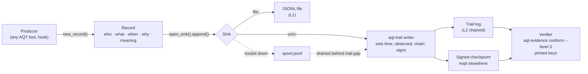

# aqt-spec — evidence records for AI agent work

Part of the **Agent Quality Toolkit** (AQT): quality management for AI coding agents.
This package holds the shared ground of all AQT tools:

- **[Evidence Records 0.1](spec/evidence-records-0.1.md)**, an open specification of one JSON record that says who did what, when and why, with canonical hashing, hash chains, Ed25519 signatures, checkpoints and a sink protocol;
- **[JSON Schemas](schemas/)** for the envelope and every registered record type, and **[conformance test vectors](vectors/)** any implementation can run;
- **[GxP catalogues](catalogues/)** (ALCOA++, EU GMP Annex 11 2011 and 2025 draft, 21 CFR Part 11, Chapter 4 and Annex 22 drafts, EU GDP, ISO 9001, EU AI Act, ICH Q9/Q10) and the generated **[crosswalk](crosswalk.md)**: requirement → AQT feature → evidence record type → what you still must do;
- **`aqt_evidence`**, the Python reference library and the `aqt-evidence` CLI that every AQT tool uses.

> Agent Quality Toolkit supports quality-management practices; it is not a validated system and does not by itself make any process compliant with GMP, GDP, 21 CFR Part 11 or EU Annex 11.

## The problem

Coding agents act faster than anyone can watch. Many projects now log agent actions in hash chains, but the logs answer "what happened" without the questions a quality manager asks: who was accountable and in which role, what was the old and the new value, why was it changed, what did a signature *mean*, and was the log written by someone other than the actor? Without one written format, every tool invents its own, and nobody outside its code can verify the result. aqt-spec fixes one small format, designed along ALCOA++, Annex 11 and Part 11 concepts, that any language can implement and check.

## Quick start (60 seconds)

```bash
uv venv .venv && uv pip install --python .venv/bin/python -e ".[schema]"
.venv/bin/aqt-evidence vectors                       # the library agrees with every test vector
.venv/bin/python examples/quickstart.py demo         # create, sign, chain and checkpoint two records
.venv/bin/aqt-evidence conform demo/trail.jsonl --level 3 --key demo/writer.key.pub --checkpoint demo/checkpoint.json
.venv/bin/aqt-evidence verify demo/trail.jsonl --key demo/writer.key.pub
```

In Python:

```python
from aqt_evidence import actor, new_record, open_sink, resolve_sink, subject, bytes_hash

record = new_record("change.finish", actor("agent", "agent:claude-code:s-0001"), "finish",
                    subject=subject("file", "docs/report.md", sha256=bytes_hash(b"...")),
                    data={"plan_ref": "plan-0001", "receipts": [], "waivers": [], "gate": "GO"})
open_sink().append(record)   # AQT_SINK, else a local aqt-trail writer, else ~/.local/state/aqt/evidence.jsonl
resolve_sink()               # where records go, and a warning when they may miss the trail
```

## How it works



- **Canonical JSON** (sorted keys, no whitespace, integers only, no duplicate keys) is byte-identical to RFC 8785 for every valid record, so the SHA-256 record hash is the same in every language.
- **Signatures**: the writer signs stored records (`sig`); people sign records or files with a detached statement in `data.signature` that contains name, role, meaning, time and the subject hash.
- **Chain and checkpoints**: each stored record links to the previous record's hash; a signed checkpoint of the head, kept outside the writer's reach, reveals rewrites and truncation of the records up to its `seq` (records written after the newest checkpoint are not covered).
- **Conformance levels**: L1 valid records, L2 intact chain, L3 signed by pinned keys and anchored.

## QM mapping

| Feature | Supports (concept and clause) |
|---|---|
| Envelope: actor and role, action, before/after, UTC time and zone, reason | ALCOA++ Attributable, Contemporaneous; Annex 11 (2011) §9, §12.4; Annex 11 draft §12.2; Part 11 §11.10(e) |
| `observed` process attribution set by the writer, `actor.agent` model and session | Chapter 4 draft 4.24–4.25 (records produced with AI); Annex 22 draft §10 |
| Canonical hash and chain | ALCOA++ Original, Accurate, Complete; Part 11 §11.10(c), §11.10(e); Annex 11 draft §12.3 |
| Signatures with meaning bound to the content hash | Part 11 §11.50, §11.70; Annex 11 (2011) §14; Annex 11 draft §13.3–13.8 |
| Checkpoints and external anchors (L3) | ALCOA++ Enduring; Part 11 §11.10(c); Annex 11 (2011) §7.1 |
| Open spec, schemas, JSONL export | Part 11 §11.10(b); Annex 11 draft §12.4, §12.9; ALCOA++ Available, Legible |
| `links` between records | ALCOA++ Traceable |

The full mapping for the whole suite, including what each clause still requires from you, is in [crosswalk.md](crosswalk.md) (121 items in 11 catalogues).

## Threat model and limits

- **Tamper evidence, not prevention.** Changes become detectable for a verifier with pinned keys and an external checkpoint; without both, a complete rewrite is undetectable. Editing the last record of an unsigned chain, and truncation, are invisible to the chain alone (the vectors show this); a checkpoint reveals truncation only down to its own `seq`.
- **Same-user writers** can be rewritten and re-signed by any process that can read the writer's key. Run aqt-trail as a separate user where that matters.
- **Time** is the writer's clock unless anchored by RFC 3161 (aqt-trail).
- **Side files.** Readers (`iter_evidence`) read the trail log first; a record in the sink file or spool cannot hide or replace a trail record with the same `id` (a differing copy is reported, not used). Records that exist only in those files are not chained or writer-signed.
- **Agent-context checks** (`require_human`) detect known harness markers; they are a guard against agents deciding by accident or by injected instruction, not a security boundary.
- **Catalogues are paraphrases**, not legal advice. Drafts (Annex 11 2025, Chapter 4, Annex 22) will change; every catalogue states its source version, consultation date and how it was checked.
- **Test keys** in `vectors/keys.json` are the published RFC 8032 keys. Never use them for real evidence.

## Library and CLI

- [`docs/api.md`](docs/api.md): the Python API (stable since 0.1.0; changes are additive).
- [`docs/implementers.md`](docs/implementers.md): implementing the spec in another language and running the vectors.
- CLI `aqt-evidence`: `validate`, `hash`, `verify`, `keygen`, `conform`, `vectors`; exit 0 ok, 1 check failed, 2 usage or runtime error.

Runtime dependency: `cryptography`. Optional: `jsonschema` (`[schema]` extra) for payload validation. Development (the `[test]` extra includes Hypothesis for the property tests): `uv pip install --python .venv/bin/python -e ".[test]"`, then `.venv/bin/python -m pytest -q`. Generated files are rebuilt with `scripts/build_schemas.py`, `scripts/gen_vectors.py` and `scripts/build_crosswalk.py`; tests fail when they are out of date.

## Licence

Code (`src/`, `scripts/`, `tests/`, `examples/`), JSON Schemas and test vectors: Apache-2.0 (`LICENSE`). Specification (`spec/`), catalogues (`catalogues/`) and `crosswalk.md`: [CC BY 4.0](https://creativecommons.org/licenses/by/4.0/) (SPDX `CC-BY-4.0`). See `NOTICE`.
