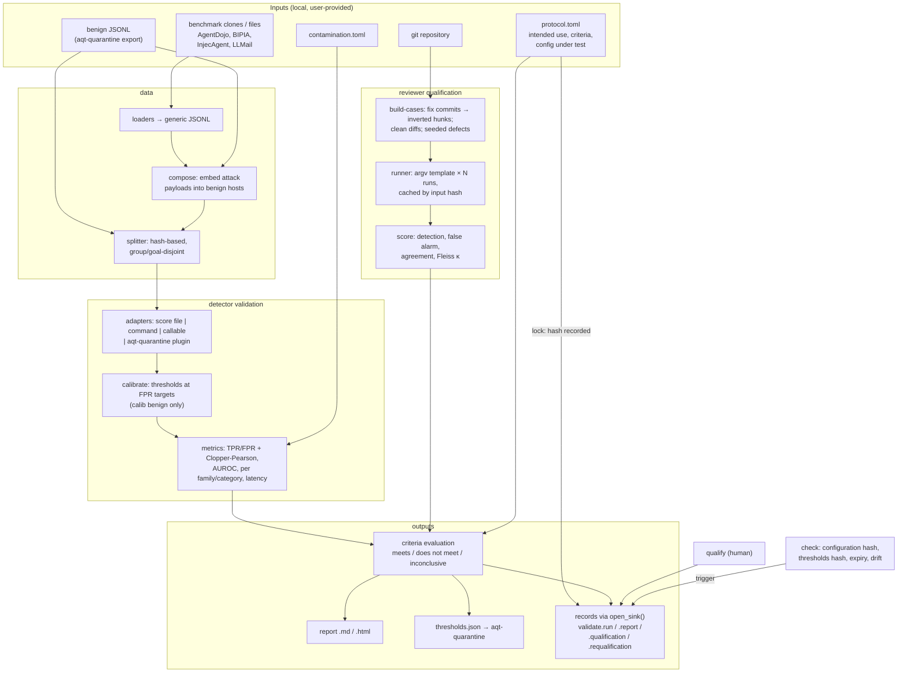

# aqt-validate — validation of AI controls

**Status:** target design, Phase A (2026-10-21). **Brief:** `planning/04_designs/SUITE_ARCHITECTURE.md` §2.7.
**Sources:** STRATEGY §4–§6; R2 §4–§5 (gap G1, candidate T2, benchmark licences); R1 §5 O3 (reviewer qualification); A2 §3.5–§3.6 and §6.5 (the owner's s36 evaluation method). The owner's s36 evaluation code and `RESULTS.md` were read for the method only; no data, labels, scores, thresholds or models are used.

---

## 1. Introduction

### Core idea

An AI control is anything that makes or filters a decision for an agent: a prompt-injection detector in front of an agent, or an AI reviewer that inspects an agent's diff. People trust these controls on the strength of model cards (F1 at a 0.5 cutoff, AUROC) or a demo. A quality manager would not accept that for a measuring instrument or an analytical method. Before use, the instrument is qualified for its *intended use*, against *acceptance criteria fixed beforehand*, on data that represents real conditions. The results carry *confidence bounds*, and the qualification has a *validity period* and *requalification triggers*.

aqt-validate applies that discipline to AI controls. It produces a validation report and evidence records that answer one question: "At this operating point, on my data, is this configuration good enough for what I use it for, and until when does that answer hold?"

### Users

- **Primary:** a solo developer or small team running aqt-quarantine (or any injection detector) who wants thresholds calibrated on their own benign traffic. The same user may want to know whether `claude -p`, `codex exec` or `pi` with a given review prompt actually finds the defects that matter in their repository.
- **Secondary:** people in regulated settings who need an intended-use / acceptance-criteria / results / conclusion record for an AI tool they use as decision support.
- **Callers:** aqt-quarantine consumes the thresholds file. aqt-change and aqt-sensei can cite a reviewer qualification. aqt-capa may open a deviation when a requalification fires. aqt-trail stores the records.

### The problem

1. **Operating points are misreported (R2 G1).** Detectors are judged by AUROC or F1@0.5, although in use they run at a threshold chosen for a tolerable false-positive rate (FPR) on the user's own traffic. The s36 evaluation showed what happens: AUROC ≈ 0.92, yet only 1.5–57 % detection at 1 % FPR for single models. Held-out FPR came out above calibration FPR, which signals drift.
2. **No one qualifies AI reviewers (R1 G3).** No tool measures on the user's own repository how often a reviewer configuration finds known defects, how often it raises false alarms, or how consistent it is from run to run. No tool requalifies it when the model changes.
3. **Post-hoc criteria and test-set reuse are easy and invisible.** In s36 the owner openly disclosed one post-hoc rule switch. Most evaluations disclose nothing.

### End-to-end behaviour (plain language)

**Detector validation**

1. The user writes a **protocol** (TOML) that names the following:
   - the intended use;
   - the detectors under test, with their versions and model hashes;
   - the datasets;
   - the FPR targets, for example *warn* at 3 % and *hold* at 1 %;
   - acceptance criteria, for example "one-sided 95 % lower bound of detection on `agent_action` ≥ 50 % at the hold threshold" and "upper bound of held-out benign FPR ≤ 3 %";
   - the validity period and the requalification triggers.
2. `protocol lock` records the protocol's hash with a reason. The locking human is on record before any test data is scored.
3. `detector run` does the following in order:
   - splits the data deterministically: benign data into calibration and held-out; attack data into dev and test, keeping goals disjoint;
   - scores every item through the configured detector adapters;
   - sets thresholds on calibration benign data only;
   - measures detection rate (TPR) and FPR with exact Clopper–Pearson bounds, AUROC, per-family and per-category results, and latency;
   - evaluates the criteria;
   - writes a Markdown/HTML report and a `thresholds.json` for aqt-quarantine;
   - records `validate.run` and `validate.report`.

   Each readout of the test split is counted, and the count appears in the report.
4. A human reads the report and runs `qualify`. That records `validate.qualification` (approved or rejected, with a reason, a validity period and the `configuration_hash` of the qualified configuration).
5. Later, `aqt-validate check` compares the current configuration with the last qualification:
   - the detector or model hash;
   - the thresholds file hash;
   - expiry;
   - optional drift input.

   When a trigger fires, it records `validate.requalification` and exits 1, so a hook or cron job can act on it.

**Reviewer qualification**

1. `reviewer build-cases` scans a git repository for fix commits. For each one it re-creates the defect as a diff to review (the fix hunk, inverted) together with a code snapshot. It also collects *clean* diffs from non-fix commits. Users can add their own seeded defects.
2. `reviewer run` executes the configured reviewer command N times per case. The command receives the diff and the snapshot and returns findings JSON. The run then scores the following, each with bounds:
   - detection rate (a finding at the defect's location);
   - false-alarm rate on clean diffs;
   - repeatability across runs (simple agreement and Fleiss' κ).

   Protocol, report, qualification and check work exactly as for detectors.

### Inputs and outputs

| Input | Form |
|---|---|
| Protocol | TOML file; its SHA-256 is locked before test readout |
| Benign data | JSONL in the generic format (§2.2), typically exported by aqt-quarantine (`cases export` / passed items); stays local |
| Attack data | User-provided clones or files of public benchmarks (AgentDojo, BIPIA, InjecAgent, LLMail-Inject: all MIT), converted by loaders into the generic format; never bundled |
| Contamination registry | TOML: which detector was trained on which dataset (version) |
| Detector adapters | Score file, command (JSONL in → JSONL out) or Python callable; optionally aqt-quarantine's detector plugins |
| Reviewer adapter | argv template plus prompt template; findings JSON on stdout |
| Repository | Local git repository for seeded defects |

| Output | Form |
|---|---|
| Run directory | `$XDG_STATE_HOME/aqt/validate/runs/<run-id>/`: manifest, split manifest (IDs and hashes only), scores, `results.json`, report `.md`/`.html`, `thresholds.json` |
| Evidence records | `validate.run`, `validate.report`, `validate.qualification`, `validate.requalification` through `aqt_evidence.open_sink()` |
| Exit codes | `0` meets / still valid, `1` does not meet or inconclusive / requalification needed, `2` usage or runtime error |

### Performance intent

Validation is a batch job, not a hot path. aqt-validate's own overhead covers splitting, statistics, reports and records. It should stay in seconds for tens of thousands of items, so that runtime is dominated by the detector or reviewer under test. The statistics are exact and deterministic: re-running a locked protocol on the same data, with the same seeds and scores, gives identical metrics (only measured latencies and timestamps differ). Reviewer runs are costly (N × cases model calls). The design keeps them resumable: completed case-runs are cached by input hash and are not re-billed after an interruption.

### Design flexibility

The modules, file layout, CLI verbs, metric formulas' implementation and report layout below are proposals. The implementing worker may merge, rename or simplify them. It may also use another algorithm, for example a different incomplete-beta method or a different line-matching rule. The **meaning** of the results must not change:

- thresholds come from calibration benign data only;
- bounds are exact binomial bounds;
- test readouts are counted;
- criteria are fixed by hash before the test readout;
- qualification is a human decision with a reason.

Small product adaptations, such as an extra loader or a dropped HTML flourish, need no approval. Removing one of the four Musts of §2.7 does.

> **Implementation workflow.** All implementation guided by this design uses `lean-vertical-delivery` (small end-to-end slices, proportionate checks, a small completion report; no separate testing or documentation regime). Work is tracked in Project Tracker Next (project "Agent Quality Toolkit", one implementation for this package) through its low-call lifecycle. This package has no interactive UI; if one is added later, it is designed with `ui-studio`. When the same functionality fails repeatedly despite a reassessed approach, consult a Sensei with the intended behaviour, the attempts and the specific help needed.

---

## 2. Proposed architecture

A single Python package (`aqt_validate`) with a stdlib-only core. There is no service and no listener; every command is a batch CLI run. The only runtime dependency is `aqt-spec`, which brings in `cryptography`.



The arrows show data flow. Benign data feeds both composition (as host documents for embedded payloads) and the splitter. The contamination registry acts at the metrics step: a contaminated (detector, dataset) pair is reported separately and kept out of the headline and criteria. The protocol hash is recorded at lock time, before any test readout, and again in every run and report record.

```mermaid
sequenceDiagram
    actor H as Human (responsible person)
    participant V as aqt-validate
    participant S as Sink / aqt-trail
    H->>V: protocol lock protocol.toml --reason
    V->>S: validate.run (action protocol-locked, protocol sha256)
    H->>V: detector run protocol.toml --split test
    V->>V: verify lock exists for this sha256; count test readouts
    V->>S: validate.run (action completed, metrics, readout n)
    V->>S: validate.report (conclusion, criteria, report sha256)
    H->>V: qualify RUN --approve --reason --valid-days 90
    V->>S: validate.qualification (meaning approved, configuration_hash, valid_until)
    Note over V: weeks later
    H->>V: check (cron / hook)
    V->>S: validate.requalification (triggers fired) → exit 1
```

**Modules (suggested, not binding):** `stats.py` (Clopper–Pearson, AUROC, Fleiss' κ, quantiles), `data.py` (generic format, loaders, compose, splits), `protocol.py` (TOML parsing, criteria, configuration hash), `detector.py` (adapters, calibration, metrics, thresholds file), `reviewer.py` (case builder, runner, matching, scoring), `report.py` (Markdown, plus HTML from the same model), `records.py` (record builders over `aqt_evidence`), `check.py`, `cli.py`.

**Storage:**
- Config at `$XDG_CONFIG_HOME/aqt/validate.toml`: human ID, default confidence, registry path, state directory.
- Run state under `$XDG_STATE_HOME/aqt/validate/`: `runs/<run-id>/` and `cache/reviewer/<sha256>.json`.
- Every path can be overridden by a flag or an environment variable.

Files are written with mode 0600. They hold IDs, hashes and scores, never benign text: the text stays in the user's own files.

**How records are written:**
- Records are built with `aqt_evidence.new_record()` and appended with `open_sink()`, which goes to a JSONL file or the aqt-trail socket.
- Run and report records are written by the invoking actor. That is `human:<id>` from the config, or `agent:<harness>:<session>` when agent environment markers are present.
- Qualification records are human only: the command calls the shared `aqt_evidence.require_human()` (INTERFACES I9). On refusal it records `validate.refused` with `data = {attempted_action, reason_code, agent_markers}` (I5).
- All numbers in records are integers (INTERFACES I7): counts, scores, thresholds, rates and bounds as `*_ppm` (parts per million), durations as `*_ms`. Full results (including floats such as AUROC) live in `results.json`, whose hash the record carries.

**Reuse from Agent Platform Next (method only, rebuilt, no code copied):** the s36 evaluation in `components/pi-omni/classifier/eval/`. The ideas taken are:
- the threshold rule "smallest *t* with mean(s > t) ≤ α on calibration benign" (`analyze.py`, `score_v2.py`);
- hash-based deterministic splits, `sha256(key)` → [0,1) (`build_sets.py`);
- embedding payloads at start, middle, end or replace positions in benign hosts (`build_sets.py`);
- the payload-span check and per-threat tagging (`tag_v2.py`);
- max-rank fusion against the calibration ECDF (`combine_rank.py`);
- leave-one-family-out (`score_v2.py`);
- the reporting discipline of `RESULTS.md`: single test readout, disclosed deviations, unmet criteria stated.

`NOTICE` records the origin as "method derived from the author's private Agent Platform Next". The s36 code relies on numpy and scikit-learn; the rebuild is stdlib.

**Open source:** no code is copied. Benchmarks are read from user-provided paths, never redistributed, and recorded with version and hash:
- AgentDojo, BIPIA, InjecAgent, LLMail-Inject, NotInject and BrowseSafe-Bench: MIT;
- deepset/prompt-injections: Apache-2.0;
- CC BY-NC sets (WASP, Qualifire) can be used locally through the generic format, and the docs warn about their licence.

Reference values for the statistics tests are computed once outside the package (statsmodels/SciPy, BSD) and hard-coded as constants. Neither library is a dependency.

### 2.1 Core concepts

**Operating point and threshold calibration.** A detector emits a score; a band (warn, hold) fires when the score exceeds a threshold. For a target FPR α and *n* calibration benign scores sorted in descending order (s₀ ≥ s₁ ≥ …), the threshold is t = s_k with k = ⌊α·n⌋. This is the smallest threshold whose realised calibration FPR, #(s > t)/n, is ≤ α. Ties make the realised FPR lower than α, and the report shows the realised value.
- **Uses only calibration benign data:** never attack data, never held-out data. This keeps the held-out FPR an honest estimate.
- **Minimum sample size:** with 0 false positives among n items, the one-sided 95 % upper bound is 1 − 0.05^(1/n) ≈ 3/n. Showing FPR ≤ 1 % therefore needs n ≥ 299 clean calibration items. The report states this explicitly: with the s36 numbers, 0/176 gives "≤ 1.7 %", not "≤ 1 %". A criterion that cannot be met at the available n is flagged **inconclusive**, not failed silently.

**Exact Clopper–Pearson bounds.** For k successes in n trials at confidence 1 − γ, the bounds come from beta quantiles:
- lower = B⁻¹(γ/2; k, n − k + 1), or 0 when k = 0;
- upper = B⁻¹(1 − γ/2; k + 1, n − k), or 1 when k = n.

Stdlib implementation: an exact binomial tail Σ C(n,i)pⁱ(1−p)ⁿ⁻ⁱ, computed in log space with `math.lgamma`, then bisection on p to 1e-12. This is monotone, has no SciPy dependency, and is fast enough for n up to 10⁵ (one-off batch). Reports show two-sided intervals. Acceptance criteria use **one-sided** bounds at the protocol's confidence (`lower95`, `upper95`) because they test "at least" or "at most" claims. Tests use known values:
- 5/10 gives [0.1871, 0.8129];
- 0/102 one-sided upper is 0.0289;
- 0/176 one-sided upper is 0.0169.

**AUROC.** The Mann–Whitney U statistic divided by n₀·n₁, with ties counted ½. It is reported as context only and is never a criterion by default, because AUROC says nothing about the operating point (R2 G1). A confidence interval is later work.

**Splits and disjointness.**
- **Benign:** calibration or held-out, decided by `u = sha256(salt ‖ group)` mapped to [0,1). `group` defaults to the session or source, so a whole session lands on one side; s36 split by item and saw session drift.
- **Attack:** dev or test, decided by the `goal`. When no goal is given, the payload hash decides, and after that the item ID. This keeps the same attacker goal in other templates from leaking into test.
- **Disjointness check:** the report counts any goal or payload hash that appears in both dev and test. It must be 0, or it is listed as a deviation.
- **Leave-one-family-out:** optional, for fusion fitting (later work).
- **Dev and test readouts:** dev can be scored any number of times (exploration, threshold tuning, fusion choice). Each test readout increments a counter in the `validate.run` record, which supports Annex 22 draft §6.3 (record how often test data is used).

**Composition.** Public payloads are short. Real untrusted inputs are web pages and tool results. `compose` copies a benign host item and inserts the payload at a seeded position:
- start, middle or end of the text;
- a JSON field (snippet/title) for search-result-shaped hosts.

It records the span offsets and `host` ID. With `compose = true` in the protocol, composition happens inside the run *after* the benign split and uses only **held-out** benign items as hosts, so calibration benign text never reappears inside attacks. The standalone `data compose` command takes an explicit host file (use a separate host pool).

**Fusion and bands.** With several detectors, each score is mapped to its rank among calibration benign scores (empirical CDF); the fused score is the maximum rank. Calibrating the fused rank at α yields one threshold per detector, at the same ECDF level. The band rule then becomes "**any** detector above its band threshold", and the realised fused FPR on calibration benign is ≤ α by construction. Consumers need no ECDF table.

An optional hold rule "≥ k of n detectors above their own α threshold" (the s36 agreement rule) is supported in the thresholds file. Its FPR is measured, not guaranteed.

**Contamination registry.** TOML entries say that detector X (version) was trained on dataset Y (version or phase); for example, Horizon on LLMail phase 1. Results for contaminated pairs are computed, shown in a separate "contaminated — not evidence" table, and excluded from criteria. The registry is user-declared; unknown training data is a stated limit.

**Seeded defects from history (reviewer qualification).** A fix commit C is selected when it matches the configured message patterns (`fix`, `bug`, `regression`, `revert`, issue keys). Its hunks to non-test source files, within size limits, define the defect. The **case diff** is the inverted fix, which reintroduces the bug relative to C. The **snapshot** is C's tree (`git archive`) with the inverted diff applied in a temporary directory, so the user's repository is never modified.

*Expected location* = the files and line ranges of the inverted hunks. **Clean cases** are diffs of commits matching non-fix patterns that no later fix touched in the same lines; this is a heuristic, and a clean diff may still contain a real bug, which the report states. User-supplied seeded defects (`defects/*.diff` plus expected locations) are first-class.

*Leakage:* public repositories' fixes may be in model training data. The protocol records the model's knowledge cutoff, and the report gives results split by commit date before and after the cutoff.

**Matching and reviewer metrics.** Findings JSON:

```json
{"findings": [{"file": "...", "line": 0, "end_line": 0, "severity": "low|medium|high", "summary": "..."}]}
```

A run **detects** a seeded defect when some finding with severity ≥ the protocol's minimum names the expected file and a line within the hunk range ± tolerance (default 3).

A run on a clean case is a **false alarm** when it has any finding at or above that severity.

- Per case, *detected* = detected in ≥ ⌈N/2⌉ runs (configurable).
- Rates and bounds are computed over **cases**, not runs. Runs on the same case are not independent, so counting runs would overstate precision.
- Per-run rates are also shown.

**Repeatability:**
- simple agreement: the share of cases where all N runs agree;
- mean pairwise agreement;
- Fleiss' κ over the binary outcome per run, with N raters per case.

Runner errors (non-zero exit, unparseable output, timeout) are counted separately as **errors**. They are excluded from the rates, listed as deviations, and an implicit criterion "errors = 0" (adjustable with `max_errors`) makes the conclusion *does not meet* when any occurred. They are never treated as misses or retried silently; a rerun happens only through an explicit `--retry-errors`. Detector errors are handled the same way.

**Configuration hash and requalification.** The `configuration_hash` (I6) is a canonical hash over what is being qualified:
- **detectors:** IDs, the versions that actually run (a plug-in's own `version`; a version pinned in the protocol must match it, otherwise the run and `check` fail with a clear error), adapter kind and value, a code hash (command argv plus script files, or a callable's module source) and the SHA-256 of each `model_file`;
- **reviewer:** harness, model, version, argv template, prompt template hash, runs, severity and matching settings.

The thresholds file in use is checked separately by its SHA-256. `check --protocol P [--thresholds FILE]` recomputes both and fires when any of these holds:
- `configuration-changed` or `thresholds-changed`;
- `expired` (`valid_until` has passed);
- `drift`: a drift input exceeds its bound.

In the MVP the drift input is an observed benign FP count supplied by the user (`--observed-fp K/N`). Deriving it from aqt-quarantine records is a later stage. The bound is the one-sided upper bound of the qualified held-out FPR of the most severe band. It fires only when the observed one-sided lower bound exceeds that upper bound, a conservative test that needs no tuning. A requalification record is written once per qualification and trigger set; later checks still exit 1.

### 2.2 Interfaces

**CLI** (`aqt-validate`, argparse, `--json` on every command, global `--config`, `--state-dir`, `--sink`):

| Command | Purpose | Exit |
|---|---|---|
| `data import --format generic\|bipia\|injecagent\|agentdojo\|llmail SRC --out FILE [--family --license]` | Convert a benchmark clone/file to generic JSONL (attack items: payload, goal, family, category) | 0 / 2 |
| `data compose --hosts BENIGN.jsonl --attacks ATTACKS.jsonl --out FILE [--seed --per-payload 2]` | Embed payloads in benign hosts | 0 / 2 |
| `data stats FILE…` | Counts by label/family/category/group; disjointness preview | 0 / 2 |
| `protocol init --kind detector\|reviewer` | Print an annotated protocol template | 0 |
| `protocol lock PROTOCOL --reason TEXT` | Record `validate.run` (action `protocol-locked`) with the protocol SHA-256 | 0 / 2 |
| `detector run PROTOCOL [--split dev\|test] [--out RUN_DIR]` | Split, score, calibrate, measure, report, thresholds; `test` requires a lock for this exact hash | 0 meets, 1 does not meet/inconclusive, 2 error |
| `reviewer build-cases --repo PATH --out DIR [--since --max --fix-pattern --clean-pattern --defects DIR]` | Build seeded-defect and clean cases with manifest | 0 / 2 |
| `reviewer run PROTOCOL [--split dev\|test] [--limit N] [--retry-errors]` | Run reviewer N × cases, score, report | 0 / 1 / 2 |
| `report RUN_DIR [--format md\|html]` | Print a run's report (written by the run; no recomputation) | 0 / 2 |
| `qualify RUN_DIR --approve\|--reject --reason TEXT [--valid-days N] [--accept-deviation]` | Human decision → `validate.qualification` | 0 / 2 (refused) |
| `check --protocol P [--thresholds FILE] [--observed-fp K/N] [--now ISO]` | Compare with the last qualification for that subject; emits `validate.requalification` when triggered | 0 valid, 1 requalify, 2 error |

**Python API (proposed):**
- `stats.clopper_pearson(k, n, conf=0.95, sided="two")`;
- `stats.auroc(neg, pos)`;
- `stats.fleiss_kappa(matrix)`;
- `calibrate.threshold_at_fpr(scores, alpha)`;
- `data.split(items, salt, key)`;
- `detector.validate(protocol) -> Result`;
- `reviewer.build_cases(repo, ...)`;
- `reviewer.qualify_run(protocol) -> Result`;
- `qualify(run_dir, decision, reason, valid_days)`;
- `check(...) -> CheckResult`.

The detector adapter protocol is `score(items: list[dict]) -> list[{"id", "score", "latency_ms"?}]`.

**Generic dataset item (JSONL):**

```json
{"id": "...", "label": "benign|attack", "text": "...", "context": {}, "group": "session or source",
 "family": "agentdojo", "category": "agent_action|task_hijack|code_payload|...", "goal": "goal id/hash",
 "payload": "payload sha256", "template": "...", "hard": false, "host": "...", "span": [0, 0],
 "source": "dataset@version", "license": "MIT"}
```

Only `id`, `label` and `text` are required. Hard-benign items (`hard: true`) are reported as their own FPR row.

**Detector adapters** (in the protocol):
- `scores = "file.jsonl"`: precomputed `{id, score, latency_ms}`;
- `command = ["argv", "…"]`: generic JSONL on stdin, score JSONL on stdout; batch, no shell;
- `callable = "module:function"`;
- `plugin = "<entry point name>"`: a detector from the Python entry-point group `aqt.detectors` (INTERFACES I8; interface owned by `aqt_quarantine.detectors`: `name`, `version`, `score(text) -> DetectorResult(score_ppm, spans)`; a class or factory is called with the spec's `options`), available with the optional extra `[quarantine]`.

Scores are integers in ppm (0–1,000,000; higher means more suspicious). Command, file and callable adapters may also return a probability in [0, 1], which is converted to ppm.

**Reviewer adapter:** `argv` with placeholders `{diff}`, `{workdir}`, `{prompt}` (file paths), `cwd = "{workdir}"`, `timeout_s`, `runs = N`, and `prompt_template` (file). Stdout is parsed as findings JSON; the first JSON object in the output is accepted, to tolerate wrapper text. `docs/` contains documented argv examples for `claude -p --output-format json`, `codex exec` and `pi`. These are not tested against real CLIs: tests use stub reviewer scripts.

**Thresholds file (`thresholds.json`, consumed by aqt-quarantine):**

```json
{"aqt_thresholds": "0.1", "calibrated": true,
 "protocol": {"id": "...", "sha256": "sha256:..."}, "run": "rec_...", "configuration_hash": "sha256:...",
 "detectors": [{"id": "heuristics", "version": "...", "sha256": "sha256:..."}],
 "bands": [{"name": "warn", "fpr_target_ppm": 30000, "rule": "any", "thresholds": {"heuristics": 412000}},
           {"name": "hold", "fpr_target_ppm": 10000, "rule": {"at_least": 2}, "thresholds": {"heuristics": 655000, "other": 870000}}],
 "calibration": {"n": 400, "realised_fpr_ppm": {"warn": 27500, "hold": 5000}}}
```

This is the shared thresholds schema (INTERFACES I8; aqt-spec publishes it, aqt-quarantine reads it). A detector fires for a band when its `score_ppm` is **strictly greater** than its threshold. `rule` is `"any"` (the band fires when any listed detector fires) or `{"at_least": k}`. Band names are `warn` and `hold` (aqt-quarantine's bands), listed from least to most severe; the most severe band that fires wins. `detectors[].sha256` (model file hash) is present only when the protocol names a model file; `run` is the `validate.run` record id (aqt-quarantine treats a file as calibrated only when `run` is set). The file's SHA-256 is recorded in the qualification.

**Record payloads (`data`)** — integers and strings only:

| Type | Actor / meaning | Key `data` fields |
|---|---|---|
| `validate.run` | invoker; action `protocol-locked` \| `completed` \| `failed` | `kind` (detector\|reviewer), `protocol {id, sha256}`, `configuration_hash`, `datasets [{name, sha256, items}]`, `splits {salt, sha256, disjoint_overlap}`, `split_read` (dev\|test), `test_readouts` (count for this protocol and dataset hash), `results_sha256`, `headline` (e.g. `{"hold": {"tpr": {"k":59,"n":80,"lo_ppm":…,"hi_ppm":…}}}`), `contaminated [..]`, `errors` |
| `validate.report` | invoker; subject `validation-report` with sha256 | `run`, `conclusion` (meets\|does-not-meet\|inconclusive), `criteria [{id, metric, op, target, observed, bound, passed}]`, `deviations [..]`, `thresholds_sha256` |
| `validate.qualification` | human; meaning `approved`\|`rejected`; `reason` required | **`configuration_hash`**, **`valid_until`** (I6), `subject_id`, `kind`, `report` (rec id), `conclusion`, `valid_from`, `triggers [..]`, `thresholds_sha256`, `expected_fpr_upper_ppm` |
| `validate.requalification` | invoker | **`configuration_hash`** (current), **`valid_until`** (of the qualification), **`trigger`** (first fired; I6), `fired [{trigger, detail}]`, `qualification` (rec id), `configuration_hash_qualified` |
| `validate.refused` | claimed actor; action `refused` | `attempted_action`, `reason_code`, `agent_markers` (I5) |

`links` connect each report to its run, each qualification to its report, and each requalification to its qualification.

### 2.3 Stack and method table

| Area | Choice | Why | Trade-offs | Alternative |
|---|---|---|---|---|
| Language/runtime | Python ≥ 3.11, stdlib core | Suite rule; easy to audit; no heavy deps | Hand-written statistics need careful tests | NumPy/SciPy behind an extra if speed ever matters |
| Binomial bounds | Exact Clopper–Pearson via log-space binomial tail + bisection | Exact, conservative, what a QM reader expects; no SciPy | Conservative (wider than Wilson); O(n) per evaluation | Wilson or Jeffreys interval as an additional column, when users ask for less conservative bounds |
| Separation | AUROC by Mann–Whitney with ties | Simple, exact | No CI in MVP | DeLong CI later |
| Repeatability | Agreement + Fleiss' κ | Standard multi-rater statistic; stdlib | κ unstable when prevalence is extreme (report agreement too) | Krippendorff's α for ordinal severities |
| Splits | sha256-salted, group/goal keyed | Deterministic, reproducible, leak-aware; s36-proven | Proportions only approximate | Explicit split files supplied by the user (also supported) |
| Fusion | Max-rank (ECDF) → per-detector thresholds, `any` rule | FPR controlled by construction; consumer needs no ECDF | Less powerful than a fitted stacker | Logistic-regression stacker fitted on calib + dev (later; needs cross-fitting) |
| Protocol/config | TOML (`tomllib`) | Human-editable, stdlib read | No stdlib writer (templates are static text) | JSON |
| Thresholds file | JSON | Writable with stdlib, exact strings | Less readable than TOML | TOML if quarantine prefers it (needs a tiny writer) |
| Reviewer isolation | `git archive` snapshot + inverted diff in a temp dir; argv, no shell | User's repository never touched; no shell injection from templates | Not a sandbox: an agent reviewer could still reach the network/home | Wrap the argv with aqt-sensei's bubblewrap profile (documented recipe) |
| Reports | Markdown + HTML from one result model, stdlib `html` escaping | Readable in terminals, git and browsers; no template engine | Plain styling | Jinja2 behind an extra if layout grows |
| Records | `aqt_evidence` (`new_record`, `open_sink`) | Suite standard; trail integration free | Integer-only payloads need ppm encoding | — |
| Detectors | Adapters (file/command/callable/quarantine plugin) | No ML deps in aqt-validate; reuses quarantine's `[hf]` runtime | Command adapter cost depends on the user's detector | Built-in ONNX runner (rejected: duplicates aqt-quarantine) |

### 2.4 QM mapping, threat model and limits

**QM mapping.** The tool *supports* these practices; it does not make a process compliant. The Annex 11/22 and Chapter 4 references are to the July 2025 drafts and may change.

| Feature | Concept | Reference |
|---|---|---|
| Protocol with intended use and acceptance criteria, hash-locked before test readout | Pre-defined validation protocol; no post-hoc criteria | Annex 22 draft §3 (intended use), §4 (acceptance criteria); Annex 11 (2011) §4.7 (test methods and scenarios); GAMP 5 / FDA CSA "intended use and risk" (R3 R-16) |
| Calibration and held-out data split by group/goal, disjointness check, test-readout counter | Test-data independence; record of test-data use | Annex 22 draft §5–§6 (§6.2–6.3) |
| TPR/FPR with exact bounds, per category, hard-benign row, latency | Method performance characteristics; measurement uncertainty | ICH Q2(R2) analogy (accuracy, specificity, precision); ISO 9001:2015 7.1.5.1 (resources fit for the monitoring purpose); EU AI Act Art. 15 (declared accuracy levels and metrics, analogy only) |
| Deviations section (overlaps, contamination, errors, inconclusive criteria) | Documented deviations; honest results | Annex 22 draft §7 (test execution and documentation); GAMP 5 |
| `thresholds.json` identified by hash and bound to a qualification | Calibration status identifiable; protected against adjustments that invalidate results | ISO 9001:2015 7.1.5.2 (b), (c) |
| Qualification by a human with reason, meaning, validity period | Release of a qualified method/instrument; signature meaning | Part 11 §11.50 (meaning), §11.10(e) via records; Annex 11 draft §13 (with aqt-signoff later) |
| `check`: configuration or thresholds change, expiry, drift → requalification | Change control and periodic requalification; performance and input-drift monitoring | Annex 22 draft §10.1–§10.4; Annex 11 draft §3.1(ii) (R3 R-17); Annex 11 (2011) §11 periodic evaluation; ISO 9001 7.1.5.2 (a) |
| Reviewer qualification (detection, false alarms, repeatability) | Analytical method validation / equipment qualification for an AI reviewer; supports HITL with a qualified tool | ICH Q2(R2) analogy; ISO 9001 7.1.5; Annex 22 draft §1 (HITL) |
| All of the above as signed/chained records | Attributable, contemporaneous, original, enduring | ALCOA++ (through aqt-spec/aqt-trail) |

**Threat model.** The adversaries are (a) an agent that wants its own control to look better, or wants to change a threshold unnoticed, and (b) the user's own optimism. Self-deception and silent drift are the primary risk, not an external attacker.

- *Post-hoc criteria:* the protocol hash is locked before the test readout. A test run under an unlocked or changed protocol is refused, and every test readout is counted and visible. A user can still create a new protocol after seeing results. The trail then shows several locks and readouts for the same dataset hash, and the report lists them.
- *Agent self-qualification:* `qualify` refuses when agent harness markers are present and records the refusal. This is best effort, the same guard pattern as aqt-quarantine; a determined same-user process can fake its environment. Real separation needs aqt-trail's separate writer and aqt-signoff's passphrase key.
- *Unnoticed threshold change:* the thresholds hash is in the qualification, and `check` detects any change.
- *Tampering with run directories:* run files are not evidence; the records carry their hashes. With a plain JSONL sink, records are only as safe as the file; with aqt-trail they are chained and signed.
- *Reviewer command execution:* the protocol's argv runs user-chosen agents. A protocol file is trusted input. The snapshot isolates the user's repository but is not a sandbox; the docs show the aqt-sensei sandbox wrapper.

**Limits (stated in every report).**
- Results are for **static** benchmark payloads. Adaptive attackers defeat every detector (R2 G6), so the report claims only risk reduction at the stated operating point.
- Calibration is only as representative as the benign data. Small n gives wide bounds, and some α targets are undemonstrable at small n (flagged inconclusive).
- Contamination is user-declared.
- Seeded defects come only from fixes that were found, which is a biased sample. Location matching is approximate, clean cases may contain real defects, and public-repository fixes may be memorised by the model.
- Reviewer qualification is repository-specific and does not transfer.
- The tool never establishes that a control is "validated" in a regulatory sense.

### 2.5 Novelty and prior art

| Closest | What it does | Difference |
|---|---|---|
| promptfoo, garak, PyRIT, spikee, DeepTeam (MIT/Apache-2.0) | Red-team LLM apps; attack success rates on probe sets | No calibration on user benign traffic, no TPR at fixed FPR with exact bounds, no protocol lock, no qualification or requalification. Complementary: their probe output can be a generic-format attack set |
| PINT benchmark; detector model cards; PromptShield paper | Leaderboards / F1 / reported TPR@1 %FPR | Vendor-run or paper-only; PINT data private; nothing re-runs on *your* traffic or emits thresholds for your deployment |
| AgentDojo / BIPIA / InjecAgent harnesses | Benchmarks and agent-level evaluation | Data sources here, not competitors; aqt-validate evaluates the *detector* operating point, not agent ASR |
| scikit-learn / statsmodels metrics | Building blocks (AUROC, `proportion_confint`) | Library functions, no evidence or validation lifecycle |
| Defects4J, BugsInPy, SWE-bench | Bug benchmarks mined from fix commits | Public, fixed, leakage-prone, target program repair/agents; not per-repository, no false-alarm or repeatability measure, no qualification record |
| Mutation testing (mutmut, cosmic-ray) | Synthetic defects to test test suites | Synthetic defects could be a later seeding source; they qualify tests, not reviewers |
| Kander, Foreman bench gate (R1 §3.11) | Production review statistics; bench gate for prompt patches | No repo-specific seeded set, no bounds, no validity period or requalification (R1 G3) |
| pytest-gxp, Agile-V (R3) | IQ/OQ/PQ-style reports for test suites; GxP matrices | Validate conventional software; not AI controls |

**Honest assessment:** every statistic here is textbook. What is new is the combination: protocol-locked criteria, calibration on the user's own traffic with leak-aware splits, a contamination registry, test-readout counting, thresholds handed directly to the runtime control, and qualification records with validity periods and automatic requalification. That combination was not found for detectors (R2 T2/G1) or for reviewers (R1 O3/G3).

---

## 3. Flexible roadmap

### MVP slice (Phase B)

All four Musts of §2.7, end to end, offline:

1. **Statistics core:** Clopper–Pearson (two- and one-sided), AUROC, Fleiss' κ, threshold-at-FPR, nearest-rank percentiles. *Check:* the reference values above, edge cases (k = 0, k = n, n = 1), and ties.
2. **Data:**
   - generic format, `compose`, salted splits with the disjointness check;
   - loaders for BIPIA (JSON files), InjecAgent (JSONL), LLMail (JSON/JSONL export; parquet needs user conversion) and AgentDojo (goals and templates read by `ast` from a user clone; a clear error if the layout differs).

   *Check:* tiny synthetic files that mimic each format. They contain no real payloads.
3. **Detector validation:**
   - protocol, lock and `detector run` with score-file, command and callable adapters (the `[quarantine]` adapter once that interface exists);
   - calibration for several bands, `any` and `at_least` rules;
   - contamination table, criteria, report (md and html), `thresholds.json`, records.

   *Check:* a stub detector with a known score distribution. It must give the expected thresholds, rates and conclusion, and test without a lock must be refused.
4. **Reviewer qualification:**
   - `build-cases` against a temporary git repository created in the test, with synthetic fix and clean commits;
   - runner with cache and error accounting;
   - matching, metrics and report.

   *Check:* stub reviewer scripts. One is perfect, one always flags, one is random with a fixed seed, and one crashes. Each must give the expected detection, false-alarm, κ and error counts.
5. **Qualify and check:** human-only guard; configuration and thresholds hash, expiry and observed-FP triggers. *Check:* changing the thresholds file or an advanced clock gives exit 1 and a `validate.requalification` record. Every record passes `validate_record`.

**End-to-end acceptance:** a script in `examples/` runs a reviewer validation and a detector validation through `protocol lock → run → report → qualify → check`. The detector run uses synthetic benign text plus synthetic "instruction-like" attack strings and a stub heuristic detector. The script finishes with a JSONL sink holding a consistent record chain (links resolve). The integration demo (wave 3) reuses it.

### Later stages

| Stage | Result | Decision (who, when) | Risk / response |
|---|---|---|---|
| Fitted fusion | LR stacker with cross-fitting and leave-one-family-out on dev | Worker, when users run ≥ 2 detectors | Overfitting on small dev → keep max-rank as default, report both |
| Drift from the trail | `check --from-sink` derives observed FP from quarantine decisions automatically | Needs the quarantine reason vocabulary (lead) | Release reasons are noisy → only count explicit `false-positive` class |
| AUROC CI, Wilson/Jeffreys columns | Richer statistics | Worker | None distinctive |
| aqt-signoff integration | Protocol and qualification signed with meaning | After aqt-signoff MVP | Key UX → optional flag |
| More seeding sources | Mutation operators, reverted agent commits (aqt-change/capa evidence) | Owner, after first real use | Synthetic defects unrepresentative → report per source |
| Hard-benign developer-web set (R2 T5) | Public, licence-clean benign set | Owner (licensing effort) | Licence/privacy review needed |

---

## 4. Resolved questions

Settled by `planning/04_designs/INTERFACES.md` (I12): ppm everywhere (I7); the thresholds file above is the shared schema (I8); detectors load through the `aqt.detectors` entry-point group via the optional `[quarantine]` extra, and command-line detectors are supported too (I8); the human-only check is the shared `aqt_evidence.require_human` (I9); `protocol-locked` is a `validate.run` action (I5).
