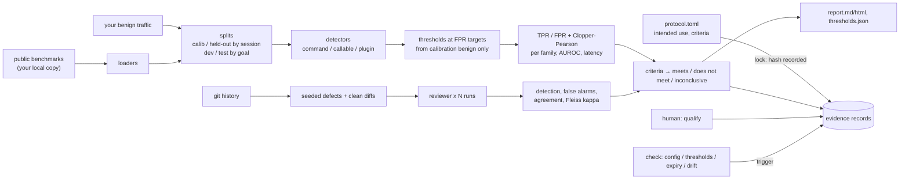

# aqt-validate — validation of AI controls

Part of the **Agent Quality Toolkit**. Before you trust a prompt-injection detector or an AI code reviewer, aqt-validate gives you a validation report like the one a quality manager expects for a measuring instrument or an analytical method. The report covers the intended use and acceptance criteria fixed *before* the test, the results with exact confidence bounds, any deviations and limits, a validity period and requalification triggers. Every step is an evidence record.

> Agent Quality Toolkit supports quality-management practices; it is not a validated system and does not by itself make any process compliant with GMP, GDP, 21 CFR Part 11 or EU Annex 11.

## The problem

- **Detectors are judged at the wrong operating point.** Model cards report F1 at 0.5 or AUROC. In use, a detector runs at a threshold set for a tolerable false-positive rate on *your* traffic. At 1 % FPR, single models with AUROC ≈ 0.9 often detect well under 60 % of injections.
- **No one qualifies AI reviewers.** Nobody measures, on your repository, how often a `claude -p` / `codex exec` / `pi` review configuration finds known defects, how often it raises false alarms, or how repeatable it is. Nobody requalifies it when the model changes.
- **Post-hoc criteria and test-set reuse go unnoticed.**

## 60-second quick start

```bash
uv venv .venv && uv pip install --python .venv/bin/python -e ../aqt-spec -e .
export AQT_SINK=file:$PWD/evidence.jsonl

# offline demo: synthetic data, toy detector, stub reviewer, full lifecycle
.venv/bin/python examples/demo.py /tmp/aqt-validate-demo
```

With your own detector:

```bash
aqt-validate data import ~/src/BIPIA --format bipia --out data/attacks.jsonl --dataset-version <commit>
aqt-validate protocol init --kind detector --out protocol.toml     # edit: intended use, data, detectors, criteria
aqt-validate detector run protocol.toml --split dev                # explore freely on dev
aqt-validate protocol lock protocol.toml --reason "criteria agreed before the test readout"
aqt-validate detector run protocol.toml                            # test split: exit 0 meets, 1 does not
aqt-validate qualify ~/.local/state/aqt/validate/runs/<run> --approve --reason "report reviewed"   # human only
aqt-validate check --protocol protocol.toml --thresholds thresholds.json   # cron / hook: exit 1 = requalify
```

With an AI reviewer:

```bash
aqt-validate reviewer build-cases --repo . --out cases             # fix commits -> seeded defects, plus clean diffs
aqt-validate protocol init --kind reviewer --out review.toml       # argv for claude -p / codex exec / pi
aqt-validate protocol lock review.toml --reason "..."
aqt-validate reviewer run review.toml
```

## How it works



- **Thresholds come from calibration benign items only.** With several detectors, scores are fused by max-rank against the calibration distribution. The band rule becomes "any detector above its threshold", and the calibration FPR is ≤ target by construction. The optional `at_least = k` rule needs k detectors to agree.
- **Exact bounds.** Clopper–Pearson bounds are computed with the standard library. Criteria use one-sided bounds. A criterion that the sample size cannot demonstrate is reported as *inconclusive*; for example, FPR ≤ 1 % needs at least 299 clean items.
- **Leak-aware splits.** Benign data is split by session, attacks by goal. Composed attacks use held-out hosts only. Overlaps are counted and reported.
- **Contamination registry.** Results for a detector trained on a dataset are shown separately and excluded from criteria.
- **Test readouts are counted.** A test run requires a locked protocol hash.
- **Reviewer qualification.** Each fix commit is inverted to reintroduce its bug, and the reviewer works on a snapshot in a temporary directory, so your repository is never touched. Findings are matched to the defect by file and line. Rates are computed per case, not per run, because runs on the same case are not independent.
- **`thresholds.json`** is the shared thresholds schema (integers in ppm) that aqt-quarantine reads; [docs/thresholds-file.md](docs/thresholds-file.md) describes it.

Records: `validate.run` (`protocol-locked` | `completed`), `validate.report`, `validate.qualification`, `validate.requalification`, `validate.refused`. They are written through `aqt_evidence.open_sink()`, to a JSONL file or to the aqt-trail socket. See [docs/records.md](docs/records.md).

## QM mapping

| Feature | Supports | Reference (drafts as of July 2025 where marked) |
|---|---|---|
| Protocol with intended use and acceptance criteria, hash-locked before the test | Pre-defined validation protocol | annex22-2025d:3, annex22-2025d:4; annex11-2011:4.7 |
| Session/goal-disjoint splits, overlap check, test-readout counter | Test-data independence and record of use | annex22-2025d:6.2 (§6.2–6.3) |
| TPR/FPR with exact bounds, hard-benign row, latency | Method performance with measurement uncertainty | iso9001-2015:7.1.5; ICH Q2(R2) by analogy |
| Deviations section (overlaps, contamination, errors, inconclusive criteria) | Documented test execution | annex22-2025d:7 |
| `thresholds.json` bound by hash to a qualification | Calibration status identifiable and protected | iso9001-2015:7.1.5 |
| Human qualification with reason, meaning, validity | Release of a qualified method | part11:11.50(a) (meaning); human only via `require_human` |
| `check`: configuration, thresholds, expiry, drift | Change control, periodic requalification, monitoring | annex22-2025d:10 (§10.1–10.4); annex11-2011:11 |
| Reviewer qualification | Qualifying an AI tool used with a human in the loop | annex22-2025d:1; iso9001-2015:7.1.5 |

## Threat model and limits

- **Main risks: self-deception and silent change.** The protocol lock and the test-readout counter make post-hoc criteria and repeated test reads visible; they do not make them impossible. Hashes reveal any change of thresholds or configuration.
- **Agents cannot qualify.** `qualify` refuses inside agent sessions and without a terminal, and records the refusal. This is a guard, not a security boundary: a same-user process can fake its environment. Use aqt-trail (separate writer) and aqt-signoff (passphrase keys) for stronger separation.
- **Reviewer commands run as you.** The snapshot protects your repository, but it is not a sandbox. Wrap the argv with a sandbox (for example aqt-sensei's bubblewrap profile) when the reviewer is an agent with tools.
- **Statistical limits.**
  - Results hold for the *static* payloads tested; adaptive attackers defeat every detector. Claim risk reduction at the stated operating point only.
  - Calibration is only as representative as your benign data.
  - Contamination is user-declared.
  - Seeded defects come only from bugs that were found; matching is approximate; clean diffs may contain real bugs; public fixes may be memorised by the model.
- **Privacy.** Benign text never leaves your files. Run directories hold IDs, splits and scores; records hold hashes and counts.

## Licence

Apache-2.0 (see `LICENSE`). The method is derived from the author's private Agent Platform Next evaluation work (see `NOTICE`). No benchmark data is included. Public benchmarks (AgentDojo, BIPIA, InjecAgent, LLMail-Inject: MIT) are read from paths you provide.
